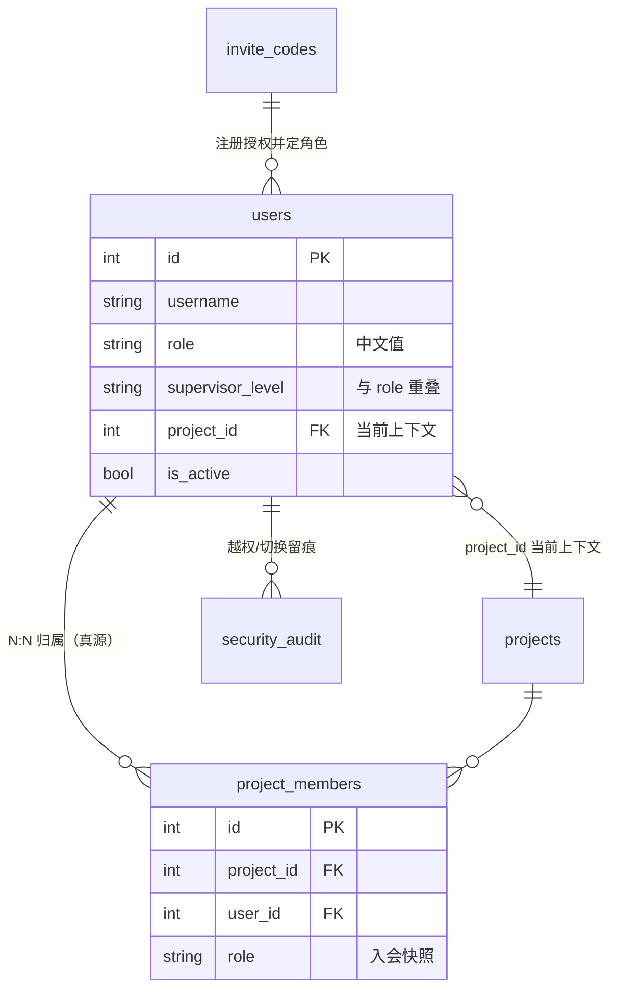

# 监理通 · 用户体系结构设计说明

| 项    | 内容                                                  |
| ---- | --------------------------------------------------- |
| 文档版本 | **v3.1**（2026-10-10。本轮新增 §7.9 / §7.10 / §8.9：①登录白名单与 `/auth/roles` 同口径；②公司级角色授予与两条防锁死；③邀请码可运营化 + 小程序注册强制邀请码。前版 v3.0：Step 2 已实施） |
| 日期   | 2026-10-09                                          |
| 范围   | 账号、角色、权限、项目归属、超管、邀请码、审计、项目成员与转场                     |
| 结论来源 | 后端代码实测（`cloud-backend/app`），非推测                     |
| 状态   | **仅诊断与建议，未改动任何代码**                                  |

> 修订备注：v2.1 的三处改动（§2.5、§7.4 第 7 条、§8.7）在 2026-10-09 15:50 的文档比对中被发现缺失，本版已重建；同时新增 §2.6 与 §7.7（一人多项目与转场）。备份见 `.workbuddy/backups/用户体系结构设计说明-2026-10-09.md.bak-20261009-1550`。
>
> **v3.1 修订（2026-10-10，Step 2 部署当天）**：本轮三处新发现全部来自生产实测而非推演 ——
> ① **登录白名单与 `/auth/roles` 必须同口径**（§7.9）：`auth.login` 的 `valid_roles` 曾是 7 个项目级枚举，与已含公司级的 `/auth/roles` 不同步，导致 Web 选「超级管理员」直接 400；
> ② **公司级角色授予**（§7.10）：补齐 `org_role` 的写通道与两条防锁死规则；
> ③ **邀请码可运营化**（§8.9）：`invite_codes` 自建立起只有读没有写，生产 0 行，两条注册链路（Web 强制邀请码 / 小程序不校验）一死一漏；本轮补齐创建/列表/停用三接口，并把小程序注册改为同样强制邀请码。

---

## 1. 背景

系统当前没有一个统一的"用户设置"入口，而是**四套彼此独立的规则**在同时决定"谁能干什么"：

1. **角色**（`UserRole` 枚举）—— 用中文字符串存在 `users.role`；
2. **权限**（`ROLE_PERMISSIONS`）—— 硬编码在 Python 模块里的功能白名单；
3. **项目归属**（`project_members` 表 + `users.project_id`）—— 两处并存的归属关系；
4. **超级管理员**（`username == "admin"`）—— 以用户名为判据的特权旁路。

这四套规则各自都能自洽，问题出在**它们互不感知**：例如第 4 套直接旁路了第 1、2 套的权限判定，而第 1 套（角色）与第 3 套（成员表里的角色快照）各存了一份角色，可能不一致。

本文档先把现状讲清楚，再给出目标方案与落地路径。

---

## 2. 现状（代码实测）

### 2.1 涉及的数据表

| 表名                                               | 文件                                | 职责           | 关键字段                                                                                                                  |
| ------------------------------------------------ | --------------------------------- | ------------ | --------------------------------------------------------------------------------------------------------------------- |
| `users`                                          | `app/models/user.py:43`           | 账号主表         | `username`（全局唯一）、`password_hash`、`role`、`supervisor_level`、`project_id`、`is_active`、`company_name`、`invite_code`、证件字段 |
| `projects`                                       | `app/models/user.py:81`           | 项目           | `name`、`code`（全局唯一）、`short_name`、`location`、`description`、`created_at`（**无状态字段**）                                     |
| `project_members`                                | `app/models/project_member.py:19` | **项目归属（真源）** | `project_id`、`user_id`、`role`（入会快照）、`joined_at`；唯一约束 `(project_id, user_id)`；**无 `left_at`**                          |
| `invite_codes`                                   | `app/models/invite_code.py:7`     | 注册邀请码        | `code`、`level`(personal/team/enterprise)、`role`、`max_uses`、`used_count`、`expires_at`                                  |
| `security_audit`                                 | `app/models/security_audit.py:17` | 越权审计         | `user_id`、`action`、`detail`、`ip`；表名**单数**                                                                             |
| `wechat_user_bindings` / `wechat_binding_audits` | `app/models/miniprogram.py`       | 微信绑定与审计      | `openid`、`user_id`                                                                                                    |

> 线上现状：**5 个账号**（chief / deputy / supervisor / inspector / admin），**3 个项目**（#1 示范工程含 5 名成员；#4、#5 为测试遗留）。

### 2.2 四个分叉详解

**① 角色 `role` —— 存中文值**

`app/models/user.py:9`：

```python
class UserRole(str, enum.Enum):
    CHIEF_SUPERVISOR = "总监理工程师"
    DEPUTY_CHIEF = "总监代表"
    SPECIAL_SUPERVISOR = "专业监理工程师"
    INSPECTOR = "监理员"
```

枚举定义了英文名，但 `.value` 是中文，数据库、JWT、接口返回、前端全部流通中文字符串。另有 `users.supervisor_level`（"总监|专监|监理员"）与 `role` 语义重叠。

**② 权限 `ROLE_PERMISSIONS` —— 硬编码**

`app/models/user.py:18-40` 是一个 Python dict，把 4 个角色映射到功能 key 白名单（共 18 个 key，如 `dashboard`/`work_record`/`task_assign`/`document_approve`/`settings`…）。`settings` 权限**只有「总监理工程师」持有**。判定入口：

```python
# app/models/user.py:74
def has_permission(self, permission: str) -> bool:
    if self.username == "admin":      # ← 第 4 套规则在此旁路
        return True
    return permission in ROLE_PERMISSIONS.get(self.role, [])
```

调用点遍布 `auth.py`、`work_record.py`、`document.py`、`task.py`、`inspection.py`、`form_doc.py`。**调整权限的唯一方式是改代码 + 重启。**

**③ 项目归属 —— 双写**

- `project_members` 是归属真源：项目列表 `GET /project/list` 只返回成员项目（`app/routers/project.py:100`），切换 `POST /project/{id}/switch` 先过成员校验（`project.py:219`）；
- `users.project_id` 只表示"当前上下文"，但被大量业务查询直接使用。

`app/routers/auth.py:534-552` 在改 `project_id` 时手工同步成员行（先删旧、再加新）——这是目前最脆弱的一处双写，**且在"一人多项目"下会误删归属，详见 2.6**。

**④ 超管 `username == "admin"` —— 硬编码 8 处**

| 位置                                       | 用途                           |
| ---------------------------------------- | ---------------------------- |
| `app/models/user.py:76`                  | `has_permission` 万能通过        |
| `app/routers/auth.py:239`                | 登录时授予全量权限                    |
| `app/routers/auth.py:363`                | `GET /me` 返回全量权限             |
| `app/routers/auth.py:425`                | `_can_manage_all_projects()` |
| `app/routers/auth.py:526`                | 保护 admin 账号不被非超管修改           |
| `app/routers/auth.py:653`                | 眼镜扫码登录授予全量权限                 |
| `app/routers/miniprogram_auth.py:59`     | 小程序登录授予全量权限                  |
| `app/routers/acceptance_template.py:171` | 模板管理放行                       |

另有 `app/services/kb_seed.py:24`、`scripts/init_default_users.py:75` 以 admin 作为查询锚点。

### 2.3 结构示意



角色 → 权限不在数据库里，而在 `ROLE_PERMISSIONS`（代码常量）。

### 2.4 认证与注册现状

- **登录**（`POST /api/auth/login`）要求传 `role`，且必须与 `users.role` 一致（admin 例外，可任选身份登录）——即"一人一角色"，不支持同名多角色。
- **JWT** 内嵌 `role` 与 `permissions` 快照，有效期 `access_token_expire_minutes = 1440`（24 小时，`app/config.py:58`）。
- **注册**走邀请码（`POST /api/auth/register`），角色由 `invite_codes.role` 决定；`RegisterRequest.role` 字段实际被忽略（冗余）。
- **公开注册已关闭**：`ALLOW_PUBLIC_REGISTRATION=false`（`app/config.py:59`，注意该项是**类属性直接读 `os.getenv`，不读 `.env`**，只能改 compose 环境变量并重建容器）。
- **小程序侧**（`app/routers/miniprogram_auth.py`）另有 login / bind / register / unbind / status 五个端点；`/miniprogram/auth/register` **未接公开注册开关**（本地有、未部署）。

### 2.5 项目成员的加入路径（实测）

后端已有完整的项目成员管理接口，**但三个前端（web-admin / mobile-h5 / glasses-app）零调用**。小程序里的「成员」是**知识库成员**（`/kb/{id}/members`），不是项目成员。

| 路径        | 入口                         | 后端行为                                                                                  | 谁能做                                                                                                |
| --------- | -------------------------- | ------------------------------------------------------------------------------------- | -------------------------------------------------------------------------------------------------- |
| ① 建号时加入   | Web 后台「用户管理 → 新增用户」填「所属项目」 | `POST /api/auth/users`：写 `users.project_id` **并**写 `project_members` 行（`auth.py:508`） | 超管任意项目；非超管只能建在自己当前项目                                                                               |
| ② 改「所属项目」 | Web 后台「用户管理 → 编辑」          | `PUT /api/auth/users/{id}`：`project_id` 变化时删旧成员行 + 加新成员行（`auth.py:534-552`）           | **仅超管可跨项目**。非超管被 `_validate_managed_project` 强制拉回自己项目（`auth.py:433/439`），且看不到其他项目的用户（`:524` 返 404） |
| ③ 接口直加    | **无 UI**，只能手工调             | `POST /api/project/{project_id}/members`，body `{"user_id": N}`，幂等                     | `require_permission("settings")` → 超管 或 总监理工程师；非超管范围限 `_require_project_scope`                     |

**四个实测到的坑：**

1. **注册进来的人不在任何项目。** `register` 写 `project_id=None`（`auth.py:317`）且**不写 `ProjectMember` 行** → 走邀请码注册的人登录后项目列表为空，必须由管理员再手工加。
2. **`_require_project_scope` 用 `users.project_id` 判定"自己所在项目"，而不是成员表**（`project.py:274`）—— 又一次"归属双写"。
3. **加成员时无法指定项目角色。** `AddMemberRequest` 只有 `user_id`（`project.py:265-267`），成员角色直接复制 `target.role`（`project.py:336`）→ 项目内角色只能是全局角色的副本，这正是跨项目串权的根源（见 7.6）。**方案 D 落地时此接口必须加 `role` 参数。**
4. 现状下**只有超管能跨项目加成员** —— 总监理工程师虽持 `settings` 权限，但被限定在自己的项目内。

> **决策（2026-10-09）**：成员增删**开放给公司级「管理员」**（可跨项目）；**总监理工程师保留本项目内的成员管理**（现状能力不变）。原「只能超管跨项目」的收紧随之放开 —— 落地细节见 7.4 第 7 条。

### 2.6 一人多项目与转场（实测）

监理行业的常态是**一个人同时在多个项目、项目完成后转场**。系统在**模型层已经支持多对多**（`project_members` 是 `(project_id, user_id)` 唯一、可多行），**所以不需要改模型**。但有三处代码是按"一人一项目"写的，另有两处缺"转场"所需字段。

**① 改「所属项目」会静默删掉旧项目的成员行 —— 最危险的一处**

`update_user`（`auth.py:534-552`）在 `project_id` 变化时**删除旧成员行、插入新成员行**；而用户自己切换项目走的是 `switch_project`（`project.py:219-259`），**只改上下文、不碰成员表**。

两条路径语义完全不同，却对应同一个界面概念「所属项目」：

- 张三同时在 A、B 两个项目，当前上下文是 A；
- 管理员在 Web 后台「编辑用户」把「所属项目」改成 B；
- 代码把 (A, 张三) 的成员行**删掉了** —— 管理员的意图只是"切一下"，结果**剥夺了他在 A 项目的归属**。

代码注释本身写着"调岗＝迁移成员关系"，说明这是**有意为之**；但在"一人多项目是常态"的前提下，它把"**切换当前工作项目**"和"**调整项目归属**"两件事混成了一个动作。

**② 管辖范围用单值 `users.project_id` 计算**

非超管的可见范围一律用 `manager.project_id` 判定：`list_users`（`auth.py:451`）、`update_user`（`:524`）、`unbind`（`:583`）、`_require_project_scope`（`project.py:274`）。

→ 一个总监同时在 A、B 项目，当前上下文在 A 时，**看不到也管不了 B 的成员**，尽管他本人是 B 的成员。

**③ 通知 / 待办按 `users.project_id` + 全局 `users.role` 匹配 → 多项目漏发**

| 位置                    | 现有逻辑                                                              | 正确判据           |
| --------------------- | ----------------------------------------------------------------- | -------------- |
| `document.py:240-246` | 待审批文书推给"本项目（`User.project_id == project_id`）的总监理工程师（`User.role`）" | 成员表中该项目角色为总监的人 |
| `hazard.py:249-255`   | 隐患推送推给"本项目的总监/总代"                                                 | 同上             |

**具体后果**：一位总监同时在 A、B 项目、当前上下文在 A 时，**B 项目提交的文书审批通知不会推给他**。

**④ 转场没有留痕**：`project_members` 只有 `joined_at`，**无 `left_at` / `is_active`**；`remove_member` 是物理删除（`project.py:367`）。→ "某人某段时间在哪个项目"**查不出来**，与监理资料追溯、穗建通上报都有冲突。

**⑤ 项目没有生命周期**：`projects` 只有 `id/name/code/short_name/location/description/created_at`，**无 `status` / 起止日期** → 无法表达"项目已完成"；项目结束后成员仍会一直出现在其项目列表里，且没有"结项"动作批量收口成员，只能逐个手工移除。

---

### 2.7 注册链路（实测）

系统有**两条注册入口，规则不一致**：

|  | Web `POST /api/auth/register`（`auth.py:276`） | 小程序 `POST /api/miniprogram/auth/register`（`miniprogram_auth.py:234`） |
|---|---|---|
| 开关 | `allow_public_registration`，关闭时 403 | 同 |
| 邀请码 | **必需**：`validate_invite_code`（`auth.py:169`）查 `invite_codes` 的 `is_active` / `expires_at` / `used_count` | **不需要** |
| 角色来源 | `invite_codes.role`（**`RegisterRequest.role` 实际被忽略**） | `req.role`，须在 `get_public_registration_roles()` 白名单内 |
| 公司名 | `level != personal` 时必填 | 不要求 |
| 用户名校验 | 非 `admin` + **全局**查重（`:304`） | 非 `admin` + **全局**查重（`:255`） |
| `project_id` | `None` | `None` |
| 成员行 | **不写** `project_members` | **不写** |
| 结果 | **直接返回 token（即注册即登录）** | 返回 token；带 `bind_token` 时同时绑微信 |

**邀请码从哪来（实测：拿不到）**

- **后端没有任何生成入口**：全仓 `InviteCode(` 只出现在模型定义（`models/invite_code.py:7`），没有创建端点、没有服务、也没有后台页面 —— 注册链路的第一道门，系统自己无法产生。
- **生产库为空**：`SELECT * FROM invite_codes` 返回 **0 行**；`users.invite_code` 也全为 `NULL`（现有 5 个账号无一由邀请码注册）。
- **前端那张表是"假的"**：`web-admin/src/views/Login.vue:126-132` 硬编码 5 个码（`PERSONAL001`/`002`、`TEAM2026001`/`002`、`ENTERPRISE001`），注释自述"仅用于前端显示，实际验证在后端"。后果：输入这几个码时**前端显示"有效、角色=专业监理工程师"，后端查库必然报"邀请码不存在"** —— 最误导人的一处。
- 叠加**公开注册开关已关闭**（`allow_public_registration=false`，`auth.py:278` 直接 403）→ **Web 注册链路整体不可用**，实际加人只能由管理员在 web 后台「用户管理 → 新增用户」建号（见 2.5）。
- 别与**知识库邀请码**混淆：小程序 `kb/detail` 的「邀请码」按钮 → `POST /kb/{id}/invite`（`knowledge_base.py:660-663`，`uuid4().hex[:8]`）是**资料库共享**用的，与账号注册无关；`users.invite_code` 列只是"注册时用了哪个码"的留痕。

`invite_codes` 现有字段：`code`（唯一）/ `level`（personal/team/enterprise）/ `role` / `max_uses` / `used_count` / `is_active` / `expires_at` / `created_by` / `used_by` —— **无 `org_id`、无 `project_id`**。

**五个必须处理的冲突**（否则注册会成为体系里的后门）：

1. **注册即发 token，与 Step 4 的审批流直接冲突**：审批落地后注册接口不得再返回 `access_token`，应返回 `{"audit_status": "pending"}`；且**登录时也要拦 `audit_status != 'approved'`**，否则可就着旧 token 或重登绕过审批。
2. **注册时的"角色"语义会漂移**：现在 `assigned_role` 写入 `users.role`，而 Step 2 之后 `users.role` 已降级为"主岗（展示兜底）"，项目内授权真源是 `project_members.role`。注册者此刻**尚无任何项目** → 正确做法：`users.role` 只写主岗兜底值，**项目级角色在审批通过、加入项目时才写入成员行**（顺带修掉 2.5 坑 1）。
3. **`users.org_id` 没有来源**：多企业后"新用户属于哪家公司"无解。**正解：`invite_codes` 加 `org_id`，注册时继承到 `users.org_id`**；小程序那条无邀请码入口须改为"注册后由管理员归入企业"。属 C-lite 组成部分（见 8.7），现在加成本≈0。
4. **用户名查重是全局的**（`auth.py:304`、`miniprogram_auth.py:255`），与 8.7 拟改的 `(org_id, username)` 复合唯一**不同步** —— 必须同步改为按 `org_id` 查重，否则"约束放开了、代码还在全局挡"，预留形同虚设。
5. **注册白名单是中文值**：`get_public_registration_roles()`（`auth.py:157-165`）拿 `config.public_registration_roles` 与 `UserRole.value`（中文）比对 → 角色 key 化后须改英文，**同时 compose 的 `PUBLIC_REGISTRATION_ROLES` 环境变量值也要跟着改**（部署侧连带项，最易漏）。

> **2026-10-09 决策（见 8.8.6）**：两条注册入口**统一为"凭邀请码注册"** —— 小程序那条也改为必需邀请码，角色一律取码上的 `role`。因此上表"小程序不需要邀请码"一行属**现状**，将在 Step 4 一并改掉；**冲突 ⑤（白名单中文值）随之作废**。

> **目标态的注册流**：邀请码（带 `org_id`）→ 建号（`org_role=NULL`、`audit_status='pending'`、`org_id` 从邀请码继承）→ **不发 token** → 管理员审批（`user_approve`）→ 审批时指定项目与项目角色 → 写 `project_members` 行 → 用户方可登录。

---

### 2.8 "角色"在系统里的 5 处独立存储与三层语义（实测）

**触发（2026-10-09）**：现实中会出现"一个人在同一个项目里兼两个身份"（如专监兼资料员）。核查后发现，系统里"role"这个词被 **5 张表各自定义、互不协调**：

| # | 存储位置                       | 取值示例                  | 语义                     | 谁在维护      |
| - | -------------------------- | --------------------- | ---------------------- | --------- |
| 1 | `users.role`               | 总监理工程师 / 监理员          | 项目级角色（Step 2 后降级为主岗）   | 管理员改用户    |
| 2 | `project_members.role`     | 同上                    | 入会角色快照（**从未参与授权**）     | 成员接口      |
| 3 | `invite_codes.role`        | 同上                    | 邀请码预置角色                | 超管建码      |
| 4 | `knowledge_base_members.role` | owner / admin / viewer | **知识库内权限**（另一套体系）     | 资料库接口     |
| 5 | `signatures.role`          | 总监 / 专监（**自由文本**）     | **签署身份**               | 用户自己上传签章  |

三点结论：

**① 同一个词承载三层不同语义** —— 组织岗位（1/2/3）、资源权限（4）、签署身份（5）。三者互不校验：`signatures.role` 可以填任意字符串，**系统不检查你是否真的持有该岗位**。

**② "一人多岗"其实已经在业务上出现** —— `signatures` 表允许一个用户持有**多个签章**（`GET /signatures/me` 返回列表），每个签章各带一个 `role`。也就是说，"同一个人要以不同岗位签署不同文书"这件事，**签章模块早已默认成立**，只是它没有连到权限体系。

**③ 角色目录本身偏窄** —— `UserRole`（`user.py:9`）只有 4 个值（总监理工程师 / 总监代表 / 专业监理工程师 / 监理员），**"资料员"根本不在枚举里**。用户举的"兼资料员"在当前系统里**无法表达** —— 现实中它被"监理员"吸收。

---

## 3. 问题清单

| 级别     | 问题                                                                | 影响                                                                                     |
| ------ | ----------------------------------------------------------------- | -------------------------------------------------------------------------------------- |
| **P0** | 超管以 `username == "admin"` 判定，散落 8 处                               | 改用户名即丢失超管权；无法支持第二个超管；权限判定不可审计                                                          |
| **P0** | 权限矩阵硬编码在代码                                                        | 任何权限调整需改码重启；无法交付"后台可配"能力                                                               |
| **P1** | 角色以中文值入库                                                          | 改词/迁移/写 SQL/i18n 均脆弱；枚举英文名形同虚设；与穗建通岗位编码对接冲突                                            |
| **P1** | `users.project_id` 与 `project_members` 双写                         | 漏同步即权限漂移（已有前车之鉴）；`auth.py:534` 手工同步                                                    |
| **P1** | **项目级角色用全局 `users.role` 判定，与当前项目无关**                              | 同一人在 A 项目当总监、B 项目当监理员时，切到 B 项目**仍按总监授权**——跨项目角色串权。`ProjectMember.role` 存了这个数据却从未参与授权判定 |
| **P1** | **改「所属项目」会删除旧项目成员行**（`auth.py:534-552`）                           | 一人多项目时，管理员"切一下项目"会**静默剥夺他在旧项目的归属**（见 2.6①）                                             |
| **P1** | **通知/待办按 `users.project_id` + 全局 `users.role` 投递**                | 一人多项目时**漏发**（`document.py:242`、`hazard.py:251`）：在 B 是总监但上下文在 A 就收不到 B 的审批通知（见 2.6③）    |
| **P2** | JWT 内嵌 24 小时权限快照                                                  | 权限变更后最长 24 小时才生效；无法即时收回                                                                |
| **P2** | `project_members` 无 `left_at`，`remove_member` 物理删除                | 转场无留痕，"某人某段时间在哪个项目"不可追溯                                                                |
| **P2** | `projects` 无 `status`/起止日期                                        | 无法表达"项目已完成"；无"结项"动作收口成员                                                                |
| **P2** | `supervisor_level` 与 `role` 语义重叠                                  | 数据冗余，易不一致                                                                              |
| **P2** | `RegisterRequest.role` 被忽略                                        | 接口语义误导                                                                                 |
| **P2** | 项目成员接口无任何前端入口                                                     | `POST/DELETE /project/{id}/members` 三端零调用；加成员只能靠"改所属项目"或手工调接口（见 2.5）                   |
| **P2** | `AddMemberRequest` 只有 `user_id`，无法指定项目角色                          | 成员角色只能复制全局 `users.role` → 无法表达"在 A 项目当总监、B 项目当监理员"                                     |
| **P2** | `company_name` 为裸字符串，无组织表                                         | 多个监理公司无法真正隔离，制约多企业上架                                                                   |
| **P3** | `users.project_id` 被广泛直接使用（`archive.py:147`、`equipment.py:130` 等） | 与"归属只认成员表"的目标原则冲突                                                                      |

---

## 4. 设计原则（建议）

1. **单一真源**：项目归属只认 `project_members`；`users.project_id` 降级为"当前上下文"，不作为授权依据。
2. **上下文与归属分离**：`users.project_id` 是**会话状态**（只由用户自己 `switch_project` 写），`project_members` 是**归属真源**（只由管理员的成员接口写）。**改上下文永不触碰归属。** 双写不是靠"同步"解决，而是靠**取消其中一次写**。
3. **身份与角色分离**：超管是角色属性（`org_role='super_admin'`），角色是岗位属性，两者不互相隐含。
4. **判据收敛**：超管判定收敛到唯一入口（`User.is_super_admin()` / `_can_manage_all_projects()`），杜绝散落。
5. **管辖范围来自成员表**：一切"他能管哪些项目/哪些人"的判断，都应查 `project_members`，而不是单值 `users.project_id`。
6. **存储用 key、展示用 label**：数据库存英文 key，中文只在展示层映射。
7. **归属留痕**：成员关系用软删除（`left_at`）而非物理删除；项目有生命周期（`status`）。

---

## 5. 目标方案对比

| 维度    | 方案 A · 最小修正                | 方案 B · 权限可配化                           | 方案 C · 多组织改造                        | **方案 D · 两级角色模型**                         |
| ----- | -------------------------- | -------------------------------------- | ----------------------------------- | ----------------------------------------- |
| 适用场景  | 自用 / 单企业（当前 5 账号）          | 需管理员后台调权限                              | 多监理企业入驻 / 上架穗建通                     | **单个公司内"公司级 + 项目级"分层，多端并存**               |
| 改动范围  | `user.py` + 8 处判定 + 角色数据迁移 | 新增 `roles`/`role_permissions` 表 + 后台界面 | 新增 `organizations` 表 + 全量查询加 org 隔离 | **`users` 增 `org_role` + 端职责拆分 + 角色列表过滤** |
| 是否动架构 | 否                          | 局部                                     | 是                                   | 局部（承认既有 4 端现实）                            |
| 主要风险  | 角色 key 迁移需一次性对齐            | 缓存一致性、界面与后端校验脱节                        | 影响面最大，需回归全部业务查询                     | 登录校验与权限合成需多端同步改                           |
| 工作量级  | 半天                         | 数天                                     | 一到两周                                | 2–4 天（含 web 后台页面）                         |

**推荐路径（2026-10-09 定稿，同日追加 C-lite）：A+D 合并为一个「权限重构」批次，B 紧随，C 改为只埋锚点。**（详见第 8 节）

- **A 是所有方案的地基**，先行止血（不改任何业务语义）；
- **D 是当前业务形态的正解** —— 公司级/项目级分层 + 4 端共存的现实；
- **B 是 D 的必然依赖**：D 中"超管给管理员授权"要求权限可写，因此 B 紧随 D 之后（而非"可选"）；
- **C 拆成两半**：**C-lite（埋锚点）并入 Step 1** —— 现在加 `organizations` 表 + 2 个 nullable 锚点 + 唯一约束改复合，成本≈0；**C-full（全量租户隔离）仍不立项** —— 待第二家企业真的要入驻时再做（见 8.7）。


## 7. 方案 D · 两级角色模型（已确认方向）

### 7.1 决策

2026-10-09 确认的三条核心决策：

1. **角色分两级**
   - **公司级（组织域）**：超级管理员、管理员 —— 跨项目，管流程与人；
   - **项目级（现场域）**：总监理工程师、总监代表、专业监理工程师、监理员 —— 只在本项目内。
2. **公司级角色不进小程序。** 小程序只承载现场作业，登录角色列表仅 4 个项目级角色；公司级管理操作统一在 Web 管理后台（`/admin/`）完成。
3. **公司级角色是"附加身份"，不是替代。** 每个人始终有一个项目级角色（现场身份），公司级角色是额外授予的管理身份。

> 决策依据：系统实际有 4 个端共存（小程序 / Web 后台 / H5 / 眼镜端），且 Web 后台已具备 `UserManage`、`CompanyDashboard`、`Settings` 等管理页——公司级管理的 UI 落点现成。

### 7.2 模型改动

`users` 新增一个字段，并**把项目级角色下沉到成员表**（向后兼容）：

```python
org_role: Mapped[str | None] = mapped_column(
    String(32), nullable=True, comment="公司级角色: super_admin|admin|NULL"
)
```

- `users.org_role` 表示**公司级角色**（跨项目），默认 `NULL`（普通现场人员）；
- `users.role` **降级为"主岗角色"**：仅用于展示与无项目上下文时的兜底，**不再作为项目内授权依据**；
- **项目级角色下沉到 `project_members.role`**（每个项目一份），它才是项目内授权的真源；
- 三者可组合：`org_role='admin'` + `role='总监理工程师'` + 成员行 (A项目, 总监)、(B项目, 监理员)。

> **为什么必须下沉**：监理行业常态是"一人多项目、各项目岗位不同"。`users.role` 是全局单值，表达不了"A 项目总监、B 项目监理员"；而 `project_members` 天生是 `(project_id, user_id)` 唯一、且自带 `role` 字段——**它早已存着数据，只是从未被读取用于授权**。

公司级权限（新增功能 key，并入 `ROLE_PERMISSIONS` 的公司级角色）：

| 权限 key           | 含义     | 超级管理员 | 管理员 |
| ---------------- | ------ | :---: | :-: |
| `project_create` | 立项     |   是   |  —  |
| `project_edit`   | 修改项目信息 |   是   |  —  |
| `user_manage`    | 修改人员信息 |   是   |  —  |
| `user_approve`   | 人员审批   |   是   |  是  |
| `role_grant`     | 给管理员授权 |   是   |  —  |
| `member_manage` | 项目成员增删（**可跨项目**） | 是 | 是 |

> **`member_manage` 是唯一同时出现在公司级与项目级两层的权限 key**（2026-10-09 定）：公司级「管理员」凭它跨项目增删成员；项目级「总监理工程师」凭同一 key 在本项目内增删成员。二者判据相同、作用域不同 —— 前者＝全公司，后者＝当前项目。实现上「持公司级该 key 即放行 `_require_project_scope` 的跨项目限制」。

> **账号管理接口的 key 归属（2026-10-10 Step 2 实施时定案）**：账号管理 4 个接口原先**全部**挂在业务 key `settings` 上，而「总监理工程师」恰好持 `settings`——等于总监可以在本项目内建号、设任意角色、改他人密码，属真实越权。按上表「修改人员信息 = `user_manage`（仅超管）」拆分为：
>
> | 接口 | key | 理由 |
> | --- | --- | --- |
> | `GET /api/auth/users`（列表） | **保留 `settings`** | 只读查看；总监在本项目内看成员属正常业务（工作台/台账要显示同事），可见范围已被成员归属子查询限制 |
> | `POST /api/auth/users`（建号） | **`user_manage`** | 写操作，可指定任意项目角色 |
> | `PUT /api/auth/users/{id}`（改信息） | **`user_manage`** | 写操作，含重置他人密码 |
> | `DELETE /api/auth/users/{id}/wechat-binding` | **`user_manage`** | 写操作，解绑他人微信身份 |
>
> 注：生产 `admin` 账号的 `org_role` 实测为 `super_admin`（`scripts/init_default_users.py:89`），故本改动**不改变生产 5 账号可用性**，纯属修掉总监越权。

### 7.3 端职责与角色可见性

| 角色                            | 管理域 | 小程序登录 | Web 后台登录 |
| ----------------------------- | --- | :---: | :------: |
| 超级管理员                         | 公司级 |   否   |     是    |
| 管理员                           | 公司级 |   否   |     是    |
| 总监理工程师 / 总监代表 / 专业监理工程师 / 监理员 | 项目级 |   是   |     是    |

> Web 后台同时开放项目级角色（后台本身含台账、文书、统计等业务页）。因此"公司级只在 Web"指的是**管理类角色只在 Web 登录**，而不是"Web 只有管理角色"。

**接口实现（2026-10-10 Step 2）**：`GET /api/auth/roles?client=` 按端过滤：

- `client=web`（默认）：返回**全部**角色（含公司级 `super_admin` / `admin`）——Web 后台是唯一的公司级角色分配入口；
- `client=miniprogram`：仅返回**项目级** 7 个岗位。

配套落地：小程序所有发 token 的路径（登录 / 绑定 / 注册 / 扫码）在唯一出口 `miniprogram_auth._token_response` 集中拦截公司级角色，返回 403「该账号为公司级账号，请使用 Web 管理后台登录」。`ROLE_LABELS` 同步补 `super_admin`→超级管理员、`admin`→管理员（否则 `/roles` 回显英文 key）。

### 7.4 需要改动的接口

1. **`GET /api/auth/roles`** 增加 `client` 参数（`web` / `miniprogram`）：小程序请求只返回 4 个项目级角色；Web 请求返回全部 6 个。
2. **`POST /api/auth/login`** 角色校验扩展：
   - `req.role` 为公司级 → 校验 `user.org_role == req.role`；
   - `req.role` 为项目级 → 校验 `user.role == req.role`（保持现状）；
   - 返回的权限集合 = 项目级权限 ∪ 公司级权限。
3. **`/api/miniprogram/auth/*`** 不接受公司级角色登录（或忽略 `org_role`，一律按项目级身份工作）。
4. **`_can_manage_all_projects()`** 由 `username == "admin"` 改为判定 `org_role == 'super_admin'`（与 A1 合并实施）。
5. **人员审批为新增能力**（系统当前缺失）：`users` 增 `audit_status`（`pending`/`approved`/`rejected`）+ `approved_by` / `approved_at`，新增审批端点；注册流程由"邀请码即时生效"改为"注册 → 待审批 → 激活"。
6. **`require_permission()` 依赖需注入 `db`**：权限判定由 `User.has_permission()`（同步、读全局角色）改为"公司级 ∪ 当前项目级"的合成（详见 7.6）。
7. **成员管理接口（`GET/POST/DELETE /project/{id}/members`）改造** —— 本次共四处：
   - **权限 key 从 `settings` 拆出为 `member_manage`**：现在三个接口都挂 `require_permission("settings")`（`project.py:288/319/349`），把"成员增删"与"项目设置"捆在一起。拆开后总监仍在本项目内可用，管理员则通过公司级 `member_manage` 跨项目可用。
   - **开放给管理员跨项目**：`_require_project_scope`（`project.py:270-275`）现以 `_can_manage_all_projects()`（即 `username=='admin'`）放行跨项目 —— 改为"持公司级 `member_manage` 即放行"，管理员由此获得全公司成员增删能力。
   - **`POST` 加 `role` 参数**：当前只能复制全局角色（见 2.5 坑 3），D 落地后项目内角色须可独立指定，否则下沉到 `project_members.role` 的真源仍无输入口。
   - **补 web 后台入口**：该接口目前**三个前端零调用**（见 2.5），借本次在 `UserManage` 或新建成员管理页补上。
8. **取消 `update_user` 对成员表的写入**（见 2.6①、A3）：`project_id` 只改上下文，不再隐式增删成员行。
9. **管辖范围判据改为成员表**：`list_users`（`auth.py:451`）、`update_user`（`:524`）、`unbind`（`:583`）、`_require_project_scope`（`project.py:274`）四处，从"`users.project_id` 相等"改为"是否同为该项目成员"。
10. **通知/待办投递改为按成员表**：`document.py:240-246`、`hazard.py:249-255` 从"`User.project_id == project_id` + 全局 `User.role`"改为"`project_members` 中该项目对应角色的人"。
11. **管理员自我提权防护（新增约束）**：既然成员接口带 `role` 参数，管理员就能给自己在任意项目挂上"总监理工程师" —— 等于绕过 7.5 的"不得授予自己未拥有的权限"。因此：**成员接口不得把操作者本人加为成员或改其项目角色**（本人涉及自己的成员行时返回 403），确需如此由超管操作。成员增删已写审计（`project_member_add` / `project_member_remove`，`project.py:337/370`），保留。

### 7.5 与方案 B 的关系

"超级管理员可给管理员授予部分权限"要求权限**可写**，因此 **D 依赖 B**：

- `role_permissions(role_key, permission)` —— 承载可编辑的角色-权限映射，超管可改；
- 若还需"给某个人单独加权限"，再加 `user_permission_grants(user_id, permission, granted_by, expires_at)`；
- 强制约束：**任何人不得授予自己未拥有的权限**（防自我提权），且授权动作写入 `security_audit`。

### 7.6 权限判定模型（上下文相关）

权限必须**分两部分合成**，项目级部分随当前项目变化：

```python
async def effective_permissions(user, db) -> list[str]:
    perms = set(ROLE_PERMISSIONS.get(user.org_role or "", []))     # 公司级：跨项目
    if user.project_id:                                            # 项目级：看成员表（岗位集合）
        rows = await db.execute(select(ProjectMember.role, ProjectMember.extra_roles).where(
            ProjectMember.project_id == user.project_id,
            ProjectMember.user_id == user.id))
        for primary, extra in rows.all():                          # 主岗 + 附加岗，取并集
            for code in [primary, *(extra or [])]:
                perms |= set(ROLE_PERMISSIONS.get(code or "", []))
    return sorted(perms)
```

**推荐的低改动量实现**：在 `get_current_user` 依赖里一次性查出当前项目角色并合成权限集，缓存到 `user` 实例属性（如 `user.effective_permissions`），`has_permission` 保持同步签名、只读该属性——这样 5 个路由文件里 20 余处调用点**无需改动**，只改判定的源头。

**跨项目角色串权示例（当前系统的真实隐患）**：

|                   | 张三                         |
| ----------------- | -------------------------- |
| `users.role`（全局）  | 总监理工程师                     |
| `project_members` | (A 项目, 总监理工程师)、(B 项目, 监理员) |

切到 B 项目后，现行 `has_permission` 仍读 `users.role='总监理工程师'` → 张三在 B 项目获得总监权限（可审批文书、派单、导出台账），而他在 B 项目实际只是监理员。

**当前是否已被触发**：生产仅 1 个真实项目（#1 示范工程，5 名成员），暂未触发；一旦出现第二个人跨项目任职即刻生效。**修复时应与 D 同批实施。**

### 7.7 一人多项目与转场（本次追加）

**触发（2026-10-09）**：现实是"一个人同时在多个项目，这个项目完成了也会加入另一个项目"。

**结论：模型不用改，改的是三处假设。**

`project_members` 已经是 `(project_id, user_id)` 唯一的多对多表，**多项目归属天生支持**。要改的是那些**把 `users.project_id`（单值上下文）当成归属或管辖范围**的地方：

**① 上下文与归属分离（原则 2 的落地）**

| 动作        | 谁做       | 写什么                   | 不写什么                      |
| --------- | -------- | --------------------- | ------------------------- |
| 切换当前工作项目  | **用户自己** | 只写 `users.project_id` | **不碰** `project_members`  |
| 加入 / 移出项目 | **管理员**  | 只写 `project_members`  | **不碰** `users.project_id` |

于是 `update_user`（`auth.py:534-552`）里那段"删旧成员行 + 加新成员行"**应当删除** —— 双写问题不是靠"同步"解决，而是靠**取消这次写**。

**② 管辖范围改从成员表算**

非超管的可见/可管范围 = "我是成员的项目集合"，而不是 `users.project_id` 那一个值。涉及 4 处（见 7.4 第 9 条）。

**③ 通知/待办改从成员表投递**

"谁是这个项目的总监"应由 `project_members(project_id, user_id, role)` 回答，而不是 `users.project_id` + 全局 `users.role` 的组合。涉及 2 处（见 7.4 第 10 条）。

**④ 转场留痕：`project_members.left_at`**

现在 `remove_member` 物理删除（`project.py:367`），转场后历史归零。建议：

- `project_members` 加 `left_at`（nullable）；
- 移出项目 = 写 `left_at` 而不是 `DELETE`；
- 有效成员 = `left_at IS NULL`；历史查询可见完整在场区间。
- 依据：监理资料需追溯责任人在场时间，且穗建通上报需要人员与项目的关联区间。

**⑤ 项目生命周期：`projects.status`**

- `projects` 加 `status`（`active` / `completed` / `archived`）与可选起止日期；
- **"结项"**&#x6210;为一个动作：批量把所有有效成员写 `left_at`，项目从各方项目列表中退出（历史仍可查）；
- 否则项目结束后，成员会一直挂在已完工项目的列表里。

**⑥ 顺带修正「所属项目」这个界面概念**

现在 Web 后台「编辑用户」里的「所属项目」承担了两种语义（切换上下文 / 调整归属）。建议拆开：**用户自己切项目走 `switch_project`**（已有 UI 落点可在小程序/后台顶部项目切换器），**归属调整走成员管理**。

---

### 7.8 岗位集合模型（一人同项目多岗，本次追加）

**触发（2026-10-09）**：用户确认"一个人在同一项目内也可能需要两个身份（如既当专监又兼资料员）"。

**这是本项目第三次遇到同一类问题**，可以归纳出一条通用规律：

| 次数  | 被打破的单值假设                     | 已定结论             |
| --- | ---------------------------- | ---------------- |
| ①   | `users.project_id` 单项目 → 一人多项目 | 上下文与归属分离（7.7）    |
| ②   | `users.role` 全局单值 → 各项目岗位不同    | 角色下沉到 `project_members`（7.2） |
| ③   | `project_members.role` 单值 → 同项目多岗 | **本节：岗位建模为集合**   |

**规律：凡是"身份"类字段，都不能假设其为单值。** 三次都是同一个模式；第三次应当在 Step 1 一次性解决，而不是等第四次。

#### 7.8.1 关键：岗位分"可叠加"与"排他"两类

单纯把 `role` 改成数组会**丢掉一条业务约束**，反而引入新错误（一个项目出现两个总监理工程师）。正确做法是给岗位加**基数属性**：

| 岗位                 | 基数              | 说明                                       |
| ------------------ | --------------- | ---------------------------------------- |
| 总监理工程师             | **排他**（每项目 1 名） | 《建设工程监理规范》要求项目设一名总监（可书面授权总监代表）           |
| 总监代表               | 排他（每项目 ≤1 名）    | 由总监书面授权                                  |
| 专业监理工程师            | 可叠加             | 可多名，也可一人兼多个专业                            |
| 监理员                | 可叠加             |                                          |
| 资料员 / 见证员 / 安全监理员  | 可叠加             | **当前不在 `UserRole` 枚举内**，需补入（见 2.8③）      |

#### 7.8.2 权限公式升级（覆盖 7.6）

```python
# 项目级权限 = 该成员在本项目全部岗位的权限并集
project_perms = set().union(*[set(ROLE_PERMISSIONS.get(c, []))
                              for c in member.role_codes])
perms = org_perms | project_perms
```

并集语义天然正确："兼资料员"＝多获得资料相关权限，**不减损专监权限**。

#### 7.8.3 两个存储选项（推荐 α）

|                     | α · 主岗 + 附加岗（**推荐**）                            | β · 独立岗位表（M:N）                            |
| ------------------- | ---------------------------------------------- | ---------------------------------------- |
| 结构                  | `project_members.role` 保留为**主岗**；新增 `extra_roles`（JSON 数组） | 新增 `project_member_roles(member_id, role_code, is_primary)` |
| 改动量                 | 一个字段，现有数据**零迁移**                                | 新表 + 存量 `role` 迁移 + 全部读点按新结构写              |
| 展示                  | 主岗现成（成员列表 / 组织图直接可用）                           | 需按 `is_primary` 或岗位权重推导                  |
| 穗建通岗位映射             | 数组展开即可                                         | join 即可，略更规范                              |
| 排他约束                | 成员接口代码校验（总监唯一）                                 | 同上（MySQL 无部分唯一索引，仍需代码校验）                 |

两者在"排他约束"与"穗建通映射"上**等价**；α 改动量显著更小，且**主岗**这一概念在展示层真实有用（一个人总要有个首要标签）。**推荐 α。**

#### 7.8.4 连带要改的六处（Step 2 范围；2026-10-10 实测修正为 6 处）

把角色变成集合后，有三处"按单个角色匹配"的代码必须同步改，否则多岗用户会表现异常：

1. **签署身份不校验** —— `sign_document`（`signature.py:162`）只校验签章归属与密码，**不校验 `signature.role` 是否为该用户在当前项目实际持有的岗位**。多岗之后应补这一层校验，否则可拿"名义岗位"签发。
2. **按角色找人不完整** —— `document.py:243`（`User.role == "总监理工程师"`）、`period_report_service.py:284`（`user.role == role`）用**全局单值**匹配角色。改成员表后须改为"在**该项目**中持有该岗位的人"，且要考虑多岗。
3. **文书签字位** —— 监理文书有固定签字栏（编制 / 审核 / 总监），需要"按岗位在项目内找人"。单值下是"找 role=X 的那个人"，多岗下是"找持有 X 的人（可能多人）"，**取人规则需明确**。

---
> **2026-10-10 实测修正**：设计时估为"三处"，实施时全仓 grep 出**六处**。统一改用
> `app/services/permissions.py` 的 `member_user_ids_with_roles(db, pid, codes)` /
> `project_members_with_permission(db, pid, perm)`：
>
> | # | 位置 | 旧写法 | 场景 | 来源 |
> | --- | --- | --- | --- | --- |
> | 1 | `routers/document.py`（待审批投递） | `User.project_id == pid, User.role == "总监理工程师"` | 文书待审批 | 设计已列 |
> | 2 | `routers/hazard.py`（隐患通知） | `User.role.in_(["总监理工程师","总监代表"])` | 隐患微信通知 | 设计已列 |
> | 3 | `services/period_report_service.py`（`pick_creator`） | `user.role == role` | 定时任务落款人 | 设计已列 |
> | 4 | `routers/inspection.py` | 同 2 | 巡检隐患通知 | **实测新增** |
> | 5 | `routers/work_record.py`（提交审批） | 同 2 | 工作记录审批通知 | **实测新增** |
> | 6 | `routers/work_record.py`（记录分享） | `User.role.in_(SHARE_ROLE_GROUPS[group])` | 按角色组分享投递 | **实测新增** |
>
> 另：`routers/rtc.py` 的 `User.role.in_(rtc.ROLES)` **保持不动**——`rtc.ROLES` 本就是 `UserRole` 全枚举的英文 key，且 `require_member` 用它是自洽的。
>
> `work_record.py` 的 `SHARE_ROLE_GROUPS` 组内岗位改英文 key（对外仍是中文组名「监理部门」/「总监」，前端下拉取值不变）。

### 7.9 登录白名单必须与 `/auth/roles` 同口径（2026-10-10 实测发现）

**现象**：Web 登录页选择「超级管理员」提交，后端直接 400「无效角色」。

**根因**：`GET /auth/roles?client=web` 在 Step 2 已把公司级角色（`super_admin` / `admin`）
并入返回列表，但 `POST /auth/login` 的角色白名单仍是：

```python
valid_roles = [r.value for r in UserRole]      # 只有 7 个项目级枚举
```

两处**各存一份口径**，一侧改了另一侧没改 —— 前端能选、后端不认。

**修复**：白名单改为 `UserRole ∪ ORG_ROLES`（共 9 项）。**这是一条必须固化的铁律**：

> 🔴 **改 `/auth/roles` 的可选角色集时，必须同步改 `login` 的白名单**。二者是同一个契约的两个出口。

**配套：角色匹配四段式**（白名单放宽后，必须按身份精确匹配，否则会出现
「以项目岗位登录、却拿到公司级权限」的角色/权限错位）：

| 请求的角色 | 账号身份 | 判定 |
| --- | --- | --- |
| 公司级（`ORG_ROLES`） | 任意 | `user.org_role == req.role`，否则 403 |
| 项目级岗位 | 超管（`super_admin`） | **放行**（超管可代任意岗位视角进入后台） |
| 项目级岗位 | 非超管的公司级账号 | **拒绝** —— 否则 `token.role` 显示为岗位、`permissions` 却是公司级全权，前端按 role 渲染菜单会错位 |
| 项目级岗位 | 纯项目级账号 | `user.role == req.role` |

**token 里的 `role` 与权限同源**：超管以公司级角色登录记 `org_role`；公司级账号记 `org_role`；
纯项目级记 `users.role`（主岗）。

> ⚠️ 实测抓到过一个真实口子：`org_role='admin'` 的账号可以用项目岗位 `inspector` 登录成功，
> 拿到 `role='inspector'` + 公司级全权权限集。四段式修复后此路径关闭。

---

### 7.10 公司级角色授予与两条防锁死（2026-10-10 补齐）

Step 2 落地了两级角色模型，但 `org_role` 只有**读**通道（`list_users` 出参），没有**写**通道 ——
公司级角色只能靠直接改库授予。本轮补齐。

**接口语义**（`CreateUserRequest` / `UpdateUserRequest` 均新增 `org_role`）：

| 传入值 | 语义 |
| --- | --- |
| `None`（字段缺省） | **不修改** |
| `""`（空串）/ `"none"` / `"null"` / `"0"` | **清除**公司级角色 |
| `super_admin` / `admin` | **授予** |

**校验（`_validate_org_role`）**：

1. **只有超管可授予** —— 非超管调用一律 403（前端下拉由 `canGrantOrgRole`
   = `auth.userInfo.org_role === 'super_admin'` 控制可编辑性，后端是最终防线）；
2. 非法值 400，并列出可选值。

**两条防锁死规则**（缺任一条都可能把系统锁死到无人可管）：

1. **超管不得降低自身的公司级角色** —— 否则一次误操作就再也没有超管能改回来。
   提示"请由另一位超管操作"。
2. **系统必须保留至少一名启用状态的超管** —— 即使操作者不是被降级者本人，
   若降级后系统内启用超管数归零，一律 400。

> 注：规则 2 在真实通道里几乎不可独立触发 —— 当系统只剩 1 名超管时，
> 「降级它」的操作者必然是它自己，会先命中规则 1。规则 2 的价值在于
> **防御"停用 + 降级"的组合操作**（先把唯一超管 `is_active=False`，再降级他人）
> 以及未来的并发场景。其纯逻辑由 `scripts/verify_org_role_grant.py` 的矩阵覆盖。

**前端**：`UserManage.vue` 的「公司级角色」由只读 tag 改为可编辑下拉
（`clearable`，占位「无（仅项目级）」），非超管显示"仅超级管理员可授予公司级角色"。

---

## 8. 最终实施方案（定稿）

### 8.1 结论

> **A 与 D 合并为一个「权限重构」批次，拆成 5 个可独立部署的 Step；B 作为第二批紧随；C 只埋锚点（C-lite），不做全量隔离。**

**推荐的就是这一条 —— 不是"A 还是 D"，也不是"要不要并批"。**

**2026-10-09 追加**：因未来可能多监理企业入驻 / 上架穗建通，C 从"不立项"改为 **C-lite**（只加 3 个锚点 + 2 处唯一约束改造，并入 Step 1）。**注意：这不是把 C 提前做** —— 22 张带 `project_id` 的表一张都不动，全量隔离仍不立项。理由见 8.7。

### 8.2 先纠正一个提法

此前的问题是"跨项目串权修复要不要与 D 并批"。这个问题**问错了**，原因是：

**串权修复不是一个独立批次 —— 它就是 D 的子集（7.6）。** D 的核心动作是"把项目级角色下沉到 `project_members.role` 并按当前项目合成权限"，这一步做完，串权问题**自动消失**，不需要额外代码。反过来，如果单独修串权，就得先改一遍 `has_permission`，等 D 落地时再改第二遍 —— 同一处代码改两次、测两次。

所以真正要定的只有**顺序**：A1 放前还是放后。答案：**并进批次的第一步**，因为 A1 要改的 8 处 `username == "admin"`，与 D 要改的权限判定源头，本来就是同一片代码。合成一批，只改一遍。

**同理（2026-10-09 追加）**：2.6 揭示的"上下文/归属分离"与"通知投递改成员表"，也全部落在 Step 2 同一片代码上，一并做。

### 8.3 一个关键简化：不引入 `is_superuser`

原方案 A1 建议新增 `is_superuser` 布尔字段。**最终方案取消这个字段**，改为：

```python
org_role == 'super_admin'   # 超管就是公司级角色的一个取值
```

理由：D 已经把"超级管理员"定义为公司级角色。如果再引入一个平行的 `is_superuser` 布尔，系统里就会同时存在**两个"超管"概念**——这正是本文档 P0 那类"两套规则互不感知"的隐患重演。**一个概念，一个字段。**

> 对 A1 的净效果：改动量不变（仍是那 8 处），但改的目标从 `user.is_superuser` 变成 `user.is_super_admin()`，且**不再有第二次改写**。

### 8.4 五个 Step

| Step                       | 内容                                                                                                                       | 依赖     | 量级    | 可独立上线 |
| -------------------------- | ------------------------------------------------------------------------------------------------------------------------ | ------ | ----- | ----- |
| **1 · 地基**                 | 4 个字段（`org_role`/`audit_status`/`org_id`/`platform_user_id`）+ `left_at` + `projects.status` + 组织锚点 + 角色 key 化 + 8 处硬编码收敛 | 无      | 1 天   | ✅     |
| **2 · 两级角色 + 串权修复 + 归属分离** | 角色下沉 + `effective_permissions` 合成 + 多端登录分支 + 取消 `update_user` 写成员表 + 管辖范围/通知投递改成员表                                       | Step 1 | 1–2 天 | ✅     |
| **3 · 权限可配（B）**            | `roles`/`role_permissions` 落库 + 后台勾选 + 即时生效                                                                              | Step 2 | 2–3 天 | ✅     |
| **4 · 人员审批**               | `audit_status` 流转 + 审批端点 + 后台审批页（细化见 8.8）                                                                                         | Step 1 | 1–2 天 | ✅     |
| **5 · 转场留痕与项目生命周期**        | `left_at` 软删除 + `projects.status` + "结项"动作与 UI                                                                           | Step 1 | 1–2 天 | ✅     |

> **Step 1 的划分原则**：把**所有 schema 变更**（加字段、加表、改唯一约束）集中在 Step 1 一次做完 —— 这类改动不可逆、需要迁移脚本与停机窗口；后续 Step 只改逻辑，可随时回滚。Step 5 之所以独立，是因为它需要"结项"这个**业务动作与界面**，而不只是字段。

**Step 1 · 地基（可独立部署，零业务语义变更）**

1. `users` 新增 `org_role`（`String(32)`, nullable）、`audit_status`（默认 `approved`）、`org_id`（nullable）、`platform_user_id`（nullable）；`username` 唯一约束改 `(org_id, username)`；**不新增 `is_superuser`**；**同步改两处用户名查重**（`auth.py:304`、`miniprogram_auth.py:255`）为按 `org_id` 查重（否则约束与代码不一致）
2. 新增 `organizations` 表最小骨架；`projects` 加 `org_id` 与 `status`，`code` 唯一约束改 `(org_id, code)`；`invite_codes` 加 `org_id`（注册时继承到 `users.org_id`，见 2.7③）
3. `project_members` 加 `left_at`（nullable）+ `extra_roles`（附加岗位，JSON，见 7.8.3 α）；`role` 保留为主岗；`UserRole` 枚举补 `资料员`/`见证员`/`安全监理员`（见 7.8.1）。
4. 数据迁移：建默认 org #1 → 回填 `users.org_id` / `projects.org_id` → `UPDATE users SET org_role='super_admin' WHERE username='admin';` → 三表角色 CASE 迁移。
5. 8 处判定（第 2.2④ 表）统一改为调用 `user.is_super_admin()` / `user.is_org_admin()`；`_can_manage_all_projects()` 内部同步改写，作为唯一判据入口。
6. 角色 key 化（原 A2）：`ROLE_LABELS` 映射表 + `ROLE_PERMISSIONS` 键改英文 + **三表 CASE 迁移**（`users` / `project_members` / `invite_codes`）+ 出参处转中文。
7. **验收**：admin 以任意角色登录仍持全权；非 admin 权限无任何变化；4 个角色各登录一次；`GET /me` 的 `permissions` 与改动前逐项一致；唯一约束改后的重复注册校验。
8. **回退**：反向 CASE 映射 + `UPDATE users SET org_role=NULL, org_id=NULL;`


**Step 2 · 两级角色 + 串权修复 + 归属分离（核心步骤）**

1. `project_members.role`（主岗）+ `extra_roles`（附加岗）由"入会快照"升级为**项目级授权真源**，权限取**岗位集合的并集**（7.8.2）；成员接口的入参/出参改为**多选岗位**，并校验**排他岗位**（总监唯一，7.8.1）。
2. 新增 `effective_permissions(user, db)`（7.6）；在 `get_current_user` 依赖中一次性合成并挂到 `user.effective_permissions`，`has_permission()` **签名不变**——5 个路由文件 20 余处调用点无需改动。
3. 登录 / `GET /me` / 眼镜扫码 / 小程序登录四处权限集合改走合成。
4. `GET /api/auth/roles?client=` 过滤；`/api/miniprogram/auth/*` 拒公司级角色。
5. **取消 `update_user` 对成员表的写入**（`auth.py:534-552`）：`project_id` 只改上下文。
6. **管辖范围改成员表**：`auth.py:451` / `:524` / `:583` + `project.py:274` 四处。
7. **通知/待办改成员表投递**：`document.py:240-246`、`hazard.py:249-255` 两处。
8. **成员管理三接口改造**：`settings` → `member_manage` 权限 key 拆分；`_require_project_scope` 改为"持公司级 `member_manage` 即放行跨项目"——**管理员由此获得跨项目成员增删能力，总监保留本项目内**；`POST` 加 `role` 参数；补 web 后台成员管理入口；**禁止把操作者本人加为成员或改其项目角色**（防自我提权，见 7.4 第 11 条）。
9. **验收（本 Step 的核心用例）**：
   - 造一个"A 项目总监 + B 项目监理员"的用户 → 切到 B 项目后 `permissions` 必须**降级**（无 `document_approve`/`task_assign`/台账导出）；
   - 造一个"同属 A、B 两项目"的用户 → 在后台改其「所属项目」→ **A 项目的成员行必须仍在**（这一条验证 2.6① 的修复）；
   - 同属 A、B 的总监当前上下文在 A 时，B 项目提交文书 → **他必须收到通知**（验证 2.6③ 的修复）；
   - **管理员**（非超管）在后台把某人加进自己**未参与**的项目 → 必须成功；同场景下**总监**操作 → 必须 403；
   - **管理员把自己加进某项目并指定"总监理工程师"** → 必须 403（验证 7.4 第 11 条）。
   - 造一个"专监 + 资料员"双岗成员 → 其权限必须是**两者并集**；同项目再加一个"总监理工程师" → 若已有总监则**必须拒绝**（验证 7.8.1 排他基数）。
10. **回退**：保留旧判定路径开关（读 `users.role`），出问题改回一行。

> **✅ 2026-10-10 实施记录（仅本地工作区，⛔未部署）** —— 逐行清单见 `docs/Step2-逐行改动清单-2026-10-10.md`；纯逻辑验证 `scripts/verify_step2_logic.py` **61 项全过**；三端 tsc（小程序 0 错 / H5 0 错 / web-admin 仅剩既有 14 个 `Documents.vue` 错误）。实施与设计的差异如下：
>
> | # | 项 | 设计 | 实测 | 处理 |
> | --- | --- | --- | --- | --- |
> | 1 | `extra_roles` 列 | 属 Step 1 第 3 条 | Step 1 只做了 `left_at`，**漏做** `extra_roles` | Step 1 已实施完毕故在 Step 2 补做并记录（见下表说明） |
> | 2 | 管辖范围判据 | §7.4 第 9 条列 **4 处** | 实际落点因 Step 1 行号偏移为 `auth.py:538` / `:494` / `:605` / `:660` | 按实测位置改 |
> | 3 | 通知投递 | §7.8.4 列 **3 处** | 全仓 grep 出 **6 处**（新增 `inspection.py` / `work_record.py:739` / `work_record.py:1756`） | 一并改，见 7.8.4 表 |
> | 4 | 账号管理 key | §7.2 隐含 | 4 接口全挂业务 key `settings` ⇒ **总监可建号/改密码（真实越权）** | 写操作改 `user_manage`，列表保留 `settings`（见 7.2 补充框） |
> | 5 | `/roles` 过滤 | §7.3 已列 | 未定拦截点 | 拦截落在 `miniprogram_auth._token_response`（小程序发 token 的**唯一出口**，避免"某个入口漏接开关"） |
> | 6 | web 成员管理入口 | 第 8 条已列 | 三前端**零调用**成员接口 | `UserManage.vue` 新增成员管理对话框 + `projectApi` 三方法 |
> | 7 | `rtc.py` | 未提 | `User.role.in_(rtc.ROLES)` | **保持不动**：`rtc.ROLES` 本就是 `UserRole` 全枚举英文 key，自洽 |
>
> **为什么 `extra_roles` 补在 Step 2 而不回改 Step 1**：`extra_roles` 属 schema 变更，与 Step 1「schema 变更全集中」的原则冲突。但 Step 1 已实施完毕（本地未部署），回改将导致 Step 1 清单与产物不一致。故在 Step 2 开头补做并显式记录。**部署时 Step 1 与 Step 2 必须同窗口一次部署** —— `extra_roles` 由 `init_db()` 的 `ADD COLUMN` 自动补齐，而 `project_members.role` 的语义变更（中文→英文 key）是不可逆点，详见 §9。

**Step 3 · 权限可配（B）**

`roles` / `role_permissions` 两张表，`ROLE_PERMISSIONS` 转为初始化种子；web 后台新增「角色权限」页（`web-admin/src/views/`），`UserManage` 扩展授权入口；安全约束：**任何人不得授予自己未拥有的权限**，变更写 `security_audit`。

**权限即时生效（原 A5）放在这一步做**，理由：B 之前"改权限"要改代码，滞后 24h 不是真问题；B 之后改权限成了常规操作，滞后才成为问题。实现取 `users.perm_version` 内嵌 token 的方案（比缩短有效期 + refresh token 更省事）。

**Step 4 · 人员审批**

`audit_status` 从"字段存在"变成"流程生效"：注册 → `pending` → 管理员批 → `approved` 激活；新增审批端点；web 后台 `UserManage` 加审批列表与按钮。**邀请码生成侧与完整状态机、接口、验收见 8.8。**

同时两处必改（见 2.7①②）：**注册接口不再返回 `access_token`**，改为返回 `audit_status='pending'`；**登录拦 `audit_status != 'approved'`**；**项目角色在审批时随成员行写入**，注册阶段只写主岗兜底值。

**Step 5 · 转场留痕与项目生命周期**

1. `remove_member` 改为写 `left_at`（软删除），有效成员 = `left_at IS NULL`。
2. 项目「结项」动作：置 `projects.status='completed'`，并批量给所有有效成员写 `left_at`。
3. web 后台补：成员管理页（加入/移出/看历史在场区间）、项目状态与结项按钮。
4. 项目列表默认只显示 `status='active'` 的成员项目，历史项目可另开筛选查看。
5. **验收**：把一个用户从 A 移到 B → A 的成员行保留 `left_at`，可查"他在 A 的在场区间"；A 结项后不再出现在其项目列表，但历史数据仍可查。

### 8.5 我替你定的默认值（不同意就推翻）

以下按"当前单公司、5 账号"的现实取值：

| 事项                       | 默认值                                    | 理由                                |
| ------------------------ | -------------------------------------- | --------------------------------- |
| `supervisor_level`       | **保留，仅展示**，不参与授权                       | 线上有数据；它与 `role` 的重叠在 key 化后不再造成歧义 |
| 授权粒度                     | **先只到角色**（`role_permissions`），个人级授权暂不做 | 个人级会引入"自我提权"攻击面，当前无需求             |
| 管理员管辖范围                  | **全公司**（公司级角色天然跨项目）                    | 与"公司级"语义一致                        |
| 管理员的项目权                  | **不获得 `project_edit`**，仅超管可立项/改项目      | 依 7.2 权限表                         |
| 人员审批触发点                  | **仅"新注册"与"新加入项目"**                     | 项目间日常调岗直接改成员表，不走审批                |
| 权限即时生效                   | **随 Step 3**，本轮不做                      | 见 8.4                             |
| 多企业（C）                   | **只埋锚点（C-lite）并入 Step 1**，全量隔离不立项      | 见 8.7                             |
| `users.platform_user_id` | **Step 1 一并预留**（nullable）              | 穗建通人员映射要用，现在加零成本                  |
| 移出项目                     | **软删除**（写 `left_at`），不再物理删除            | 转场留痕，见 7.7④                       |
| 项目结项后成员                  | **批量置离场**，项目退出各方列表但历史可查                | 见 7.7⑤                            |
| 成员增删权限 | **管理员可跨项目 ＋ 总监限本项目**，统一权限 key `member_manage` | 2026-10-09 用户确认，见 7.2 / 7.4 第 7 条 |
| 同项目多岗 | **支持**：`role` 主岗 + `extra_roles` 附加岗，权限取并集 | 2026-10-09 用户确认"也有这种可能"，见 7.8 |
| 岗位基数 | `总监理工程师`/`总监代表` **排他**（每项目 1 名），其余可叠加 | 监理规范要求；防止多值化后丢失约束 |
| 角色枚举范围 | Step 1 **补入 `资料员`/`见证员`/`安全监理员`** | 当前 4 值枚举装不下现实岗位，见 2.8③ |

### 8.6 现在就该动手的：Step 1

Step 1 不依赖任何未决策项，且是后面四步的地基。若现在开工，按此顺序：

| 序 | 文件                                                                       | 动作                                                                                                                                        |
| - | ------------------------------------------------------------------------ | ----------------------------------------------------------------------------------------------------------------------------------------- |
| 1 | `app/models/organization.py`（新建）                                         | 建 `organizations` 表最小骨架（`id`/`name`/`code`/时间戳）                                                                                           |
| 2 | `app/models/user.py`（`User`）                                             | 加 `org_role` / `audit_status` / `org_id` / `platform_user_id`；`username` 唯一改 `(org_id, username)`；加 `ROLE_LABELS`；`ROLE_PERMISSIONS` 键改英文 |
| 3 | `app/models/user.py`（`Project`）                                          | 加 `org_id` / `status`；`code` 唯一改 `(org_id, code)`                                                                                         |
| 4 | `app/models/project_member.py`                                           | 加 `left_at`（nullable）                                                                                                                     |
| 5 | `app/models/user.py`                                                     | `has_permission` 的 admin 分支改为 `self.is_super_admin()`；新增 `is_super_admin()` / `is_org_admin()`                                            |
| 6 | `app/routers/auth.py` + `miniprogram_auth.py` + `acceptance_template.py` | 8 处 `username == "admin"` 全部替换                                                                                                            |
| 7 | `app/routers/auth.py` 出参组装处                                              | 用 `ROLE_LABELS` 转中文（前端零改动）                                                                                                                |
| 8 | 迁移脚本                                                                     | 建默认 org #1 → 回填 `users.org_id` / `projects.org_id` → `org_role` 回填 → 三表角色 CASE 迁移（**成对编写回退脚本**）                                           |
| 9 | 回归                                                                       | 4 角色登录、`/me` 权限对比、项目列表/切换、成员增删、**唯一约束改后的重复注册校验**                                                                                          |

**上线前置**：数据库备份（`mysqldump`）+ 预演库跑通迁移（本机 MySQL 8.0 容器已有预演链路）。

### 8.7 面向多企业与穗建通的预留（C-lite）

**触发（2026-10-09 追加）**：未来可能有多家监理企业入驻，或上架穗建通。

**结论：C 不改"立项"，改为"只埋锚点"。** 现在就加锚点，**不**做全量隔离。

**为什么现在做 —— 成本不对称，这是本节的全部论据：**

|                     | 现在做（并入 Step 1）                                                             | 上线后再补                           |
| ------------------- | -------------------------------------------------------------------------- | ------------------------------- |
| 组织实体                | 新增 `organizations` 表                                                       | 同                               |
| 项目侧锚点               | `projects.org_id`（nullable）                                                | 同，但需回填存量                        |
| 人员侧锚点               | `users.org_id`（nullable）                                                   | 同，但需回填存量                        |
| 带 `project_id` 的业务表 | **一张都不动**                                                                  | 若要直连隔离，22 处字段需全部加 `org_id`      |
| 唯一约束                | `users.username` → `(org_id, username)`；`projects.code` → `(org_id, code)` | 需 drop + 重建 + 存量撞号清理 + **停机窗口** |
| 查询层                 | 不动                                                                         | 所有列表/详情查询加组织过滤                  |
| 风险                  | ≈0（nullable，单企业时全填同一 org，行为等价）                                             | 改地基，需全量回归                       |

**22 处 `project_id` 分布在 20 个模型**（代码实测）：

`ledger_archives`、`archive_records`、`issue_tickets`、`documents`、`measure_devices`、`hazards`、`image_records`、`inspection_sessions`、`kb_chunks`、`knowledge_bases`、`meeting_minutes`、`wechat_user_bindings`、`parallel_inspections`、`progress_records`、`project_members`、`resource_inputs`、`rtc_call_sessions`、`task_assignments`、`users`、`video_records`、`visas`、`work_records`

> **它们不需要现在加 `org_id`** —— 隔离可以统一通过 `projects.org_id` 做 join / 子查询实现。这是 C-lite 最省的地方：**只加一个锚点，不铺 22 张表。**

**一个必须现在就改的硬阻塞：`users.username` 全局唯一**

`users.username` 是 `unique=True`（`user.py:47`），而超管账号字面量就叫 `admin`。第二家监理企业入驻时，**它的管理员连 `admin` 这个用户名都建不出来** —— 直接撞唯一约束。而且 Step 1 刚把超管判据从 `username` 收敛为 `org_role`，如果用户名仍全局唯一，`admin` 会继续以"唯一标识"的形式隐含企业语义，等于刚拆掉的分叉又长回来。

**改法**：`users` 唯一键改为 `(org_id, username)` 复合唯一，`projects.code` 同理。单企业时（`org_id` 全为 1）**语义完全等价**，成本≈0；上线后再改则要停机 + 存量校验。

**注册侧配套**：`invite_codes` 加 `org_id`，注册时继承到 `users.org_id`（否则新用户无企业归属）；详见 2.7③。

**与穗建通对接的交集**

| 对接项                | 与本方案的关系                    | 建议                                        |
| ------------------ | -------------------------- | ----------------------------------------- |
| 人员岗位映射             | 政府统表要的是**标准岗位编码**，不是中文字符串  | **角色 key 化（A2）从"卫生问题"升级为对接前置，必做**         |
| 项目关联               | `projects.code` 可作对接键      | 一并进入 C-lite 的复合唯一改造                       |
| `platform_user_id` | 人员与平台账号的映射字段，当前缺失          | Step 1 一并预留（nullable，零成本）                 |
| 回写通道               | 需平台文档 + 沙箱                 | 外部依赖，当前无可做的代码                             |
| **SSO 替换登录主干**     | 与 Step 2 的登录分支同处 `auth.py` | **单独做，不与权限重构混批** —— 回写＝加功能，SSO＝换主干，风险量级不同 |

**明确不做（避免过度设计）**：不建全量 `org_id` 隔离、不改查询层、不做数据分区、不建跨租户管理后台。**锚点埋下即可。**

### 8.8 Step 4 展开：邀请码与人员审批（"后者"的具体设计）

> 对应 8.4 的 Step 4。**核心转变：邀请码从"授权凭证"降级为"申请凭证"** —— 它只决定"你被允许申请成为谁"，**审批才决定"你是否真的被激活"**。这一步同时把**开户**与**归属**合并为一次动作。

#### 8.8.1 邀请码侧：谁来生成

**现状**：零生成入口（见 2.7 实测），前端靠一张硬编码假表撑门面。

**要做的**：给 `invite_codes` 表**补上写入侧**，并让它承载企业归属。

| 接口 | 权限 | 说明 |
| --- | --- | --- |
| `POST /api/auth/invite-codes` | 超管（`role_grant`） | 生成码。入参 `level` / `role` / `max_uses` / `expires_at` / **`org_id`（默认当前企业）**；**不含 `project_id`、不含岗位绑定**（A-1 定案：项目归属由审批决定）；`code` 默认随机 8 位大写，可手工指定 |
| `GET /api/auth/invite-codes` | 超管 | 列表 + 已用次数 + 状态 |
| `POST /api/auth/invite-codes/{id}/disable` | 超管 | 停用（**不物理删除**，留痕） |
| `POST /api/auth/invite-codes/validate` | **匿名可访问** | 注册页预校验：传 `code` → 返回 `{valid, level, role, org_name}`，供前端显示提示。**必须限流**（防枚举） |

**必须删掉前端硬编码**（`web-admin/src/views/Login.vue:126-132` 的 `inviteCodeMap`）：它现在是"前端显示有效、后端必然拒绝"，改为调上面的 `validate` 接口。

#### 8.8.2 审批侧：状态机

`audit_status` 四态：

```
[未注册]
   │ ① 注册（Web 与小程序【均带邀请码】）→ 建号，【不发 token】
   ▼
 pending ──② 管理员批准（选项目 + 岗位）──▶ approved ──④ 登录放行
   │                                          ▲
   └──③ 拒绝（附理由）──▶ rejected ────────────┘
                       （管理员可改判回 approved）
```

要点：

- **只有 ①③ 属"审批流"**；④ 之后的**改岗、调项目不走审批**（直接改成员表，见 8.5 默认值）。
- `rejected` 后**账号保留**（用户名不释放，避免被抢注）；管理员可直接改判 `approved`，不必让用户重新注册。
- `audit_status` 与 `is_active` **分工**：前者管"进门"，后者管"停用"。

#### 8.8.3 注册接口的改造（两处）

| 端点 | 改造 |
| --- | --- |
| `POST /api/auth/register`（`auth.py:276`） | ① 建号写 `audit_status='pending'`，`org_id` **继承邀请码**；② **不再返回 `access_token`**，返回 `{"audit_status":"pending","message":"已提交，等待管理员审核"}`；③ `users.role` 只写**主岗兜底值**，项目角色不在此刻写（见 2.7②） |
| `POST /api/miniprogram/auth/register`（`miniprogram_auth.py:234`） | 同上；**并新增 `invite_code` 参数**（模式 A，见 8.8.6），`org_id` 同样继承码；`bind_token` 微信绑定**可保留**（绑定与激活解耦，审批通过后小程序自然可用） |

#### 8.8.4 审批接口

| 接口 | 权限 | 入参 |
| --- | --- | --- |
| `GET /api/auth/registrations?status=pending` | `user_approve` | 分页；管理员只看到**本企业**待批 |
| `POST /api/auth/registrations/{user_id}/approve` | `user_approve` + 目标项目 `member_manage` | `{project_id?, roles: [...], org_role?}`；`org_role` **仅超管可给** |
| `POST /api/auth/registrations/{user_id}/reject` | `user_approve` | `{reason}` |

**批准时在一个事务里做五件事**（"一条链解决三件事"的落点）：

1. `users.audit_status='approved'` + `approved_by` + `approved_at`；
2. `users.org_id` 补齐（若注册时无码）；
3. `users.role` = 岗位集合的**主岗**（兜底展示）；
4. **若指定了项目** → `INSERT project_members(project_id, user_id, role=主岗, extra_roles=附加岗)` —— **归属落定，顺带修掉 2.5 坑 1**；
5. 写 `security_audit`（新动作 `user_approve` / `user_reject`）。

**约束**：

- 校验**排他岗位**：目标项目已有总监时再批一个"总监理工程师" → 拒绝（见 7.8.1）；
- 审批人**不得批自己**（`user_id == operator.id` → 403）；
- 多企业后管理员**只能批本 `org_id`** 的申请（依赖 Step 1 的 `users.org_id`）。

#### 8.8.5 登录拦截（最容易漏）

`/api/auth/login` 与 `/api/miniprogram/auth/*` **两处都要拦** `audit_status != 'approved'` → 403「账号待审批 / 已拒绝」。

**只改注册不改登录，等于没做** —— 注册时不给 token，但用户重登一次就绕过去了。

#### 8.8.6 小程序入口：已定模式 A-1（全要码 + 审批管项目）

**决策（2026-10-09）**：小程序入口**同样强制邀请码**（模式 A）—— 不再保留"免码注册"，两条注册入口统一为"凭码"；并已定 **A-1：审批保留**（码只管企业，项目与岗位由审批指定，见下方）。

**连带改动（5 处，比想象中多）**：

| # | 位置 | 改动 |
| --- | --- | --- |
| 1 | `pages/register/index.ts` + `.wxml` | **新增邀请码输入框**（当前字段只有 username / realName / role / phone / password，无邀请码） |
| 2 | `miniprogram_auth.py:234` | 加 `invite_code` 参数 + 调 `validate_invite_code`（`auth.py:169` 可直接复用） |
| 3 | 同上 | **角色不再由用户选**：码上的 `role` 只作 **`users.role` 主岗兜底值 + 审批弹窗预填**；**最终项目岗位以审批时指定为准**（A-1 口径，见下方第 4 条） |
| 4 | `pages/register` 角色下拉 | **整块删除**（角色由码决定，用户不再选）→ 连带 `get_public_registration_roles()` 与 compose 的 `PUBLIC_REGISTRATION_ROLES` 白名单**整体废弃** |
| 5 | `pages/register` 跳转 | 去掉"注册即进主界面"，改为"已提交，等待审核" |

**收益（选 A 的三条硬好处）**：

- **企业归属在注册时即确定**：码带 `org_id` → `users.org_id` 有来源，§2.7 冲突 ③ **自动消解**，不再依赖"审批时猜企业"；
- **两条入口合并成一条逻辑**：角色一律取码上的 `role`，"两条入口规则不一致"（§2.7 开头）**从根上消失**；
- **§2.7 冲突 ⑤（白名单中文值）作废**：白名单与 `PUBLIC_REGISTRATION_ROLES` 不再需要，少一处部署侧连带项。

**代价**：一线人员必须先拿到码 —— 需要一条"发码"的运转流程（超管生成 → 工地群转发 → 工人输入）。因此 `max_uses` 要按"一批人"设计，而不是一个码一人。

**二层问题已定：A-1 · 码管企业 + 审批管项目（决策 2026-10-09）**

码既然是管理员亲手发的，它已经构成一道人工闸门；但它**只管"哪家公司"，管不了"哪个项目、什么岗位"** —— 而 §8.8.4 批准事务的第 4 步恰恰需要后者（`invite_codes` 至今**没有 `project_id`**，见 §2.7 实测）。因此定案：

| 支 | 规则 | 状态 |
| --- | --- | --- |
| **A-1 · 码管企业 + 审批管项目** | 码只带 `org_id`；注册 → `pending` → **审批时选项目与岗位** | ✅ **已定（2026-10-09）** |
| A-2 · 码管到底（免审批） | 码再加 `project_id` + 岗位，注册即落位 | ❌ 不采用：**码泄露即等于直接进了项目**，失去复核闸门 |

**A-1 的三条直接后果**：

1. **`invite_codes` 只加 `org_id` 一个字段**（不加 `project_id`、不加岗位）—— 表结构改动最小；
2. **审批流原样成立**：§8.8.4 批准事务里的"选项目 + 多选岗位"就是**唯一**的项目归属落点，不需要第二个入口；
3. **发码与派工解耦**：超管可按"一批人"发一个码（`max_uses > 1`），无须事先知道谁进哪个项目 —— 项目留到审批时定。这让"工地群里转发一个码"的运转方式可行；
4. **码上的 `role` 降级为"预填值"**（这是 A-1 顺带钉死的一处口径冲突）：邀请码的 `role` 与审批时指定的岗位**会不一致**，必须明确谁说了算 —— 裁定为：**码上的 `role` = 申请意向（用于 `users.role` 主岗兜底与审批弹窗预填），审批时指定的岗位 = 最终裁定**（写入 `project_members.role` / `extra_roles`）。这与 8.8 开篇"邀请码是**申请凭证**、审批才是授权"的定性一致 —— 不发生职务绑定，审批人可改。

**与 §8.8.9 的关系**：A-1 正是"开户与归属合并为一次审批"的落点 —— 若走 A-2，归属会在注册时被写死，反而退回"一次动作被拆成两处"的老问题。

#### 8.8.7 UI 落点（都在 web 后台）

| 页面 | 变动 |
| --- | --- |
| `views/UserManage.vue` | 新增「待审批」tab + 批准/拒绝按钮；批准弹窗**选项目 + 多选岗位** |
| `views/InviteCodes.vue`（新建） | 超管：生成 / 列表 / 停用邀请码 |
| `views/Login.vue` | **删硬编码 `inviteCodeMap`**；改调 `/invite-codes/validate` 显示级别与角色 |
| 小程序 `pages/register` | **加邀请码输入框**、**删除角色下拉**；文案改为「提交后等待管理员审核」；**去掉"注册即进主界面"的跳转** |

#### 8.8.8 验收用例

1. 超管生成码 → 用码注册 → **登录被拦（待审批）** → 管理员批（选项目 #1 + 专业监理工程师）→ 登录成功，项目列表含 #1，权限 = 专监；
2. 小程序**凭码**注册（角色自动取码上的 `role`，用户不再选）→ 同样进 `pending` → 管理员批并选项目 → 可用；
3. 拒绝（附理由）→ 登录 403「已拒绝」→ 管理员改判 `approved` → 可登录；
4. 批准时项目已有总监，再指定「总监理工程师」→ **必须拒绝**（排他岗位）；
5. 审批人 `user_id == 自己` → 403；
6. 存量 5 账号（`audit_status` 默认 `approved`）→ **登录不受任何影响**（回归底线）；
7. **A-1 专属**：同一邀请码被 3 人使用（`max_uses=5`）→ 三人各自 `pending` → 管理员分别批准到**不同项目、不同岗位** → 三人的归属与权限互不相同（验证"码不携带项目、归属只由审批决定"）；
8. **码上 `role` 与审批岗位不一致**：用"角色=监理员"的码注册 → 审批时指定"专业监理工程师" → 最终 `project_members.role` **必须是专监**（`users.role` 主岗仍为监理员兜底）—— 验证第 4 条裁定。

#### 8.8.9 为什么必须并入 Step 4，而不是只补一个生成入口

只补生成入口（"第 2 档"）会留下两个问题：① 邀请码仍是**注册即生效** → 等于装了一台无审计的自动开户机；② 注册后**仍不进任何项目**（2.5 坑 1）→ 管理员还得再手工加一次。第 3 档把**开户与归属合并为一次审批**，两步并作一步。

---

### 8.9 邀请码：从死数据到可运营资产（2026-10-10 补齐）

**实测暴露的三重问题**（`invite_codes` 表自建立起**只有读没有写**）：

| # | 问题 | 后果 |
| --- | --- | --- |
| ① | 无任何创建邀请码的接口/页面 | 生产 `invite_codes` **0 行** |
| ② | Web 注册 `/auth/register` **强制**邀请码 | 无码可填 → **Web 注册完全不可用** |
| ③ | 小程序注册 `/miniprogram/auth/register` **不校验**邀请码 | 只要开关打开，**任何人可自助注册** → 准入裂缝 |

同一个"邀请码"概念，在两条注册链路上一个严一个松，且严的那条因无码而彻底堵死。

**本轮修复（三个接口，权限 key = `user_manage`，目前仅超管持有）**：

| 接口 | 方法 | 作用 |
| --- | --- | --- |
| `/auth/invite-codes` | GET | 列表（可选 `include_inactive`），带 `remaining` / `expired` / `used_by` 等派生字段 |
| `/auth/invite-codes` | POST | 创建。`role` + `level` + `max_uses` + `expires_in_days` + 可选自定义 `code` |
| `/auth/invite-codes/{code}/revoke` | POST | 软停用（保留历史供审计） |

**两条硬约束**：

1. **邀请码不得发放公司级角色** —— 否则会出现"拿到一个码就获得公司级权限"的越权面。
   公司级角色只能在用户管理中由超管显式授予（§7.10）。后端对 `ORG_ROLES` 显式拦截。
2. **小程序注册改为与 Web 同口径：强制邀请码，且角色取自 `invite_codes.role`**。
   前端传的 `role` 一律忽略（`RegisterRequest.role` 降级为兼容字段），
   杜绝"自选岗位绕过白名单"。双保险：邀请码的 `role` 仍须落在
   `PUBLIC_REGISTRATION_ROLES` 白名单内，白名单可随时收紧。

**注册成功才递增 `used_count`**，用满自动 `is_active=False`；只读校验接口
`GET /auth/invite-codes/validate` 不消耗次数（供注册页失焦时回显岗位）。

**🔴 配置坑（本轮修复的生产 Bug）**：`PUBLIC_REGISTRATION_ROLES` 在
`.env` 里仍是 Step 1 英文化之前的中文旧值 `监理员,专业监理工程师`，
而 `get_public_registration_roles()` 用 `{m.value for m in UserRole}`（英文）做交集：

```python
valid_roles = {member.value for member in UserRole}          # 英文
configured = settings.public_registration_roles.split(",")    # 中文 → 交集为空
roles = [i for i in configured if i in valid_roles]           # []
return roles or [UserRole.INSPECTOR.value]                    # 兜底成 ['inspector']
```

**静默失败**：白名单被清空，靠兜底退化为**只有 `inspector` 一个岗位**，
「专业监理工程师」无法注册。修正为英文 `inspector,special_supervisor` 后恢复。

> ⚠️ 凡是"配置里的枚举值"与"代码里的枚举值"比对，都要检查是否同步做过 key 化。
> 这类不匹配不会报错，只会静默失效。

---

## 9. 迁移与回退

1. 改动前按惯例备份：`docker-compose.yml.bak-<原因><日期>`，数据库 `mysqldump` 留存。
2. 角色 key 迁移属于**不可逆数据变更**，执行前必须先落库备份；建议先在预演库（本机 MySQL 8.0 容器已有迁移预演链路）跑一遍。
3. 迁移脚本与回退脚本成对编写：回退即反向 CASE 映射 + `UPDATE users SET org_role=NULL, org_id=NULL;` + 唯一约束回滚。
4. **唯一约束改动需单独验证**：改 `(org_id, username)` 前后，检查存量是否有重复用户名（当前应无），并确认 `org_id` 回填完整，否则复合唯一会退化为"允许重复"。
5. 上线后必测清单：登录（4 角色各一次）、项目列表/切换、成员增删、任务指派、文书审批、`GET /me` 权限集合、眼镜扫码登录、小程序登录、**双项目多岗位用户的权限降级**。

---

### 9.x Step 2 的迁移与回退（2026-10-10 追加）

**Step 2 只有一个不可逆点**：`project_members.role` 的**语义变更**（"入会快照" → "项目授权真源"）。
`extra_roles` 是新增列（NULL 安全，留着无害）；权限合成是纯逻辑（可回退）。

> ⚠️ **部署前必须执行的三条检查（上服务器）**：
>
> ```sql
> -- ① role 是否为中文？若是，Step 2 的英文 key 比较会**全部静默失败**，必须先反 CASE 映射
> SELECT DISTINCT role FROM project_members;
>
> -- ② 排他岗位是否已超员？超员会导致下一次增删成员报 409
> SELECT project_id, role, COUNT(*) c FROM project_members
> WHERE left_at IS NULL GROUP BY project_id, role HAVING c > 1;
>
> -- ③ 三表角色的 key 化进度（Step 1 是否已跑完 CASE 迁移）
> SELECT DISTINCT role FROM users;
> SELECT DISTINCT role FROM invite_codes;
> SELECT DISTINCT org_role FROM users;
> ```
>
> **回退**：源码级回退 = `.workbuddy/backups/step2-pre/` 覆盖 + 重启 backend 容器。
> `extra_roles` 列**无法回退**（`ADD COLUMN` 不可逆），但该列 NULL 安全。
> 若 `role` 已做中文→英文映射则**不可逆**（反 CASE 映射不到新增的英文岗位值），回退前须确认。

## 10. 待决策事项

**已确认（2026-10-09）**：以方案 A 为地基；采用方案 D 两级角色模型；公司级角色不进小程序（管理角色只在 Web 登录）；"公司管理员同时在项目挂岗"的场景成立；A1 不引入独立 `is_superuser`，超管即 `org_role='super_admin'`；串权修复并入 Step 2，不单独立项；**"一人多项目、项目完成后转场"是常态**，因此上下文与归属必须分离、转场必须留痕；因未来可能多企业入驻 / 上架穗建通，**C 改为 C-lite（只埋组织锚点）并入 Step 1，全量隔离不立项**；**成员增删开放给公司级「管理员」（可跨项目），总监理工程师保留本项目内**；**小程序注册入口统一为"凭邀请码"（模式 A），不保留免码入口**；**A 之下保留审批（A-1）**：邀请码只带 `org_id`（回答"哪家公司"），项目归属与岗位由**审批时**指定 —— `invite_codes` 不加 `project_id`、不做"注册即落位"（A-2 不采用，避免码泄露即入项目）。

**已按默认值推进（第 8.5 节，如有异议可推翻）**：`supervisor_level` 保留仅展示；授权粒度先到角色；管理员管全公司；审批仅覆盖新注册与新入项目；权限即时生效随 Step 3；`users.platform_user_id` 在 Step 1 预留；移出项目改软删除；项目结项批量置离场。

**仍待确认（均不阻塞 Step 1 开工）**：

1. 管理员的项目权边界：确认"不获得 `project_edit`、仅超管可立项/改项目"？
2. 是否同意取消独立 `is_superuser` 字段（8.3）？
3. 是否同意 `users.username` / `projects.code` 现在就改复合唯一（8.7）？**这一条建议尽快定** —— 它决定第二家企业能否入驻，且现在改成本≈0。
4. Step 1 的角色 key 化节奏：因穗建通岗位映射需要标准编码，**建议本次就做**。
5. 多企业的预期时间点（决定 `organizations` 表是只留最小骨架，还是现在就把企业状态/套餐一起设计）。
6. ~~"加人进项目"的权限归属~~ → **已确认**：开放给公司级「管理员」（可跨项目），总监保留本项目内（见 2.5 / 7.4 第 7 条）。
7. **项目结项后成员是否保留查阅权**：结项后是"完全退出"，还是保留只读的历史查阅？影响 Step 5 的成员状态设计。
8. 是否确认本轮开工 Step 1。
9. ~~**注册模式**~~ → **已确认：模式 A-1 并已于 2026-10-10 落地**（§8.9）—— 小程序同样强制邀请码，角色取自 `invite_codes.role`；开关 `ALLOW_PUBLIC_REGISTRATION=true`，白名单已修正为英文 `inspector,special_supervisor`。**后台「邀请码管理」页面已上线**（`/invite-codes`）。A-2（码带 `project_id`、免审批）不采用。

10. **岗位集合的落地形态**：确认按 7.8.3 **α**（`role` 主岗 + `extra_roles` 附加岗）实施，还是走 β（独立岗位表）？
11. **`signatures.role` 是否纳入校验**：多岗之后，签章角色是否要求"必须是本人当前项目实际持有的岗位"？（现状为自由文本、完全不校验）
12. **岗位枚举要补哪些**：除 `资料员` 外，是否需要 `见证员` / `安全监理员` / `测量员` 等？（见 2.8③）

---

## 附录 · 代码索引

| 关注点                 | 位置                                                                                                                |
| ------------------- | ----------------------------------------------------------------------------------------------------------------- |
| 角色枚举 / 权限矩阵         | `app/models/user.py:9` / `:18`                                                                                    |
| 权限判定                | `app/models/user.py:74`                                                                                           |
| 项目成员模型（无 `left_at`） | `app/models/project_member.py:19`                                                                                 |
| 登录 / 注册             | `app/routers/auth.py:218` / `:276`（注册 `project_id=None`：`:317`）                                                   |
| 用户管理接口              | `app/routers/auth.py:444`（list）/ `:482`（create）/ `:514`（update）                                                   |
| 调岗双写（待删除）           | `app/routers/auth.py:534-552`                                                                                     |
| 管辖范围判据（待改成员表）       | `app/routers/auth.py:451` / `:524` / `:583`                                                                       |
| 超管判据                | `app/routers/auth.py:424` `_can_manage_all_projects`                                                              |
| 项目列表 / 切换 / 成员      | `app/routers/project.py:100` / `:219` / `:285`                                                                    |
| 成员增删（物理删除）          | `app/routers/project.py:315` / `:345`（`:367` delete）                                                              |
| 管辖范围校验              | `app/routers/project.py:270` `_require_project_scope`                                                             |
| 审计写入                | `app/routers/project.py:29` `_write_audit`                                                                        |
| 通知按单值归投递（待改）        | `app/routers/document.py:240-246`、`app/routers/hazard.py:249-255`                                                 |
| 小程序认证               | `app/routers/miniprogram_auth.py`                                                                                 |
| 公开注册开关              | `app/config.py:59`                                                                                                |
| 小程序端页面              | `pages/login`、`pages/register`、`pages/mine`、`pages/contacts`                                                      |
| Web 后台（公司级 UI 落点）   | `web-admin/src/views/UserManage.vue`、`Settings.vue`、`CompanyDashboard.vue`                                        |
| 多端接口基址              | 小程序 `miniprogram/config.ts:39`；Web 后台 `web-admin/src/api/index.ts`（`baseURL:'/api'`）                              |
| 多端部署                | `docker-compose.yml` 的 `web-admin` / `mobile-h5` / `nginx` 服务；`nginx/default.conf` 的 `/admin/`、`/mobile/`、`/api/` |
| 签章模型 / 签署（role 不校验） | `app/models/signature.py:20`；`app/routers/signature.py:162` `sign_document` |
| 按全局单值角色匹配（待改）  | `app/routers/document.py:243`、`app/services/period_report_service.py:284` |
| 知识库角色（另一套体系）   | `knowledge_base_members.role`：owner / admin / viewer（`app/routers/knowledge_base.py`） |
| 用户关系图（可视化） | `docs/用户关系图-2026-10-09.html`（从注册起的六视图关系图，含现状/目标对比、三层身份、权限合成、表关系、实例） |
