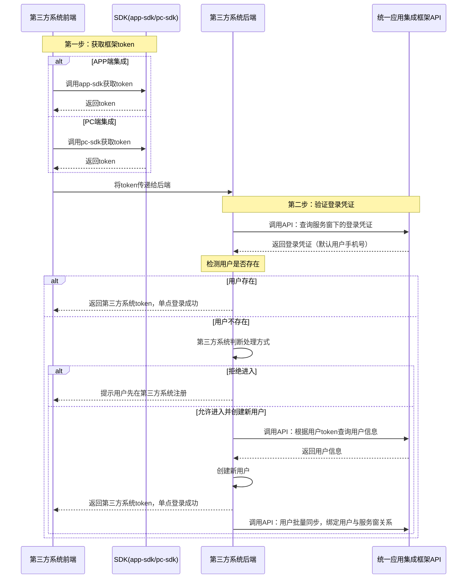

全局环境变量说明

| 环境变量 | 环境 | 地址 |
| :--- | :--- | :--- |
| API_URI | 测试环境 | http://183.6.48.123:30680 |
| API_URI | 生产环境 | http://sjt.gz-szcj.com:8000 |


# 1.接入过程
## 1.1.第三方系统接入方式
### 1.1.1.接入准备
A. 第三方系统，需提供系统名称及服务窗LOGO和服务窗主页URL

> 概念举例说明：
>
> 系统：第三方系统名是xxxx人力信息管理平台
>
> 服务窗：第三方系统具备2个服务窗，1是人力资源个人端，2是人力资源管理端，每个服务窗都需提供独立的URL入口
>

B. 第三方系统，服务窗组织通讯录LOGO和访问地址（若第三方系统需要将通讯录集成到统一应用框架上的话）

C. 统一应用集成框架的用户和该服务窗的关系类型设置，（统一应用集成框架支持服务窗配置无服务窗权限用户与服务窗权限关系），包括下面四种：

a. 显示服务窗，用户可直接进入服务窗

b. 显示服务窗，用户需要申请加入（第三方系统服务窗需配置申请加入页面URL）

c. 显示服务窗，弹框提示配置文案（需要提供配置文案）

d. 非服务窗用户，不显示该服务窗

D. 第三方系统需要接入应用按照"修改手机号" 接口标准实现，并提供接口服务地址。

### 1.1.2.接入流程
#### 1.1.2.1.第三方系统注册
> 1、 应用注册：提供好接入准备需要的资料和确定接入方式后，联系管理员
>
> 2、 应用注册完成：管理员会提供3个参数：AppKey、AppSecret、windowsId

#### 1.1.2.2.第三方应用用户同步（可选）
> 注意：如果第三方应用中当前已存在存量用户，处理方式有两种：
>
> 1、 可调用用户批量同步接口一次性将用户同步给统一应用集成框架。且应用内存在用户注册用户行为，也需要通过批量同步接口将用户及时同步至框架。此操作类似服务窗提前帮助用户完成了统一应用集成框架APP的注册工作。
>
> 2、 无需同步，让用户自行在统一应用集成框架APP上注册，注册完后，进入第三方系统所在服务窗时，由服务窗自行判断该用户是否能正常访问服务窗即可，若服务窗允许该用户能正常访问服务窗，则需要调用用户同步接口同步用户和服务窗的关系。
>

#### 1.1.2.3.统一应用集成框架用户同步
由统一应用集成框架注册的新用户，并非是第三方应用用户进入时，由第三方系统的服务窗自行判断是否需要接入该新用户，如果需要接入用户可通过用户信息查询接口获取用户基本信息，并自行在第三方系统内进行注册等。注册成功后需要通过用户同步接口向框架同步用户与服务窗关系。

#### 1.1.2.4.用户信息修改
框架支持用户修改手机号。框架会通知由用户相关的服务窗。


# 2.单点登录

## 2.1.单点登录时序图



### 2.2.第三方应用获取统一应用集成框架用户
用户登录框架进入服务窗之后，第三方应用调用SDK获得用户token，拿到token之后调用框架开放API：根据token获得用户基本信息接口，从而拿到手机号，姓名等关键信息。

调用说明：

1. 移动APP调用参考：H5组件开发工具包章节

2. PC客户端调用const token = umPcSdk.getData('token')，无需引用脚本，umPcSdk直接注入到windows对象上。

3. web端调用方式同PC客户端，但需要引入一下脚本：
- 测试环境：[http://183.6.48.123:30680/pcsdk/pcsdk.min.js](http://183.6.48.123:30680/pcsdk/pcsdk.min.js)
- 生产环境：[http://sjt.gz-szcj.com:8000/pcsdk/pcsdk.min.js](http://sjt.gz-szcj.com:8000/pcsdk/pcsdk.min.js)


## 3.1.公用Head头
说明：访问授权基于OpenApi的方式，第三方系统在框架注册服务，届时会生成Appkey 和Appsecret，以及服务窗windowsId，第三方需用Nonce，CurTime， AppKey三个参数进行sha1签名，并将值放到CheckSum 这个Head 头里面去，服务端会校验这个签名

### 3.1.1.公用Head头参数说明
| 参数 | 参数名称 | 类型 | 是否<br/>可空 | 参数说明 |
| --- | :--- | :--- | :--- | :--- |
| Nonce | 随机数（最大长度36个字符） | String(36) | N | 随机数（最大长度36个字符） |
| CurTime | 时间戳 | String | N | 当前UTC时间戳，从1970年1月1日0点0 分0 秒开始到现在的秒数(String) |
| AppKey |  | String(36) | N | 框架分配的appkey |
| CheckSum |  |  | N | SHA1(AppSecret + Nonce + CurTime)，三个参数拼接的字符串，进行SHA1哈希计算(String，小写) |


### 3.1.2.CheckSum生成代码
```java
import java.security.MessageDigest;

public class CheckSumBuilder {
    private static final char[] HEX_DIGITS = {'0', '1', '2', '3', '4', '5', '6', '7', '8', '9', 'a', 'b', 'c', 'd', 'e', 'f'};

    /
    * 计算并获取CheckSum
    *
    * @param appSecret 秘钥
    * @param nonce 随机数
    * @param curTime 当前系统时间戳（从1970年1月1日0点0 分0 秒开始到现在的秒数）
    * @return checkSum值
    */
    public static String getCheckSum(String appSecret, String nonce, String curTime) { 
        return encode("sha1", appSecret + nonce + curTime);
    }

    private static String encode(String algorithm, String value) {
        if (value == null) {
            return null;
        } 
        try {
            MessageDigest messageDigest = MessageDigest.getInstance(algorithm);
            messageDigest.update(value.getBytes());
            return getFormattedText(messageDigest.digest());
        } catch (Exception e) { 
            throw new RuntimeException(e);
        } 
    }

    private static String getFormattedText(byte[] bytes) {
        int len = bytes.length;
        StringBuilder buf = new StringBuilder(len * 2);
        for (int j = 0; j < len; j++) {                  
            buf.append(HEX_DIGITS[(bytes[j] >> 4) & 0x0f]);
            buf.append(HEX_DIGITS[bytes[j] & 0x0f]);
        } 
        return buf.();
    }
}
```

## 3.2.用户相关API
### 3.2.1.根据用户token查询用户信息
#### 3.2.1.1.接口URL
{API_URI}/yjy/external/open/get/user/basic/info/by/token

#### 3.2.1.2.请求方式
HTTP GET

#### 3.2.1.3.请求
##### 3.2.1.3.1.请求头
Content-Type: application/json

公用Head头参数

Authorization：用户token

##### 3.2.1.3.2.参数说明
##### 3.2.1.3.3.请求示例
请求数据格式为：

{API_URI}/yjy/external/open/get/user/basic/info/by/token

#### 3.2.1.4.响应
##### 3.2.1.4.1.响应字段说明
| 参数 | 参数名称 | | 类型 | 是否<br/>可空 | 参数说明 |
| :--- | :--- | --- | :--- | :--- | :--- |
| code | 返回码 | | Integer | N | 返回码，具体信息请参见"附录A 返回码" |
| msg | 响应信息 | | String | N | 返回的响应信息 |
| error | 错误信息 | | Object | N | 参数验证信息 |
| data | 结果集 | | List | N | 信息集合 |
| phone | | 手机号码 | String | N |  |
| userName | | 用户名称 | String | N |  |
| userId | | 用户id | String | N |  |
| account | | 账号 | String | N |  |
| avatar | | 头像路径 | String | N |  |
| createTime | | 创建时间 | String | N |  |
| authInfos | | 统一认证平台用户信息 | Array | Y |  |
| authType | | 认证方式 | Integer | Y | 0-局统一支撑平台 1-省统一身份认证平台 2-支付宝人脸实名认证 |
| userInfo | | 认证信息 | String | Y | 统一认证平台用户信息。authType=0/1 时为 AES 加密的 json 串（解密方式详见附录B：解密算法，解密的 secretKey 为请求的用户 token）；authType=2 时为未加密的 json 字符串，字段包括 alipayUserName（支付宝实名姓名）、gender（性别 MALE/FEMALE）、certified（是否实名认证 T/F）、faceAuthStatus（人脸认证状态 T/F）、certifyTime（认证完成时间） |


##### 3.2.1.4.2.响应示例
```java
{
    "code":3001,
    "msg":"操作成功",
    "data": {
          "userId": "1461613321869462235",
           "phone": "18110953386",
           "userName": "安华",
           "account": "18110953386",
           "avatar": "https://dev.yuan.com/file/app/03-47.jpg",
           "createTime": "2021-11-19 16:32:26"，
        "authInfos": [{
        "authType": 1,
        "userInfo": "{\"userinfo\":{\"userobj\":{\"usertype\":\"1\",\"uid\":\"lizhongqi013\",\"useridcode\":\"5ce21c0188f549e58dd1657a792cc078\",\"telephonenumber\":\"15665417620\",\"mail\":\"-1\",\"cn\":\"李杰\",\"idcardtype\":\"10\",\"idcardnumber\":\"340402199766661412\",\"sex\":null,\"createtime\":\"20220308124734\",\"isreal\":\"true\",\"realtype\":\"YSS-MP||YSS\",\"entdep\":null,\"authloc\":\"-1\",\"link_person_name\":\"\",\"creditable_level_of_account\":\"L2\",\"creditable_level_of_account_way\":\"L1@YSS-MP@340402199701231412||L2@YSS@340402199701231412\"},\"pareobj\":null,\"user_creditable_level\":{\"creditable_level_of_account\":\"L2\",\"creditable_level_of_account_way\":\"L1@YSS-MP@340402199701231412||L2@YSS@340402199701231412\",\"creditable_level_of_account_way_list\":[{\"identity_level\":\"L1\",\"way_code\":\"YSS-MP\",\"credential_no\":\"340402199701231412\",\"user_name\":\"李杰\",\"auth_identification\":\"5ce21c0188f549e58dd1657a792cc078\",\"auth_time\":\"2022-05-10 21:55:33\",\"useridcode\":null},{\"identity_level\":\"L2\",\"way_code\":\"YSS\",\"credential_no\":\"340402199701231412\",\"user_name\":\"李杰\",\"auth_identification\":\"340402199701231412\",\"auth_time\":\"2022-03-08 12:47:34\",\"useridcode\":null}]}},\"userType\":\"个人\",\"unitName\":\"李杰\",\"unitCode\":\"340402199701231412\",\"userName\":\"lizhongqi013\",\"sx\":null,\"ts\":null,\"token\":null}"
 },{
        "authType": 0,
        "userInfo":{
            "userId":"ef1d28a2afac4976ab",
            "userName":"元知",
            "loginName":"yuanzhi",
            "mobile":""
            }
 },{
        "authType": 2,
        "userInfo": "{\"alipayUserName\":\"童桢柯\",\"gender\":\"MALE\",\"certified\":\"T\",\"faceAuthStatus\":\"T\",\"certifyTime\":\"2026-08-06 13:40:29\"}"
    }]
        }
}
```

# 3.开放API
### 3.2.2.用户批量同步(绑定用户与服务窗的关系)
批量同步用户，并绑定用户与服务窗的关系

#### 3.2.2.1.接口URL
{API_URI}/yjy/external/open/user/batch/add

#### 3.2.2.2.请求方式
HTTP POST

#### 3.2.2.3.请求
##### 3.2.2.3.1.请求头
Content-Type: application/json

公用Head头参数

windowsId: 第三方在框架注册的服务窗ID

##### 3.2.2.3.2.参数说明
| 参数 | 参数名称 | 类 | 是否<br/>可空 | 参数说明 |
| :--- | :--- | :--- | :--- | :--- |
| user | 用户信息 | object[] | N | 数组类型 |
| phone | 手机号码 | String(16) | N |  |
| userName | 用户名 | String(8) | N |  |
| hasAddressBook | 是否有通讯录功能 | Integer(1) | Y | 1代表有，0或者不传代表没有 |
| batchId | UUId | String(36) | N |  |


##### 3.2.2.3.3.请求示例
```java
{
    "batchId":"11111",
    "user":[
        {
            "userName":"张三",
            "phone":"13725257431",
            "hasAddressBook":1
        }
    ]
}
```

#### 3.2.2.4.响应
##### 3.2.2.4.1.响应字段说明
| 参数 | 参数名称 | 类型 | 是否<br/>可空 | 参数说明 |
| :--- | :--- | :--- | :--- | :--- |
| code | 返回编码 | int | N | 返回码，具体请参见"附录A 返回码" |
| msg | 返回描述 | string | N | 返回的响应信息 |


##### 3.2.2.4.2.响应示例
```java
{
    "code":3001,
    "msg":"操作成功"
}
```

### 3.2.3.查询批量用户同步失败的数据
查询3.2.1用户批量同步接口失败的数据

#### 3.2.3.1.接口URL
{API_URI}/yjy/external/open/sync/failure/list?batchId=11111

#### 3.2.3.2.请求方式
HTTP GET

#### 3.2.3.3.请求
##### 3.2.3.3.1.请求头
Content-Type: application/json

公用Head头参数

##### 3.2.3.3.2.参数说明
| 参数 | 参数名称 | 类型 | 是否<br/>可空 | 参数说明 |
| :--- | :--- | :--- | :--- | :--- |
| batchId | UUId | String(36) | N | 用户批量同步接口传过来的batchId |


##### 3.2.3.3.3.请求示例
#### 3.2.3.4.响应
##### 3.2.3.4.1.响应字段说明
| 参数 | 参数名称 | 类型 | 是否<br/>可空 | 参数说明 |
| :--- | :--- | :--- | :--- | :--- |
| code | 返回编码 | int | N |  |
| msg | 返回描述 | string(50) | Y |  |
| data |  | object [] | Y | 数组，返回所有的同步失败的用户 |
| phone | 手机号码 | String(16) | Y |  |
| userName | 用户名称 | String(8) | N | 最长为8个字符,且只能是中文字符 |


##### 3.2.3.4.2.响应示例
```java
{
    "code":3001,
    "msg":"操作成功",
    "data":[
        {
            "phone":"18110969999",
            "userName":"失败用户名称"
        }
    ]
}
```

### 3.2.4.根据手机号查询用户基本信息
#### 3.2.4.1.接口URL
{API_URI}/yjy/external/open/get/user/basic/info?phone=18110953386

#### 3.2.4.2.请求方式
HTTP GET

#### 3.2.4.3.请求
##### 3.2.4.3.1.请求头
Content-Type: application/json

公用Head头参数

##### 3.2.4.3.2.参数说明
| 参数 | 参数名称 | 类型 | 是否<br/>可空 | 参数说明 |
| :--- | :--- | :--- | :--- | :--- |
| phone | 手机号码 | String(16) | N |  |


##### 3.2.4.3.3.请求示例
#### 3.2.4.4.响应
##### 3.2.4.4.1.响应字段说明
| 参数 | 参数名称 | | 类型 | 是否<br/>可空 | 参数说明 |
| :--- | :--- | --- | :--- | :--- | :--- |
| code | 返回码 | | Integer | N | 返回码，具体信息请参见"附录A 返回码" |
| msg | 响应信息 | | String | N | 返回的响应信息 |
| error | 错误信息 | | Object | N | 参数验证信息 |
| data | 结果集 | | List | N | 信息集合 |
| phone | | 手机号码 | String | N |  |
| userName | | 用户名称 | String | N |  |
| userId | | 用户id | String | N |  |
| account | | 账号 | String | N |  |
| avatar | | 头像路径 | String | N |  |
| createTime | | 创建时间 | String | N |  |


##### 3.2.4.4.2.响应示例
```java
{
    "code":3001,
    "msg":"操作成功",
    "data":[
    {
        "userId": "1461613321869462235",
        "phone": "18110953386",
        "userName": "安华",
        "account": "18110953386",
        "avatar": "https://dev.yuan.com/file/app/03-47.jpg",
        "createTime": "2021-11-19 16:32:26"
    }
    ]
}
```

### 3.2.5.用户解绑服务窗
#### 3.2.5.1.接口URL
{API_URI}/yjy/external/open/user/unbind/windows

#### 3.2.5.2.请求方式
HTTP POST

#### 3.2.5.3.请求
##### 3.2.5.3.1.请求头
Content-Type: application/json

公用Head头参数

windowsId: 第三方在框架注册的服务窗ID

##### 3.2.5.3.2.参数说明
| 参数 | 参数名称 | 类型 | 是否<br/>可空 | 参数说明 |
| :--- | :--- | :--- | :--- | :--- |
| phone | 手机号码 | String(16) | N |  |


##### 3.2.5.3.3.请求示例
```java
{
    "phone":"18110951234",
}
```

#### 3.2.5.4.响应
##### 3.2.5.4.1.响应字段说明
| 参数 | 参数名称 | 类型 | 是否<br/>可空 | 参数说明 |
| :--- | :--- | :--- | :--- | :--- |
| code | 返回码 | Integer | N | 返回码，具体信息请参见"附录A 返回码" |
| msg | 响应信息 | String | N | 返回的响应信息 |
| error | 错误信息 | Object | Y | 参数验证信息 |


##### 3.2.5.4.2.响应示例
```java
{
    "code":3001,
    "msg":"操作成功",
    "error":null
}
```

## 3.3.服务窗相关API
### 3.3.1.查询服务下的所有服务窗信息
#### 3.3.1.1.接口URL
{API_URL}/yjy/external/open/get/service/info

#### 3.3.1.2.请求方式
HTTP POST

#### 3.3.1.3.请求
##### 3.3.1.3.1.请求头
Content-Type: application/json

公用Head头参数

##### 3.3.1.3.2.参数说明
| 参数 | 参数名称 | 类型 | 是否<br/>可空 | 参数说明 |
| :--- | :--- | :--- | :--- | :--- |
| serviceId | 服务ID | String(16) | N |  |
| pageNum | 页码 | Integer(4) | N |  |
| pageSize | 每页数量 | Integer(4) | N |  |


##### 3.3.1.3.3.请求示例
```java
{
    "serviceId": "519031479275884544",
    "page": {
        "pageNum": 1,
        "pageSize": 10
    }
}
```

#### 3.3.1.4.响应
##### 3.3.1.4.1.响应字段说明
| 参数 | 参数名称 | | 类型 | 是否<br/>可空 | 参数说明 |
| :--- | :--- | --- | :--- | :--- | :--- |
| code | 返回码 | | Integer | N | 返回码，具体信息请参见"附录A 返回码" |
| msg | 响应信息 | | String | N | 返回的响应信息 |
| error | 错误信息 | | Object | N | 参数验证信息 |
| data | 结果集 | | List | N | 信息集合 |
| list | | 列表 | String | N |  |
| windowsId | | 服务窗ID | String | N |  |
| windowsName | | 服务窗名称 | String | N |  |
| icon | | 服务窗图标URL | String | N |  |
| domain | | 服务窗主域名 | String | N |  |
| contactDomain | | 第三方通讯录组织架构 | String | Y |  |
| indexUrl | | 服务首页url | String | N |  |
| pageNum | | 页码 | Integer | N |  |
| pageSize | | 每页数量 | Integer | N |  |
| total | | 总数 | Integer | N |  |


##### 3.3.1.4.2.响应示例
```java
{
    "code": 3001,
    "msg": "操作成功",
    "data": {
        "list": [
        {
            "windowsId": "2",
            "windowsName": "1",
            "icon": "111",
            "domain": "http://",
            "contactDomain": "",
            "indexUrl": "/z"
        }
        ],
        "page": {
            "pageNum": 1,
            "pageSize": 10,
            "total": 1
        }
    },
    "error": {},
    "success": true
}
```

### 3.3.2.查询服务窗下的登录凭证
#### 3.3.1.1.接口URL
{API_URL}/yjy/external/open/get/windows/loginCredentials

#### 3.3.1.2.请求方式
HTTP POST

#### 3.3.1.3.请求
##### 3.3.1.3.1.请求头
Content-Type: application/json

公用Head头参数

Authorization：用户token

##### 3.3.1.3.2.参数说明
| 参数 | 参数名称 | 类型 | 是否<br/>可空 | 参数说明 |
| :--- | :--- | :--- | :--- | :--- |
| windowsId | 服务ID | String(16) | N |  |


##### 3.3.1.3.3.请求示例
```java
{
    "windowsId": "519031479275884544",
}
```

#### 3.3.1.4.响应
##### 3.3.1.4.1.响应字段说明
| 参数 | 参数名称 | | 类型 | 是否<br/>可空 | 参数说明 |
| :--- | :--- | --- | :--- | :--- | :--- |
| code | 返回码 | | Integer | N | 返回码，具体信息请参见"附录A 返回码" |
| msg | 响应信息 | | String | N | 返回的响应信息 |
| error | 错误信息 | | Object | N | 参数验证信息 |
| data | 结果集 | | List | N | 信息集合 |
| windowsId | | 服务窗ID | String | N |  |
| loginCredentials | | 用户登录凭证 | String | N |  |


##### 3.3.1.4.2.响应示例
```java
{
    "code": 3001,
    "msg": "操作成功",
    "data": {
        "windowsId": "519031479275884544",
        "loginCredentials": "18126779558"
    },
    "error": {},
    "success": true
}
```


## 3.4.IM相关API
### 3.4.1.服务窗发送消息
#### 3.4.1.1.接口URL
{API_URL}/yjy/external/open/im/sendAppMsg

#### 3.4.1.2.请求方式
HTTP POST

#### 3.4.1.3.请求
##### 3.4.1.3.1.请求头
Content-Type: application/json

公用Head头参数公 

windowsId:发送方所在的服务窗ID

##### 3.4.1.3.2.参数说明
| 参数 | 参数名称 | 类型 | 是否<br/>可空 | 参数说明 |
| :--- | :--- | :--- | :--- | :--- |
| title | 待办标题 | String(64) | N |  |
| content | 待办内容 | String(512) | N |  |
| coverUrl | 封面图URL | String(256) | Y | 图片地址url，无封面图可传空，区分消息显示是文本还是带封面图 |
| toUsers | 接收人账户 | String(1024) | Y | 多个使用逗号分隔,不传发送服务窗下所有用户 |
| andriodJumpUrl | 安卓跳转链接 | String(256) | Y |  |
| iosJumpUrl | iOS跳转链接 | String(256) | Y |  |
| pcJumpUrl | pc端跳转链接 | String(256) | Y |  |


##### 3.4.1.3.3.请求示例
```java
{
    "title": "待办消息", 
    "content": "取个快递", 
    "coverUrl": "http://test.baidu.com/a.jpg", 
    "toUsers": "13716519874,13888888888", 
    "andriodJumpUrl": "http://test.baidu.com/a/b/c.html", 
    "iosJumpUrl": "http://test.baidu.com/a/b/c.html", 
    "pcJumpUrl": "http://test.baidu.com/a/b/c.html"
}
```

#### 3.4.1.4.响应
##### 3.4.1.4.1.响应字段说明
| 参数 | 参数名称 | 类型 | 是否<br/>可空 | 参数说明 |
| :--- | :--- | :--- | :--- | :--- |
| code | 返回编码 | int | N | 返回码，具体信息请参见"附录A 返回码" |
| msg | 返回描述 | string | N | 返回的响应信息 |
| data | 数据 | String | N | 消息ID：msgId，查询时可用 |


##### 3.4.1.4.2.响应示例
```java
{
    "code": 3001,
    "msg": "success"，
    "data": "12345111234123"
}
```

### 3.4.2.服务窗查询消息发送记录
#### 3.4.2.1.接口URL
{API_URL}/yjy/external/open/im/getAppMsgs

#### 3.4.2.2.请求方式
HTTP POST

#### 3.4.2.3.请求
##### 3.4.2.3.1.请求头
Content-Type: application/json

公用Head头参数公 

windowsId:发送方所在的服务窗ID

##### 3.4.2.3.2.参数说明
| 参数 | 参数名称 | 类型 | 是否<br/>可空 | 参数说明 |
| --- | --- | --- | --- | --- |
| msgId | 消息ID | String(36) | Y | 消息ID |


##### 3.4.2.3.3.请求示例
```java
{
	"msgId": "2063968531506139136"
}
```

#### 3.4.2.4.响应
##### 3.4.2.4.1.响应字段说明
| 参数 | 参数名称 | 类型 | 是否<br/>可空 | 参数说明 |
| :--- | :--- | :--- | :--- | :--- |
| code | 返回编码 | int | N | 返回码，具体信息请参见"附录A 返回码" |
| msg | 返回描述 | string | N | 返回的响应信息 |
| data | 数据 | String | N | 消息列表 |
| msgId | 消息唯一标识 | String(64) | N | 初始发送时为空（接口返回msgId） |
| title | 待办标题 | String(64) | N |  |
| content | 待办内容 | String(512) | N |  |
| coverUrl | 封面图URL | String(256) | Y |  |
| jumpUrl | 跳转链接 | String(256) | Y |  |
| andriodJumpUrl | 安卓跳转链接 | String(256) | Y |  |
| iosJumpUrl | iOS跳转链接 | String(256) | Y |  |
| pcJumpUrl | pc端跳转链接 | String(256) | Y |  |


##### 3.4.2.4.2.响应示例
```java
{
	"code": 3001,
	"msg": "操作成功",
	"data": [
		{
			"msgId": "2063968531506139136",
			"windowId": "519309086076702720",
			"title": "关于进一步加强广州市在建项目安全管理及房屋建筑隐患排查工作的通知",
			"content": "各相关单位、各在建项目参建主体，​为切实吸取事故教训，保障人民群众生命财产安全，有效防范化解各类安全风险，现就加强全市在建项目及重点区域房屋建筑安全管理工作通知如下",
			"coverUrl": "https://project-gzzj.oss-cn-hangzhou.aliyuncs.com/%E6%B0%94%E8%B1%A1%E7%B3%BB%E7%BB%9F.png",
			"andriodJumpUrl": "http://183.6.145.40:8002/mobile/gzzjapp/enterprise/#/todo/jkkyr4?windowsId=1951432397375541248&msgId=1957709855783522304&status=1&systemCode=GZZJ",
			"iosJumpUrl": "http://183.6.145.40:8002/mobile/gzzjapp/enterprise/#/todo/jkkyr4?windowsId=1951432397375541248&msgId=1957709855783522304&status=1&systemCode=GZZJ",
			"pcJumpUrl": "",
			"createTime": "2026-06-08 20:56:59"
		}
	],
	"error": {},
	"success": true
}
```


# 4.第三方系统集成API（可选）
## 4.1.人员组织树列表
描述：需第三方集成系统提供接口，根据参数orgId，返回当前节点下的直属组织，以及直属成员

### 4.1.1.接口URL
{API_URI}/yjy/cloud/external/direct/org/and/user/list

### 4.1.2.请求方式
HTTP POST

### 4.1.3.请求
#### 4.1.3.1.请求头
Content-Type: application/json

windowsId: 第三方在平台注册的服务窗ID

#### 4.1.3.2.参数说明
| 参数 | 参数名称 | 类型 | 是否<br/>可空 | 参数说明 |
| :--- | :--- | :--- | :--- | :--- |
| orgId | 组织id | String(36) | N | 不传就是根节点 |
| Phone | 手机号码 | String(16) | N |  |


#### 4.1.3.3.请求示例
```java
{
    "orgId":"123",
    "phone":"18110951234"
}
```

### 4.1.4.响应
#### 4.1.4.1.响应字段说明
| 参数 | 参数名称 | 类型 | 是否<br/>可空 | 参数说明 |
| :--- | :--- | :--- | :--- | :--- |
| code | 返回编码 | int | N | 返回码，具体信息请参见"附录A 返回码" |
| msg | 返回描述 | string | N | 返回的响应信息 |
| data |  | object [] | Y | 返回具体的数据 |
| orgList | 组织列表 | object [] | Y |  |
| orgId | 组织ID | string | N |  |
| orgName | 组织名称 | string | N |  |
| orgDesc | 组织描述 | string | Y |  |
| peopleCount | 当前组织以及所有后代组织总人数 | integer | Y |  |
| userList | 当前组织直属成员 | object [] | Y |  |
| phone | 手机号码 | string | Y |  |
| userName | 用户名称 | string | Y |  |
| avatar | 用户头像 | string | Y |  |
| userId | 用户Id | string | N |  |
| position | 科员 | string | Y |  |


#### 4.1.4.2.响应示例
```java
{
    "code":3001,
    "msg":"success",
    "data":{
        "orgList":[
        {
            "orgName":"住建局",
            "orgId":"2",
            "orgDesc":"组织描述",
            "peopleCount":11
        }
        ],
        "userList":[
        {
            "avatar":"https://test.yuan.com/file/default.png",
            "phone":"18234262780",
            "userName":"李四",
            "userId":"11",
            "position":"ke"
        }
        ]
    }
}
```

## 4.2.人员信息列表
描述：需第三方集成系统提供接口，根据searchValue 模糊查询用户list，支持姓名手机号查询

### 4.2.1.接口URL
{API_URI}/yjy/cloud/external/user/list

### 4.2.2.请求方式
HTTP POST

### 4.2.3.请求
#### 4.2.3.1.请求头
Content-Type: application/json

windowsId: 第三方在框架注册的服务窗ID

#### 4.2.3.2.参数说明
| 参数 | 参数名称 | 类型 | 是否<br/>可空 | 参数说明 |
| :--- | :--- | :--- | :--- | :--- |
| searchValue | 姓名，手机号码 | String(16) | N | 根据条件模糊查询 |
| maxCount | 默认返回最大行数 | Integer(1) | Y | 默认值:3 |


#### 4.2.3.3.请求示例
```java
{
    "searchValue":"靓仔",
    "maxCount":"3"
}
```

### 4.2.4.响应
#### 4.2.4.1.响应字段说明
| 参数 | 参数名称 | 类型 | 是否<br/>可空 | 参数说明 |
| :--- | :--- | :--- | :--- | :--- |
| code | 返回编码 | int | N | 返回码，具体信息请参见"附录A 返回码" |
| msg | 返回描述 | string | N | 返回的响应信息 |
| data |  | object [] | Y | 返回具体的数据 |
| orgId | 组织ID | string | Y |  |
| orgName | 组织/公司名称 | string | Y |  |
| phone | 手机号码 | string | Y |  |
| userId | 用户ID | string | N |  |
| userName | 用户名称 | string | N |  |
| position | 岗位 | string | Y |  |


#### 4.2.4.2.响应示例
```java
{
    "code":3001,
    "msg":"success",
    "data":{
        "orgList":[
        {
            "orgName":"住建局",
            "orgId":"2",
            "avatar":"https://test.yuan.com/file/default.png",
            "phone":"18234262780",
            "userName":"李四",
            "userId":"11",
            "position":"科长"
        }
        ]
    }
}
```

## 4.3.修改框架用户手机号
### 4.3.1.接口URL
{API_URI}/yjy/cloud/external/user/info/update

### 4.3.2.请求方式
HTTP POST

### 4.3.3.请求
#### 4.3.3.1.请求头
Content-Type: application/json

windowsId: 第三方在平台注册的服务窗ID

#### 4.3.3.2.参数说明
| 参数 | 参数名称 | 类型 | 是否<br/>可空 | 参数说明 |
| :--- | :--- | :--- | :--- | :--- |
| oldPhone | 原手机号码 | String(16) | N |  |
| userName | 姓名 | string(8) | Y |  |
| newPhone | 新手机号码 | string(16) | N |  |


#### 4.3.3.3.请求示例
```java
{
    "oldPhone":"15564847000",
    "userName":"靓仔",
    "newPhone":"15564847003"
}
```

### 4.3.4.响应
#### 4.3.4.1.响应字段说明
| 参数 | 参数名称 | 类型 | 是否<br/>可空 | 参数说明 |
| :--- | :--- | :--- | :--- | :--- |
| code | 返回编码 | int | N | 返回码，具体信息请参见"附录A 返回码" |
| msg | 返回描述 | string | N | 返回的响应信息 |


#### 4.3.4.2.响应示例
```java
{
    "code":3001,
    "msg":"success"
}
```


# 5.统一应用集成框架SDK
框架为应用提供了调用原生控件的能力，帮助开发者高效使用获取手机基础信息、定位等手机系统的能力，同时可以直接使用扫一扫、消息等特有的能力，带给应用接近原生代码的体验。

开发工具包文档详见：

[统一应用集成框架SDK使用指南V1.0](https://www.yuque.com/ershixiong-atebu/fhyo2f/se5cr2gvlwdcft9x)

# 6.常见问题
### 附录A
#### 返回码
| 返回码 | 说明 |
| :---: | :---: |
| 3001 | 请求成功！ |
| 41001 | token不存在 |
| 41002 | token过期 |
| 41003 | 已在其他地方登录 |
| 41006 | 其他 |


### 
### 附录B
#### 解密算法
secretKey 密钥：用户token的值

JAVA：

```java
/
     *  解密参数
     * @param value 待解密的参数
     * @param secretKey 密钥
     * @return
     */
public static String decryptAES(String value, String secretKey) {
    try {
        if(secretKey.length() > 16) {
            secretKey = secretKey.substring(0, 16);
        }
        byte[] data = value.getBytes("UTF-8");
        SecretKeySpec secretKeySpec = new SecretKeySpec(secretKey.getBytes(), "AES");
        Cipher cipher = Cipher.getInstance("AES");
        cipher.init(Cipher.DECRYPT_MODE, secretKeySpec);
        byte[] digestData = Base64.getDecoder().decode(new String(data));
        digestData = cipher.doFinal(digestData);
        java.util.regex.Pattern pattern = java.util.regex.Pattern.compile("\\s*|\t|\r|\n");//去掉空格、换行
        String result = pattern.matcher(new String(digestData)).replaceAll("");
        return result;
    } catch (Exception e) {
        e.printStackTrace();
        return null;
    }
}
```

C#：

```csharp
/// <summary>
/// AES解密
/// </summary>
/// <param name="value">待解密的参数</param>
/// <param name="secretKey">密钥</param>
/// <returns></returns>
public static string AESDecrypt(string value, string secretKey)
{
    RijndaelManaged rijndaelCipher = new RijndaelManaged();
    rijndaelCipher.Mode = CipherMode.ECB;
    rijndaelCipher.Padding = PaddingMode.PKCS7;
    rijndaelCipher.KeySize = 128;
    rijndaelCipher.BlockSize = 128;
    byte[] encryptedData = Convert.FromBase64String(value);
    byte[] pwdBytes = System.Text.Encoding.UTF8.GetBytes(secretKey);
    byte[] keyBytes = new byte[16];
    int len = pwdBytes.Length;
    if (len > keyBytes.Length) len = keyBytes.Length;
    System.Array.Copy(pwdBytes, keyBytes, len);
    rijndaelCipher.Key = keyBytes;
    ICryptoTransform transform = rijndaelCipher.CreateDecryptor();
    byte[] plainText = transform.TransformFinalBlock(encryptedData, 0, encryptedData.Length);
    return Encoding.UTF8.GetString(plainText);
}
```


