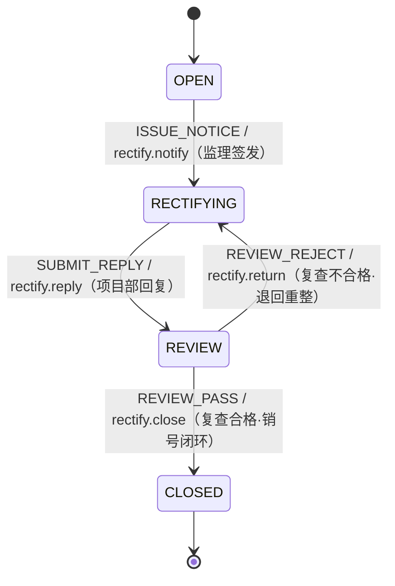
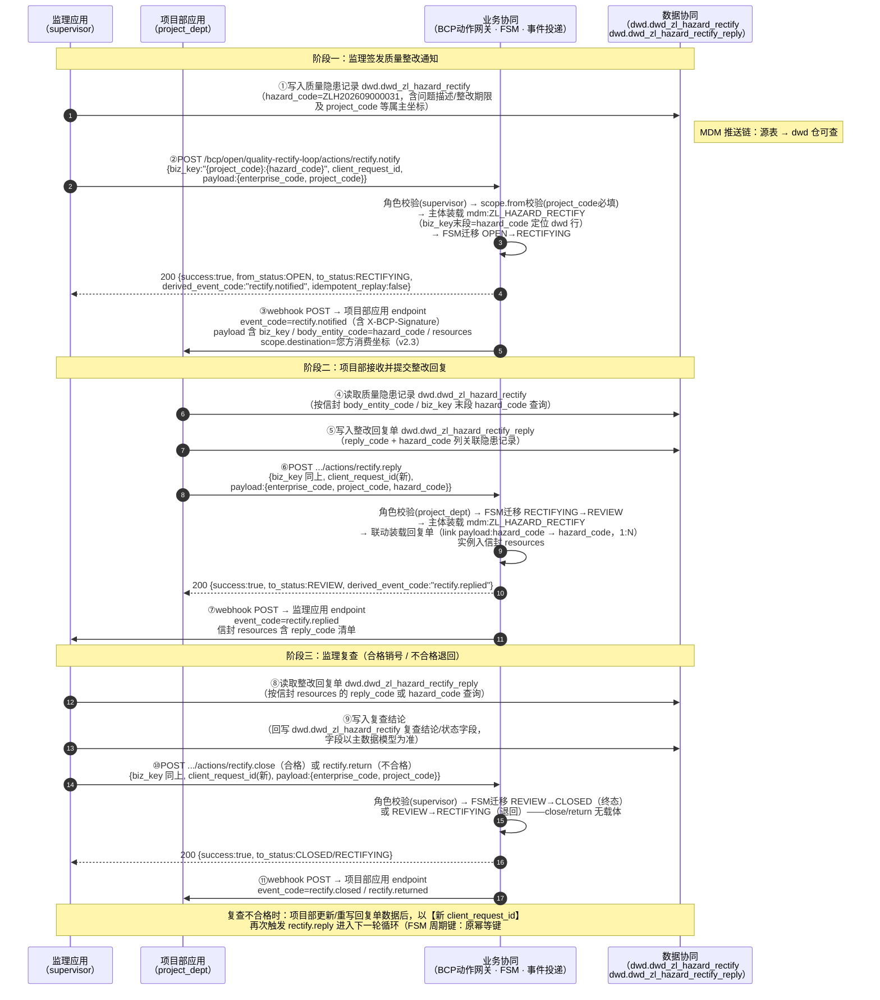

# 28-质量问题整改闭环协同场景 · 三方应用集成操作手册

| 项 | 内容 |
|---|---|
| 场景 | 质量问题整改闭环协同（`quality-rectify-loop`，当前版本 v2026，状态 published） |
| 协同类型 | 项目协同（PROJECT） |
| 覆盖范围 | **仅红框范围**：项目部（project_dept）、监理单位（supervisor）两角色 × rectify.notify/reply/close/return 四动作。**不含施工企业本部（company）**、不含监管部门（regulator） |
| 读者 | 第三方应用方（监理单位应用 / 项目部应用）集成开发人员 |
| 数据基线 | 2026-09-09 dev 库实证（动作目录 4 条、**动作载体配置 mdm 实证**、FSM 模型 rectify-loop v3、角色授权）；⚠ 该场景 dev 环境**仍无触发与投递流水、无生效订阅**，§5.3 信封为 v2.3 结构示意（隐患编码样例取 dev 真实数据） |
| 姊妹篇 | 26-安全隐患整改通知场景、27-安全隐患整改闭环协同场景（接口契约结构同源） |

---

## 一、场景与三方角色总览

### 1.1 业务流程一句话

监理单位对质量问题签发整改通知 → 项目部接收并提交整改回复 → 监理单位复查：合格则销号闭环，不合格则退回重整（可循环），直至复查合格销号。

### 1.2 三方角色定义

| 角色 | 组成 | 职责 |
|---|---|---|
| **三方应用** | 监理单位应用（supervisor 侧）、项目部应用（project_dept 侧） | 写入/读取协同数据（质量隐患记录、整改回复单）；发起业务动作触发；提供 webhook 接收派生事件 |
| **业务协同** | BCP 开放动作网关（bcp-external `/bcp/open/**`）+ 状态机内核（bcp-fsm）+ 事件订阅投递 | 角色授权校验、payload 载体装载、FSM 状态迁移、派生事件发射与 webhook 回调投递 |
| **数据协同** | 数仓主数据读写面（mdm 实体 ↔ dwd 仓表） | 两张协同表的写入与读取：`dwd.dwd_zl_hazard_rectify`（质量隐患记录）、`dwd.dwd_zl_hazard_rectify_reply`（质量问题记录整改回复） |

> **关键认知**：三方应用只关心「**何时写哪张表、何时读哪张表、何时调哪个动作**」。事件驱动读写——收到哪个事件，就意味着对应数据已可读取；动作触发前，对应数据必须已写入并可查。平台内部的数据授权机制对三方完全透明，无需对接。

### 1.3 协同角色 × 动作矩阵（红框范围，库内实证）

| 动作 | 动作码 | 触发角色 | 订阅角色（本文范围） | 派生事件码 |
|---|---|---|---|---|
| 质量整改通知签发 | `rectify.notify` | supervisor（监理） | project_dept（项目部） | `rectify.notified` |
| 整改回复提交 | `rectify.reply` | project_dept（项目部） | supervisor（监理） | `rectify.replied` |
| 复查合格销号 | `rectify.close` | supervisor（监理） | project_dept（项目部） | `rectify.closed` |
| 复查不合格退回 | `rectify.return` | supervisor（监理） | project_dept（项目部） | `rectify.returned` |

> **范围说明**：库内订阅角色另含 company（施工企业本部，四事件全订阅）与 regulator（主管部门，仅 rectify.closed），均不在本文范围。

### 1.4 两张协同主数据表（dev 库实证）

本场景 payload 载体为 **mdm 主数据类型**（非表单），结构与 27-安全隐患整改闭环同源：

| mdm 实体 | 数仓表（dwd） | 编码列 | 真实编码样例（dev） | 业务含义 |
|---|---|---|---|---|
| `ZL_HAZARD_RECTIFY`（主体，mount=body） | `dwd.dwd_zl_hazard_rectify` | `hazard_code` | `ZLH202609000031` | 质量隐患记录——监理方写入（含问题描述、整改要求、整改期限等）；**复查结论亦回写本表** |
| `ZL_HAZARD_RECTIFY_REPLY`（联动，mount=extend） | `dwd.dwd_zl_hazard_rectify_reply` | `reply_code` | —（dev 暂无数据行） | 整改回复单——项目部写入，**必须携带 `hazard_code` 列关联隐患记录（1:N，一条隐患可多轮回复）** |

写入路径：三方业务系统落源表 → 经 MDM 推送链入 dwd 仓；读取路径：三方经各自数据接口按编码列查询。

> **载体配置实证（2026-09-09 dev 库 `bcp_scene_action`）**：rectify.notify `payload_refs=[{mdm:ZL_HAZARD_RECTIFY, mount:body}]`；rectify.reply 在此基础上追加联动载体 `{mdm:ZL_HAZARD_RECTIFY_REPLY, mount:extend, link: payload:hazard_code → hazard_code, 1:N}`；rectify.close / rectify.return **无载体**，payload 仅需 scope 字段。
>
> ⚠ **边界澄清**：本场景数据面**只涉及上述两张表，不涉及监理通知相关表**——`dwd_supervisor_notice` / `dwd_supervisor_notice_reply`（监理通知单/回复单）属 29-监理通知单场景（`form-zl-gdb215`），两者不要混用。

---

## 二、FSM 状态机模型（model_type=doc，rectify-loop 当前 v3）

### 2.1 状态集

| 状态码 | 名称 | 属性 |
|---|---|---|
| `OPEN` | 待整改（初始） | **初始态** |
| `RECTIFYING` | 整改中 | 中间态（退回也回到此态） |
| `REVIEW` | 待复查 | 中间态 |
| `CLOSED` | 已销号 | **终态**（唯一终态） |

### 2.2 迁移边（动作触发即驱动迁移）

| 边码 | event | from → to | 对应动作 | 迁移后 emit |
|---|---|---|---|---|
| T1 | `ISSUE_NOTICE` | OPEN → RECTIFYING | rectify.notify | `{scene}.lifecycle.status.changed` |
| T2 | `SUBMIT_REPLY` | RECTIFYING → REVIEW | rectify.reply | 同上 |
| T3 | `REVIEW_PASS` | REVIEW → CLOSED | rectify.close | 同上 |
| T4 | `REVIEW_REJECT` | REVIEW → RECTIFYING | rectify.return | 同上 |

**注意**：
- 本场景是**真循环**：rectify.return 把状态从 REVIEW 打回 RECTIFYING（非终态），项目部可重整后再次提交回复，直至 rectify.close 销号。每轮循环必须更换新的 `client_request_id`（见 §6.3 幂等周期键）。
- 状态不符的迁移请求一律返回 `BCP-EXT-8029`（409），不会产生任何事件。

### 2.3 状态图



---

## 三、三方时序图（核心）

> 四条生命线自左到右：**监理应用**（supervisor）、**项目部应用**（project_dept）、**业务协同**（动作网关 + FSM + 事件投递）、**数据协同**（两张 dwd 表的写入与读取）。



---

## 四、触发接口契约（业务协同面）

### 4.1 动作触发

```
POST {网关}/bcp/open/{scene}/actions/{action}
示例：POST /bcp/open/quality-rectify-loop/actions/rectify.notify
```

**请求头**

| 头 | 必填 | 说明 |
|---|---|---|
| `Authorization: Bearer <token>` | 是 | 平台签发的应用访问令牌（stub 联调模式仅持 Bearer 即可；生产 jwt 模式从 claim 解析 enterprise_id/app_id） |
| `X-BCP-Enterprise-Id` | 联调必填 | 调用方企业 ID（stub 模式回退通道；生产 jwt 模式不需要） |
| `X-BCP-App-Id` | 建议 | 调用方应用 ID（授权审计/投递归因） |
| `Content-Type: application/json` | 是 | |

**请求体**

| 字段 | 类型 | 必填 | 说明 |
|---|---|---|---|
| `biz_key` | string | **是** | 业务对象键，主权归调用方（不重写）。本场景约定 `{project_code}:{hazard_code}`，如 `PRJ202608000052:ZLH202609000031`。**末段必须等于隐患编码**——主体载体以末段定位 dwd 行（code_field_name=hazard_code） |
| `client_request_id` | string | **是** | 幂等键（≤128 字符，留痕列宽约束；2026-09-04 起，此前 64）。同键同参数重放 → 返回首个结果（`idempotent_replay=true`，零副作用）；**同键不同参数 → 409 `BCP-EXT-8051`**。退回后新一轮回复必须换新键 |
| `payload` | object | 是 | 业务载荷，至少携带下方两个 scope 字段 + 对应动作的表单业务字段 |
| `payload.enterprise_code` | string | **是** | 触发方企业编码。⚠ 原 `tenant_id` 已更名为 `enterprise_code`（2026-08-28 变更，直接切换无兼容期） |
| `payload.project_code` | string | **是** | 触发方项目编码（scope.from 必填校验项） |
| `payload.hazard_code` | string | rectify.reply **是** | 隐患编码——回复单联动装载键（link：payload:hazard_code → hazard_code，1:N）。缺省将无法自动定位回复单实例，信封 `resources` 丢失回复单索引 |
| `scope` | object | 否 | 显式 scope 块（role/enterprise_id/target）；缺省由服务端按令牌身份 + payload 装配 |

**各动作载体与 payload 业务字段**（2026-09-09 dev 库实证）：

| 动作 | 载体 | payload 业务字段 |
|---|---|---|
| rectify.notify | mdm:ZL_HAZARD_RECTIFY（body） | 仅 scope 字段（enterprise_code / project_code） |
| rectify.reply | mdm:ZL_HAZARD_RECTIFY（body）+ mdm:ZL_HAZARD_RECTIFY_REPLY（extend，link 1:N） | scope 字段 + `hazard_code`（联动装载键） |
| rectify.close / rectify.return | 无载体 | 仅 scope 字段（复查结论经数据面回写 `dwd_zl_hazard_rectify`，不经动作 payload） |

**响应体**（HTTP 200，信封 `code=0`）

| 字段 | 说明 |
|---|---|
| `action_code` / `biz_name` | 动作码 / 动作名 |
| `biz_key` | 生效业务键（原文回显） |
| `from_status` / `to_status` | 迁移前后状态（如 `OPEN` → `RECTIFYING`） |
| `derived_event_code` | 派生事件码（`rectify.notified` 等） |
| `success` | 业务成败（守卫拒绝时 false + `reject_reason`） |
| `idempotent_replay` | true=命中幂等重放，未产生新迁移/新事件 |
| `role` | 本次生效的协同角色 |

**示例**（结构示意，dev 暂无流水实证）：

```json
请求: {"biz_key":"PRJ202608000052:ZLH202609000031","client_request_id":"cr-20260909-q01",
       "payload":{"enterprise_code":"ENT202608000053","project_code":"PRJ202608000052",
                  "hazard_code":"ZLH202609000031"}}
响应: {"action_code":"rectify.reply","biz_key":"PRJ202608000052:ZLH202609000031",
       "from_status":"RECTIFYING","to_status":"REVIEW","derived_event_code":"rectify.replied",
       "success":true,"idempotent_replay":false,"role":"project_dept"}
```

### 4.2 辅助接口

| 接口 | 用途 |
|---|---|
| `GET /bcp/open/{scene}/catalog` | 目录自描述：本调用方角色视图下可用动作/事件清单 |
| `GET /bcp/open/{scene}/fsm-instance?biz_key={key}&history=true` | 业务对象当前状态与迁移历史（对账主通道；实例不存在返回 BCP-FSM-2004） |
| `GET /bcp/open/assurance/actions/{clientRequestId}` | 按幂等键回查动作执行结局 |
| `GET /bcp/open/assurance/deliveries` | 本应用投递流水自助查询 |
| `GET /bcp/open/assurance/subscriptions` | 本应用生效订阅清单（不输出密钥） |
| `POST /bcp/open/assurance/webhook/test` | 回调端点连通性/验签自测 |
| `POST /bcp/open/assurance/deliveries/{deliveryId}/redeliver` | 失败投递人工重放（仅 failed 状态可重放，否则 409/8049） |

---

## 五、事件接收契约（业务协同面 → 三方应用）

### 5.1 订阅前提

订阅记录由平台侧按角色授权**自动批量生成**，或经平台管理员登记：

| 订阅项 | 本场景值 |
|---|---|
| channel / format | `callback` / `envelope` |
| endpoint | 三方提供的 HTTPS 回调地址 |
| event_family | `lifecycle-status` |
| event_codes | 监理应用：`["rectify.replied"]`；项目部应用：`["rectify.notified","rectify.closed","rectify.returned"]` |
| callback_secret | 验签密钥（订阅级，平台签发；不落任何导出包） |

### 5.2 回调请求

```
POST {三方 endpoint}
Content-Type: application/json; charset=UTF-8
X-BCP-Event-Id:    {事件ID}
X-BCP-Topic:       quality-rectify-loop.lifecycle.status.changed
X-BCP-Scene:       quality-rectify-loop
X-BCP-Delivery-Id: evt-{subscriptionId}-{eventId}
X-BCP-Timestamp:   {毫秒时间戳}
X-BCP-Signature:   HmacSHA256(secret, timestamp + "." + 原始报文体) 的十六进制小写
```

**验签注意**：签名输入是**线上原始字节**（UTF-8），必须先取原始 body 字节验签再反序列化；禁止先 parse 再序列化（字段序/空白变化会导致验签失败）。密钥优先级：订阅级 callback_secret → 应用级 webhook_secret → 全局默认 → 均空则不携带签名头（联调 logging 端点）。

### 5.3 事件信封（v2.3 格式；结构示意——该场景 dev 暂无投递实证）

> **v2.3 报文升级要点**（平台 2026-08-29 升级通知）：平台技术字段统一归类，`payload` 仅保留业务数据——
> `instance_id`/`model_type`/`lifecycle_seq`/`lifecycle_instance_no`/`event` 归入根节点 **`fsm` 组**；
> `project_code`/`enterprise_code`/`owner_project_code` 仅在 **`scope` 根节点**（payload 内不再出现）；
> `scope` 根新增 **`destination`**（最终目的地坐标，开箱即用）。如您曾从 payload 读取上述字段，请按下表调整取值位置。

```json
{
  "event_id": "{事件ID}",
  "event_type": "status.changed",
  "event_code": "rectify.replied",
  "topic": "quality-rectify-loop.lifecycle.status.changed",
  "trace_id": "",
  "seq": 2,
  "occurred_at": "{ISO8601 时间}",
  "scene_code": "quality-rectify-loop",
  "scene_version": "v2026",
  "fsm": {
    "instance_id": 36048,
    "model_type": "doc",
    "lifecycle_instance_no": 1,
    "lifecycle_seq": 2,
    "event": "SUBMIT_REPLY"
  },
  "scope": {
    "version": 2,
    "project_code": "PRJ202608000052",
    "enterprise_code": "ENT202608000053",
    "role": "project_dept",
    "owner_project_code": "PRJ202608000050",
    "destination": { "type": "project", "code": "PRJ202608000052" },
    "target": {
      "gcbm": "2411-440105-04-01-183590-2001",
      "project_type": "BUILDING_ENGINEERING",
      "project_code": ["PRJ202608000052"],
      "enterprise_code": "ENT202608000058"
    }
  },
  "payload": {
    "biz_key": "PRJ202608000052:ZLH202609000031",
    "from_state": "RECTIFYING",
    "to_state": "REVIEW",
    "body_entity_code": "ZLH202609000031",
    "resources": [
      {"type": "mdm", "code": "ZL_HAZARD_RECTIFY", "instances": ["ZLH202609000031"]},
      {"type": "mdm", "code": "ZL_HAZARD_RECTIFY_REPLY", "instances": ["{reply_code}"]}
    ]
  }
}
```

> 与安全整改闭环（27 号文）结构同源：信封 `payload` 含 `body_entity_code`（主体隐患编码）与 `resources` 载体实例清单；差异在主体载体类型——27 号文主体为 ext（hazard_record_base），本场景主体为 **mdm（ZL_HAZARD_RECTIFY）**，联动回复单为 mdm:ZL_HAZARD_RECTIFY_REPLY（1:N）。**本场景与 29-监理通知单场景数据面无交集**——不涉及 `dwd_supervisor_notice` / `dwd_supervisor_notice_reply`。

**信封关键字段取用建议**（v2.3 坐标域/数据域分离）：

| 字段 | 用途 |
|---|---|
| `event_code`（根） | **事件分发唯一依据**（rectify.notified/replied/closed/returned）；不要解析 `event_type`（两态）或 `fsm.event`（内部迁移令牌） |
| `scope.destination` | **最终目的地坐标（v2.3 新增，开箱即用）**：`{type:"project"\|"enterprise", code}`——"您该以哪个空间身份消费本事件"。做业务判断/数据协同查询一律用它，与平台为您登记的数据访问权限严格一致，**不要自行拼装** |
| `scope.owner_project_code` | **触发方属主项目码（v2.3 新增）**："数据由谁生产"。实例归属≠数据属主的场景靠它区分 |
| `payload.biz_key` | 业务对象键，回查锚点，关联己方数据 |
| `payload.body_entity_code` | 主体隐患编码（hazard_code）——**读 `dwd_zl_hazard_rectify` 的查询键** |
| `payload.resources[]` | **载体实例清单**——mdm 主体（hazard_code）+ mdm 联动回复单（reply_code 列表，1:N），订阅方零二次查询即可定位数据（数据回查依据） |
| `scope.target.gcbm/project_type` | 触发侧投送目标预算回执；`scope.target.project_code[]` 为订阅匹配命中的您方授权项目码全集（destination.code 即其首元素） |
| `fsm.*`（根） | 状态机技术坐标（instance_id/lifecycle_seq/event 等），仅迁移事件出现；排障/对账备用。状态对账走 `fsm-instance` 查询接口，禁止据事件本地推断状态 |

### 5.4 投递语义

- **重试**：失败自动重投，最多 3 次（连接超时 3s / 读超时 5s）；仍失败置 `failed`，可经 `/assurance/deliveries/{id}/redeliver` 人工重放。
- **幂等消费**：三方必须按 `X-BCP-Delivery-Id`（或 event_id）去重——重投会产生重复报文。
- **响应**：2xx 视为成功；非 2xx / 超时计入失败重试。
- **空投递警示**：动作成功但无任何投递 = 订阅未生成或 scope 不匹配（检查订阅记录 event_codes 是否含该派生事件码、TO 规则 gcbm/project_type 是否命中己方项目）。

---

## 六、数据协同面说明（两张表的读写时序与约束）

### 6.1 读写时序总表

| 序 | 操作方 | 操作 | 表 | 时机锚点 |
|---|---|---|---|---|
| ① | 监理应用 | **写** | `dwd.dwd_zl_hazard_rectify` | rectify.notify 触发**之前**——主体行必须已入仓可查 |
| ② | 项目部应用 | **读** | `dwd.dwd_zl_hazard_rectify` | 收到 rectify.notified 事件后，按 `body_entity_code`（hazard_code）查询 |
| ③ | 项目部应用 | **写** | `dwd.dwd_zl_hazard_rectify_reply` | rectify.reply 触发**之前**——且必须写 `hazard_code` 关联列 |
| ④ | 监理应用 | **读** | `dwd.dwd_zl_hazard_rectify_reply` | 收到 rectify.replied 事件后，按信封 `resources` 的 reply_code（或 hazard_code）查询 |
| ⑤ | 监理应用 | **写** | `dwd.dwd_zl_hazard_rectify`（复查结论回写） | rectify.close / rectify.return 触发**之前**（review_result 等字段以主数据模型为准） |
| ⑥ | 项目部应用 | **读** | `dwd.dwd_zl_hazard_rectify`（复查结论） | 收到 rectify.closed / rectify.returned 事件后，按 hazard_code 查询（可选——结论已回写隐患记录） |

### 6.2 四条铁律

1. **先写库、后触发**：动作触发时业务协同面会即时到 dwd 定位主体行（biz_key 末段 = hazard_code）。行未入仓即触发 → `BCP-EXT-8037`（资源实例不存在）。MDM 推送链存在入仓窗口期，三方写入源系统后须确认 dwd 可查再触发动作。
2. **回复单必带 hazard_code（双处一致）**：联动装载依赖 link 关系 `payload:hazard_code → hazard_code`（1:N）——**回复单数据行**要有 `hazard_code` 列、**触发请求 payload** 也要带 `hazard_code` 字段。两处缺一 → 自动装载定位不到行，信封 `resources` 丢失回复单索引，监理方无法直读。
3. **读数用信封给的键**：不要扫表——`body_entity_code` 给隐患编码、`resources[].instances` 给回复单编码，按编码列精确查询即可。
4. **退回循环重写回复单**：复查不合格后，项目部更新（或重写）回复单数据，再以**新 client_request_id** 触发 rectify.reply；FSM 按周期键（原键#lifecycle_seq）区分循环轮次，同键不会吞掉新一轮。1:N 关系天然承载多轮回复单。

### 6.3 幂等纪律（触发侧）

| 情形 | 结果 |
|---|---|
| 同 client_request_id + 同参数 | 重放首结果，零副作用（不发新事件） |
| 同 client_request_id + 不同参数 | **409 `BCP-EXT-8051`** 拒绝（载荷指纹不一致） |
| 退回（REVIEW→RECTIFYING）后新一轮回复 | 必须更换 client_request_id（FSM 周期键 = 原键#lifecycle_seq，同键不吞新周期） |

---

## 七、常见错误码速查

| 错误码 | HTTP | 含义与处置 |
|---|---|---|
| BCP-EXT-8015 | 404 | 动作不存在或未启用——核对动作码 |
| BCP-EXT-8016 | 403 | 角色越权——该应用未开通触发角色（联系平台核对场景角色授权） |
| BCP-EXT-8019 | 401 | 调用方身份缺失——检查 Bearer / X-BCP-Enterprise-Id |
| BCP-EXT-8025 | 404 | 场景不存在——scene_code 拼写 |
| BCP-EXT-8026 | 403 | scope.from 必填未过——payload.project_code 缺失或不属于触发方 |
| BCP-EXT-8029 | 409 | 状态机守卫拒绝——当前状态不允许该动作（先查 fsm-instance 确认状态） |
| BCP-EXT-8037 | 404 | 资源实例不存在——**mdm 行未入仓或 biz_key 末段编码错误**（先确认 dwd 可查再重试） |
| BCP-EXT-8042 | 400 | mdm 实体未注册或停用 |
| BCP-EXT-8044 | 500 | 编码列多行命中（数仓唯一性违例，联系平台） |
| BCP-EXT-8049 | 409 | 重放非法——仅 failed 投递可重放 |
| BCP-EXT-8051 | 409 | 幂等键参数指纹不一致——换键重提 |
| BCP-FSM-2004 | 404 | FSM 实例不存在（对账查询时） |

---

## 八、接入 Checklist（按序执行）

1. ☐ 平台开通应用在场景下的协同角色（监理应用→supervisor；项目部应用→project_dept），并取得 Bearer 令牌与企业/应用 ID；
2. ☐ 提供回调 endpoint，平台生成订阅（确认 event_codes 覆盖 §5.1 清单）并取得 callback_secret；
3. ☐ 实现 webhook 接收：验签（原始字节 HmacSHA256）+ delivery_id 幂等去重 + 2xx 应答；
4. ☐ 联调 `POST /assurance/webhook/test` 验证回调链路；
5. ☐ 数据面演练：监理侧写入 `dwd_zl_hazard_rectify` 并确认可查 → 项目部侧按 hazard_code 读取 → 项目部侧写入 `dwd_zl_hazard_rectify_reply`（含 hazard_code 关联列）→ 监理侧按 reply_code 读取并回写复查结论；
6. ☐ 动作面演练：按序触发 rectify.notify → rectify.reply → rectify.close，每步用 `fsm-instance?history=true` 核对状态迁移、用 `/assurance/deliveries` 核对投递、核对事件信封 `resources` 联动装载结果（回复事件的回复单编码清单）；
7. ☐ 异常演练：行未入仓先触发（8037）、payload 漏带 hazard_code（resources 空载验证）、重复提交（幂等）、退回循环换新幂等键重走回复（REVIEW→RECTIFYING→REVIEW）、断网恢复（failed 重放）。

---

*本文档与库内配置（dev 实证 2026-09-09，动作载体配置经 `bcp_scene_action` 核实）一致；信封样例为 v2.3 结构示意（该场景 dev 暂无投递流水）。正式环境接入地址、令牌签发流程与主数据实体注册以平台运营下发为准。*
