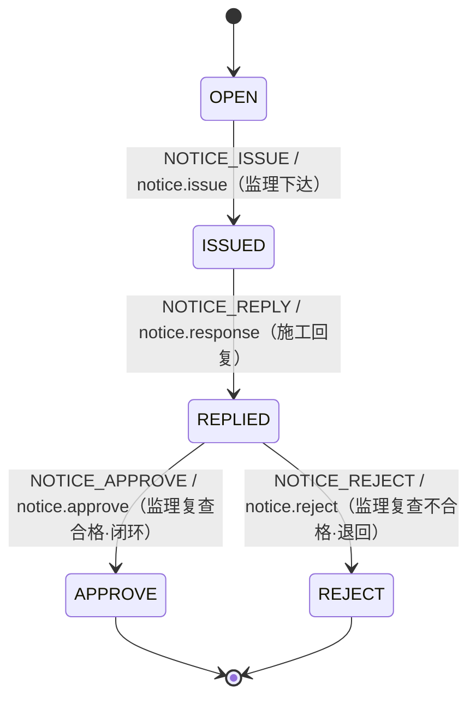
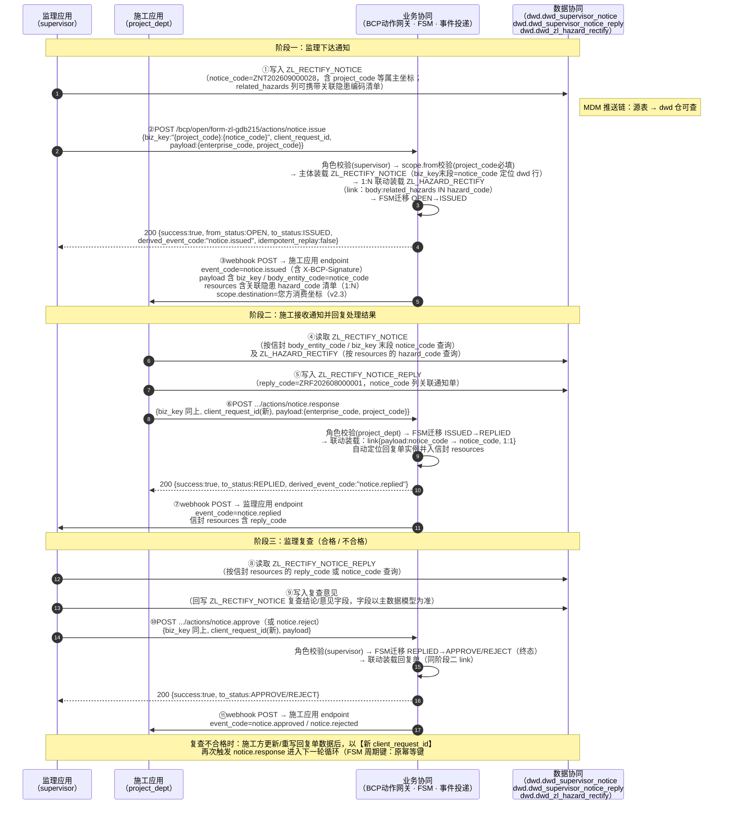

# 29-监理通知单场景 · 三方应用集成操作手册

| 项 | 内容 |
|---|---|
| 场景 | 监理通知单（`form-zl-gdb215`，当前版本 v1，状态 published；来源广东省竣工资料统一用表 2024 版，表号 GD-B-215） |
| 协同类型 | 项目协同（PROJECT），生效范围为 role_scope=PROJECT 的场景角色 |
| 读者 | 第三方应用方（监理单位应用 / 施工项目部应用）集成开发人员 |
| 数据基线 | 2026-09-04 dev 库实证（动作目录 4 条、FSM 模型 v1（clone:form-aq-gdaq30308）、场景角色 2 个、角色授权 12 行、生效订阅 2 条、三张 dwd 表真实编码样例）；⚠ 该场景 dev 环境**尚无触发与投递流水**，§5.3 信封为 v2.3 结构示意（编码样例取 dev 真实数据） |
| 姊妹篇 | 26-安全隐患整改通知场景（**FSM 模型与动作目录同源克隆**，接口契约结构一致）、27-安全隐患整改闭环协同场景、28-质量问题整改闭环协同场景 |

---

## 一、场景与三方角色总览

### 1.1 业务流程一句话

监理单位下达监理通知单（可关联多条质量隐患记录）→ 施工项目部接收并回复处理结果 → 监理单位复查：合格则闭环，不合格则退回重改（可循环），直至复查合格。

### 1.2 三方角色定义

| 角色 | 组成 | 职责 |
|---|---|---|
| **三方应用** | 监理单位应用（supervisor 侧）、施工项目部应用（project_dept 侧） | 写入/读取主数据（监理通知单、监理通知回复单、质量隐患记录）；发起业务动作触发；提供 webhook 接收派生事件 |
| **业务协同** | BCP 开放动作网关（bcp-external `/bcp/open/**`）+ 状态机内核（bcp-fsm）+ 事件订阅投递 | 角色授权校验、payload 载体装载、FSM 状态迁移、派生事件发射与 webhook 回调投递 |
| **数据协同** | 数仓主数据读写面（mdm 实体 ↔ dwd 仓表） | 三张协同表的写入与读取：`dwd.dwd_supervisor_notice`（监理通知单）、`dwd.dwd_supervisor_notice_reply`（监理通知回复单）、`dwd.dwd_zl_hazard_rectify`（质量隐患记录） |

> **关键认知**：三方应用只关心「**何时写哪张表、何时读哪张表、何时调哪个动作**」。事件驱动读写——收到哪个事件，就意味着对应数据已可读取；动作触发前，对应数据必须已写入并可查。平台内部的数据授权机制对三方完全透明，无需对接。

### 1.3 协同角色 × 动作矩阵（库内实证）

| 动作 | 动作码 | 触发角色 | 订阅角色 | 派生事件码 |
|---|---|---|---|---|
| 通知下达 | `notice.issue` | supervisor（监理） | project_dept（施工） | `notice.issued` |
| 通知回复 | `notice.response` | project_dept（施工） | supervisor（监理） | `notice.replied` |
| 审查通过（复查合格） | `notice.approve` | supervisor（监理） | project_dept（施工） | `notice.approved` |
| 审查不通过（复查不合格） | `notice.reject` | supervisor（监理） | project_dept（施工） | `notice.rejected` |

> 角色授权表中另有 `notice.close` / `notice.recheck` 动作授权行及 `notice.closure` / `notice.reinspection` 事件授权行（施工侧订阅已含这两个事件码），但对应动作当前**未上架**（动作目录无此 4 码），不会产生任何事件，以本表 4 个动作为准。

### 1.4 三张协同主数据表（dev 库实证）

| mdm 实体 | 数仓表（dwd） | 编码列 | 真实编码样例（dev） | 业务含义 |
|---|---|---|---|---|
| `ZL_RECTIFY_NOTICE` | `dwd.dwd_supervisor_notice` | `notice_code` | `ZNT202609000028` | 监理通知单（GD-B-215）——监理方写入；`related_hazards` 列可携带关联隐患编码清单 |
| `ZL_RECTIFY_NOTICE_REPLY` | `dwd.dwd_supervisor_notice_reply` | `reply_code` | `ZRF202608000001` | 监理通知回复单——施工方写入，**必须携带 `notice_code` 列关联通知单** |
| `ZL_HAZARD_RECTIFY` | `dwd.dwd_zl_hazard_rectify` | `hazard_code` | `ZLH202609000031` | 质量隐患记录——下达通知时按 `related_hazards` **1:N 联动装载**入事件信封 |

写入路径：三方业务系统落源表 → 经 MDM 推送链入 dwd 仓；读取路径：三方经各自数据接口按编码列查询。

---

## 二、FSM 状态机模型（model_type=doc，model_code=form-aq-gdaq30308 当前 v1，clone 自安全隐患整改通知场景）

### 2.1 状态集

| 状态码 | 名称 | 属性 |
|---|---|---|
| `OPEN` | 开始 | **初始态** |
| `ISSUED` | 进行中 | 中间态 |
| `REPLIED` | 已回复 | 中间态 |
| `APPROVE` | 复查合格 | **终态** |
| `REJECT` | 复查不合格 | **终态** |

### 2.2 迁移边（动作触发即驱动迁移）

| # | event | from → to | 对应动作 | 迁移后 emit |
|---|---|---|---|---|
| T1 | `NOTICE_ISSUE` | OPEN → ISSUED | notice.issue | `{scene}.lifecycle.status.changed` |
| T2 | `NOTICE_REPLY` | ISSUED → REPLIED | notice.response | 同上 |
| T3 | `NOTICE_APPROVE` | REPLIED → APPROVE | notice.approve | 同上 |
| T4 | `NOTICE_REJECT` | REPLIED → REJECT | notice.reject | 同上 |

**注意**：
- 终态不可再迁移；REJECT 退回后需由施工方**重新触发 notice.response** 进入下一轮回复-复查循环（每次循环必须更换新的 `client_request_id`，见 §6.3 幂等周期键）。
- 状态不符的迁移请求一律返回 `BCP-EXT-8029`（409），不会产生任何事件。

### 2.3 状态图



---

## 三、三方时序图（核心）

> 四条生命线：**监理应用**（supervisor 侧）与**施工应用**（project_dept 侧）分侧呈现（同属「三方应用」角色）；**业务协同** = 动作网关 + FSM + 事件订阅投递；**数据协同** = 数仓三张 mdm 表的写入与读取。



---

## 四、触发接口契约（业务协同面）

### 4.1 动作触发

```
POST {网关}/bcp/open/{scene}/actions/{action}
示例：POST /bcp/open/form-zl-gdb215/actions/notice.issue
```

**请求头**

| 头 | 必填 | 说明 |
|---|---|---|
| `Authorization: Bearer <token>` | 是 | 平台签发的应用访问令牌（签发时可携扩展参数 `app_code` 绑定应用身份，详见《02-业务协同（BCP）集成接口文档》签发期应用绑定章节） |
| `X-BCP-App-Code` | 多应用租户必填 | 调用方应用编码（token 未绑定 app_code 时用于消歧；与 token 绑定不一致将明拒 401 `BCP-AUTH-4091`） |
| `Content-Type: application/json` | 是 | |

**请求体**

| 字段 | 类型 | 必填 | 说明 |
|---|---|---|---|
| `biz_key` | string | **是** | 业务对象键，主权归调用方（不重写）。本场景约定 `{project_code}:{notice_code}`，如 `PRJ202608000052:ZNT202609000028`。**末段必须等于通知单编码**——主体载体以末段定位 dwd 行（code_field_name=notice_code） |
| `client_request_id` | string | **是** | 幂等键（≤128 字符，留痕列宽约束；2026-09-04 起，此前 64）。同键同参数重放 → 返回首个结果（`idempotent_replay=true`，零副作用）；**同键不同参数 → 409 `BCP-EXT-8051`**。REJECT 后重走回复必须换新键 |
| `payload` | object | 是 | 业务载荷，至少携带下方两个 scope 字段 |
| `payload.enterprise_code` | string | **是** | 触发方企业编码。⚠ 原 `tenant_id` 已更名为 `enterprise_code`（2026-08-28 变更，直接切换无兼容期） |
| `payload.project_code` | string | **是** | 触发方项目编码（scope.from 必填校验项，如 `PRJ202608000052`） |
| `payload.notice_code` | string | 回复/审查动作**是** | 通知单编码——notice.response / notice.approve / notice.reject 三个动作的回复单联动装载键（link：payload:notice_code → notice_code，1:1）。缺省将无法自动定位回复单实例，信封 `resources` 为空 |
| `scope` | object | 否 | 显式 scope 块（role/enterprise_id/target）；缺省由服务端按令牌身份 + payload 装配 |

**响应体**（HTTP 200，信封 `code=0`）

| 字段 | 说明 |
|---|---|
| `action_code` / `biz_name` | 动作码 / 动作名 |
| `biz_key` | 生效业务键（原文回显） |
| `from_status` / `to_status` | 迁移前后状态（如 `OPEN` → `ISSUED`） |
| `derived_event_code` | 派生事件码（`notice.issued` 等） |
| `success` | 业务成败（守卫拒绝时 false + `reject_reason`） |
| `idempotent_replay` | true=命中幂等重放，未产生新迁移/新事件 |
| `role` | 本次生效的协同角色 |

**样例**（结构示意——该场景 dev 暂无触发流水；编码取 dev 真实数据，notice.response）：

```json
请求: {"biz_key":"PRJ202608000052:ZNT202609000028","client_request_id":"cr-20260904-001",
       "payload":{"enterprise_code":"ENT202608000053","project_code":"PRJ202608000052",
                  "notice_code":"ZNT202609000028"}}
响应: {"action_code":"notice.response","biz_key":"PRJ202608000052:ZNT202609000028",
       "from_status":"ISSUED","to_status":"REPLIED","derived_event_code":"notice.replied",
       "success":true,"idempotent_replay":false,"role":"project_dept"}
```

### 4.2 辅助接口

| 接口 | 用途 |
|---|---|
| `GET /bcp/open/{scene}/catalog` | 目录自描述：本调用方角色视图下可用动作/事件清单 |
| `GET /bcp/open/{scene}/fsm-instance?biz_key={key}&history=true` | 业务对象当前状态与迁移历史（对账主通道；实例不存在返回 BCP-FSM-2004） |
| `GET /bcp/open/assurance/actions/{clientRequestId}` | 按幂等键回查动作执行结局 |
| `GET /bcp/open/assurance/deliveries` | 本应用投递流水自助查询 |
| `GET /bcp/open/assurance/subscriptions` | 本应用生效订阅清单（不输出密钥） |
| `POST /bcp/open/assurance/webhook/test` | 回调端点连通性/验签自测 |
| `POST /bcp/open/assurance/deliveries/{deliveryId}/redeliver` | 失败投递人工重放（仅 failed 状态可重放，否则 409/8049） |

---

## 五、事件接收契约（业务协同面 → 三方应用）

### 5.1 订阅前提

订阅记录由平台侧按角色授权**自动批量生成**，或经平台管理员登记。dev 库实证生效订阅（联调实例，生产以运营下发为准）：

| 订阅方（dev 实例） | 角色 | channel / format | event_codes |
|---|---|---|---|
| 浩云监理通（`APP-20260617-2391`） | supervisor | `callback` / `envelope` | `["notice.replied"]` |
| 中科建华App（`APP-20260616-4975`） | project_dept | `callback` / `envelope` | `["notice.approved","notice.issued","notice.rejected","notice.closure","notice.reinspection"]` |

> 其中 `notice.closure` / `notice.reinspection` 为**已授权但暂无上架动作派生**的事件码（对应 notice.close / notice.recheck 动作未上架），当前不会产生投递；后续动作上架后无需变更订阅。

| 订阅项 | 说明 |
|---|---|
| endpoint | 三方提供的 HTTPS 回调地址 |
| callback_secret | 验签密钥（订阅级，平台签发；不落任何导出包） |

### 5.2 回调请求

```
POST {三方 endpoint}
Content-Type: application/json; charset=UTF-8
X-BCP-Event-Id:    {event_id}
X-BCP-Topic:       form-zl-gdb215.lifecycle.status.changed
X-BCP-Scene:       form-zl-gdb215
X-BCP-Delivery-Id: evt-{subscriptionId}-{eventId}
X-BCP-Timestamp:   {毫秒时间戳}
X-BCP-Signature:   HmacSHA256(secret, timestamp + "." + 原始报文体) 的十六进制小写
```

**验签注意**：签名输入是**线上原始字节**（UTF-8），必须先取原始 body 字节验签再反序列化；禁止先 parse 再序列化（字段序/空白变化会导致验签失败）。密钥优先级：订阅级 callback_secret → 应用级 webhook_secret → 全局默认 → 均空则不携带签名头（联调 logging 端点）。

### 5.3 事件信封（v2.3 格式；结构示意——该场景 dev 暂无投递实证，编码取 dev 真实数据）

> **v2.3 报文要点**：平台技术字段统一归类，`payload` 仅保留业务数据——`instance_id`/`model_type`/`lifecycle_seq`/`lifecycle_instance_no`/`event` 归入根节点 **`fsm` 组**；`project_code`/`enterprise_code`/`owner_project_code` 仅在 **`scope` 根节点**；`scope` 根含 **`destination`**（最终目的地坐标，开箱即用）。

notice.replied（监理侧接收，施工回复事件）：

```json
{
  "event_id": "{uuid}",
  "event_type": "status.changed",
  "event_code": "notice.replied",
  "topic": "form-zl-gdb215.lifecycle.status.changed",
  "trace_id": "",
  "seq": 2,
  "occurred_at": "2026-09-04T10:00:00.000+08:00",
  "scene_code": "form-zl-gdb215",
  "scene_version": "v1",
  "fsm": {
    "instance_id": 0,
    "model_type": "doc",
    "lifecycle_instance_no": 1,
    "lifecycle_seq": 2,
    "event": "NOTICE_REPLY"
  },
  "scope": {
    "version": 2,
    "project_code": "PRJ202608000052",
    "enterprise_code": "ENT202608000053",
    "role": "project_dept",
    "owner_project_code": "PRJ202608000052",
    "destination": { "type": "project", "code": "PRJ202608000052" },
    "target": {
      "gcbm": "{工程编码}",
      "project_type": "BUILDING_ENGINEERING",
      "project_code": ["PRJ202608000052"],
      "enterprise_code": "{订阅方企业编码}"
    }
  },
  "payload": {
    "biz_key": "PRJ202608000052:ZNT202609000028",
    "from_state": "ISSUED",
    "to_state": "REPLIED",
    "body_entity_code": "ZNT202609000028",
    "resources": [
      {"type": "mdm", "code": "ZL_RECTIFY_NOTICE_REPLY", "instances": ["ZRF202608000001"]}
    ]
  }
}
```

notice.issued（施工侧接收，通知下达事件）**额外携带关联隐患清单**（1:N 联动装载，通知单 `related_hazards` 列为空时该资源块不出现在信封中）：

```json
  "payload": {
    "biz_key": "PRJ202608000052:ZNT202609000028",
    "from_state": "OPEN",
    "to_state": "ISSUED",
    "body_entity_code": "ZNT202609000028",
    "resources": [
      {"type": "mdm", "code": "ZL_HAZARD_RECTIFY", "instances": ["ZLH202609000029", "ZLH202609000030"]}
    ]
  }
```

**信封关键字段取用建议**（v2.3 坐标域/数据域分离）：

| 字段 | 用途 |
|---|---|
| `event_code`（根） | **事件分发唯一依据**（notice.issued/replied/approved/rejected）；不要解析 `event_type`（两态）或 `fsm.event`（内部迁移令牌） |
| `scope.destination` | **最终目的地坐标（开箱即用）**：`{type:"project"\|"enterprise", code}`——"您该以哪个空间身份消费本事件"。做业务判断/数据协同查询一律用它，与平台为您登记的数据访问权限严格一致，**不要自行拼装** |
| `scope.owner_project_code` | **触发方属主项目码**："数据由谁生产"。实例归属≠数据属主的场景（如施工方代回复、监理代录）靠它区分 |
| `payload.biz_key` | 业务对象键，回查锚点，关联己方单据 |
| `payload.body_entity_code` | 主体通知单编码（notice_code）——**读 ZL_RECTIFY_NOTICE 的查询键** |
| `payload.resources[]` | **联动装载的载体实例清单**——下达事件带 `ZL_HAZARD_RECTIFY` 的 hazard_code 清单（1:N）；回复/审查事件带 `ZL_RECTIFY_NOTICE_REPLY` 的 reply_code（1:1）。订阅方零二次查询即可定位关联单据（数据回查依据） |
| `scope.target.gcbm/project_type` | 触发侧投送目标预算回执；`scope.target.project_code[]` 为订阅匹配命中的您方授权项目码全集（destination.code 即其首元素） |
| `fsm.*`（根） | 状态机技术坐标（instance_id/lifecycle_seq/event 等），仅迁移事件出现；排障/对账备用，一般无需消费。状态对账走 `fsm-instance` 查询接口，禁止据事件本地推断状态 |

### 5.4 投递语义

- **重试**：失败自动重投，最多 3 次（连接超时 3s / 读超时 5s）；仍失败置 `failed`，可经 `/assurance/deliveries/{id}/redeliver` 人工重放。
- **幂等消费**：三方必须按 `X-BCP-Delivery-Id`（或 event_id）去重——重投会产生重复报文。
- **响应**：2xx 视为成功；非 2xx / 超时计入失败重试。
- **空投递警示**：动作成功但无任何投递 = 订阅未生成或 scope 不匹配（检查订阅记录 event_codes 是否含该派生事件码、TO 规则 gcbm/project_type 是否命中己方项目）。

---

## 六、数据协同面说明（三张表的读写时序与约束）

### 6.1 读写时序总表

| 序 | 操作方 | 操作 | 表 | 时机锚点 |
|---|---|---|---|---|
| ① | 监理应用 | **写** | `dwd.dwd_supervisor_notice` | notice.issue 触发**之前**——主体行必须已入仓可查；如需携带关联隐患，`related_hazards` 列一并写入 |
| ② | 施工应用 | **读** | `dwd.dwd_supervisor_notice` / `dwd.dwd_zl_hazard_rectify` | 收到 notice.issued 事件后，按 `body_entity_code`（notice_code）读通知单、按 `resources` 的 hazard_code 读关联隐患 |
| ③ | 施工应用 | **写** | `dwd.dwd_supervisor_notice_reply` | notice.response 触发**之前**——且必须写 `notice_code` 关联列 |
| ④ | 监理应用 | **读** | `dwd.dwd_supervisor_notice_reply` | 收到 notice.replied 事件后，按信封 `resources` 的 reply_code（或 notice_code）查询 |
| ⑤ | 监理应用 | **写** | `dwd.dwd_supervisor_notice`（复查意见回写） | notice.approve / notice.reject 触发**之前**（字段以主数据模型为准） |

### 6.2 五条铁律

1. **先写库、后触发**：动作触发时业务协同面会即时到 dwd 定位主体行（biz_key 末段 = 编码列值）。行未入仓即触发 → `BCP-EXT-8037`（资源实例不存在）。MDM 推送链存在入仓窗口期，三方写入源系统后须确认 dwd 可查再触发动作。
2. **回复单必带 notice_code（双处一致）**：联动装载依赖 link 关系 `payload:notice_code → notice_code`（1:1）——**回复单数据行**要有 `notice_code` 列、**触发请求 payload** 也要带 `notice_code` 字段。两处缺一 → 自动装载定位不到行，信封 `resources` 为空，监理方将丢失回复单索引。
3. **关联隐患走 related_hazards 列**：通知下达时如需向施工方同步关联质量隐患，在通知单 `related_hazards` 列写入隐患编码清单（与 `dwd.dwd_zl_hazard_rectify.hazard_code` 对应，IN 匹配 1:N 装载）。隐患行未入仓或编码不符 → 该资源块静默缺席，不阻断动作。
4. **读数用信封给的键**：不要扫表——`body_entity_code` 给通知单编码、`resources[].instances` 给回复单/隐患编码，按编码列精确查询即可。
5. **REJECT 循环重写回复单**：复查不合格后，施工方更新（或重写）回复单数据，再以**新 client_request_id** 触发 notice.response；FSM 按周期键（原键#lifecycle_seq）区分循环轮次，同键不会吞掉新一轮。

### 6.3 幂等纪律（触发侧）

| 情形 | 结果 |
|---|---|
| 同 client_request_id + 同参数 | 重放首结果，零副作用（不发新事件） |
| 同 client_request_id + 不同参数 | **409 `BCP-EXT-8051`** 拒绝（载荷指纹不一致） |
| REJECT 后新一轮回复 | 必须更换 client_request_id（FSM 周期键 = 原键#lifecycle_seq，同键不吞新周期） |

---

## 七、常见错误码速查

| 错误码 | HTTP | 含义与处置 |
|---|---|---|
| BCP-AUTH-4091 | 401 | token 绑定应用与 X-BCP-App-Code 声明不一致——换用正确的应用令牌或修正头部 |
| BCP-EXT-8015 | 404 | 动作不存在或未启用——核对动作码（notice.close/recheck 当前未上架） |
| BCP-EXT-8016 | 403 | 角色越权——该应用未开通触发角色（联系平台核对场景角色授权） |
| BCP-EXT-8019 | 401 | 调用方身份缺失——检查 Bearer / X-BCP-App-Code |
| BCP-EXT-8025 | 404 | 场景不存在——scene_code 拼写（本场景 `form-zl-gdb215`） |
| BCP-EXT-8026 | 403 | scope.from 必填未过——payload.project_code 缺失或不属于触发方 |
| BCP-EXT-8029 | 409 | 状态机守卫拒绝——当前状态不允许该动作（先查 fsm-instance 确认状态） |
| BCP-EXT-8035 | 400 | ext overlay 字段越权——payload 覆盖了非白名单键 |
| BCP-EXT-8036 | 400 | 资源未在 payload_refs 声明——resources 声明与配置不符 |
| BCP-EXT-8037 | 404 | 资源实例不存在——**mdm 行未入仓或 biz_key 末段编码错误**（先确认 dwd 可查再重试） |
| BCP-EXT-8042 | 400 | mdm 实体未注册或停用 |
| BCP-EXT-8044 | 500 | 编码列多行命中（数仓唯一性违例，联系平台） |
| BCP-EXT-8049 | 409 | 重放非法——仅 failed 投递可重放 |
| BCP-EXT-8051 | 409 | 幂等键参数指纹不一致——换键重提 |
| BCP-FSM-2004 | 404 | FSM 实例不存在（对账查询时） |

---

## 八、接入 Checklist（按序执行）

1. ☐ 平台开通应用在场景下的协同角色（监理应用→supervisor；施工项目部应用→project_dept），并取得 Bearer 令牌（签发时建议携 `app_code` 绑定）与应用编码；
2. ☐ 提供回调 endpoint，平台生成订阅（确认 event_codes 覆盖 §5.1 清单）并取得 callback_secret；
3. ☐ 实现 webhook 接收：验签（原始字节 HmacSHA256）+ delivery_id 幂等去重 + 2xx 应答；
4. ☐ 联调 `POST /assurance/webhook/test` 验证回调链路；
5. ☐ 数据面演练：监理侧写入 ZL_RECTIFY_NOTICE（需要时含 related_hazards 关联隐患）并确认 dwd 可查 → 施工侧按 notice_code 读取通知单与关联隐患 → 施工侧写入 ZL_RECTIFY_NOTICE_REPLY（含 notice_code 关联列）→ 监理侧按 reply_code 读取并回写复查意见；
6. ☐ 动作面演练：按序触发 notice.issue → notice.response → notice.approve，每步用 `fsm-instance?history=true` 核对状态迁移、用 `/assurance/deliveries` 核对投递、核对事件信封 `resources` 联动装载结果（下达事件的隐患清单、回复/审查事件的回复单编码）；
7. ☐ 异常演练：行未入仓先触发（8037）、重复提交（幂等）、终态再迁移（8029）、断网恢复（failed 重放）、REJECT 后换新幂等键重走回复、payload 漏带 notice_code（resources 空载验证）。

---

*本文档与库内配置（dev 实证 2026-09-04）一致；正式环境接入地址、令牌签发流程以平台运营下发为准。*
