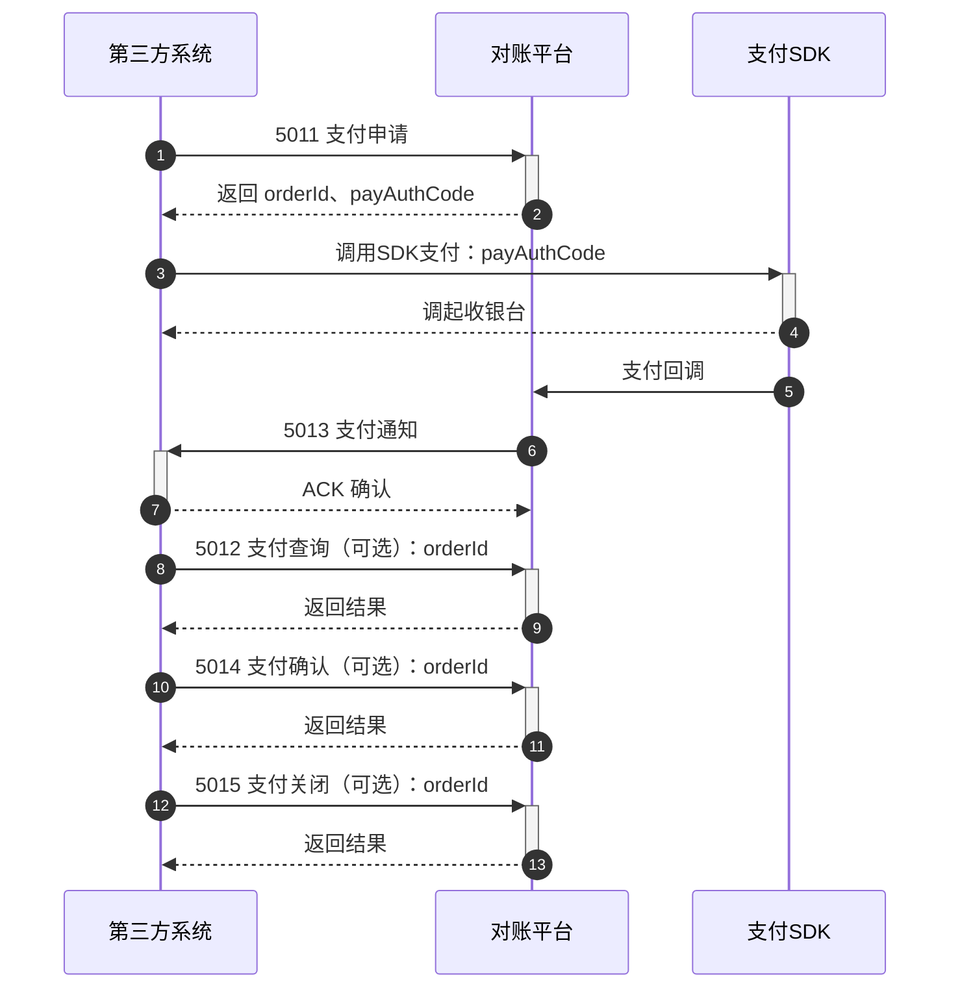
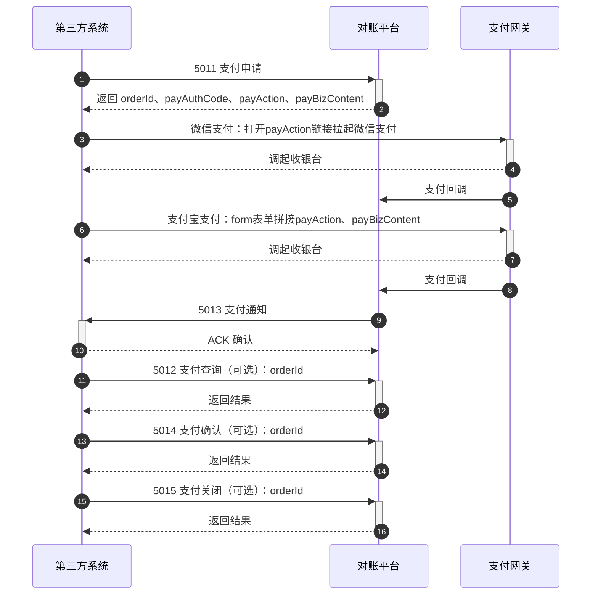
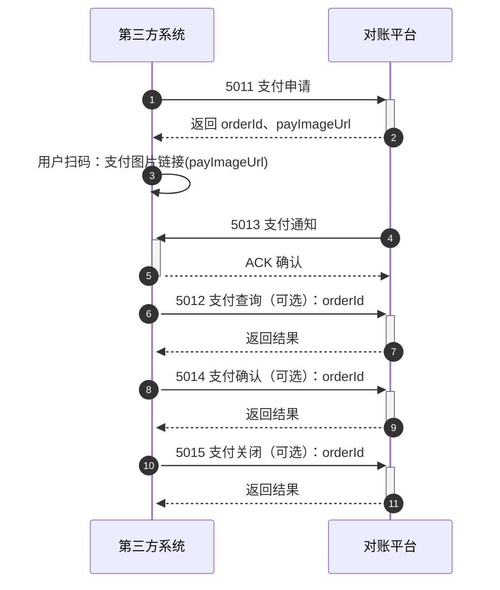
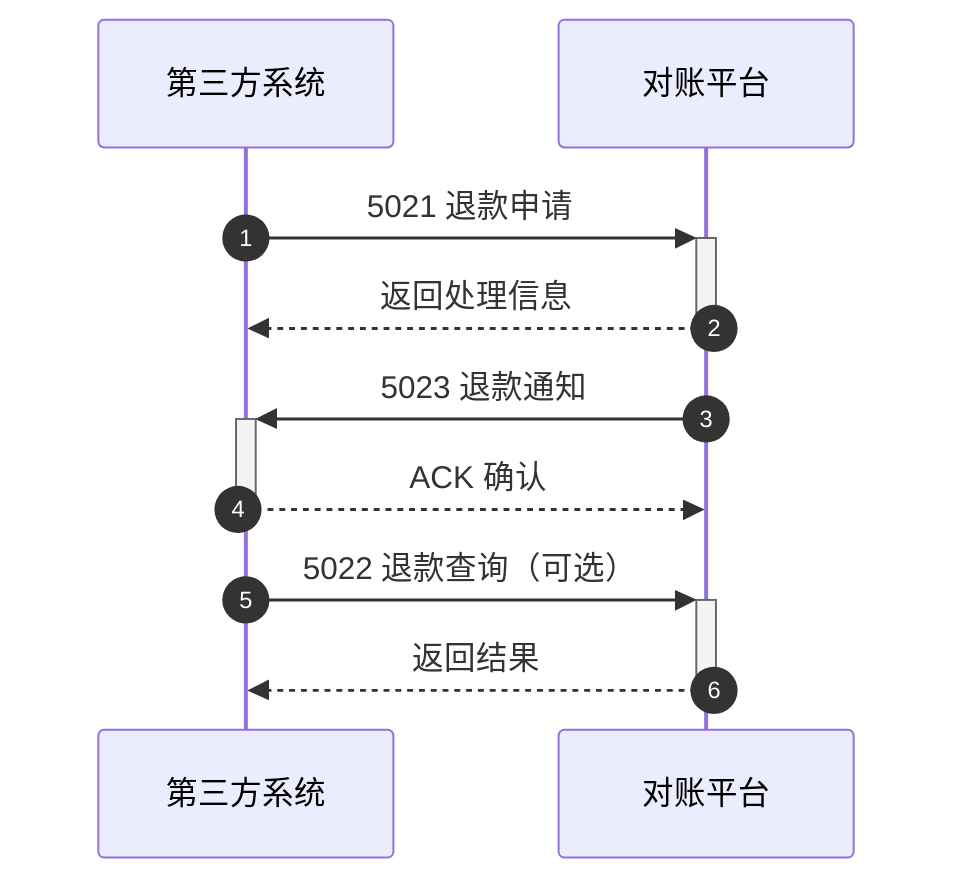
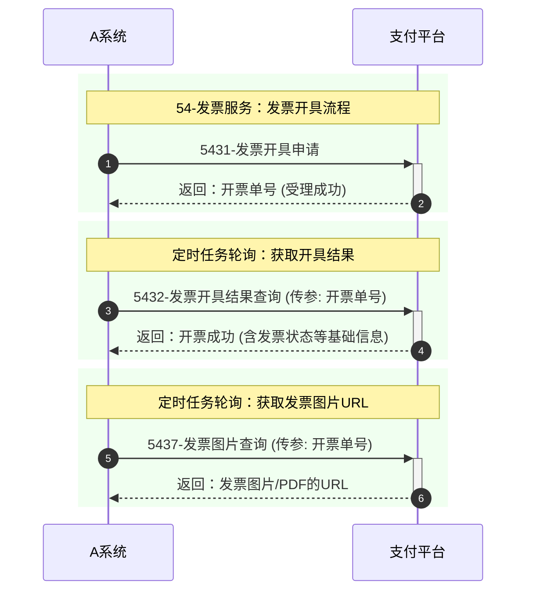
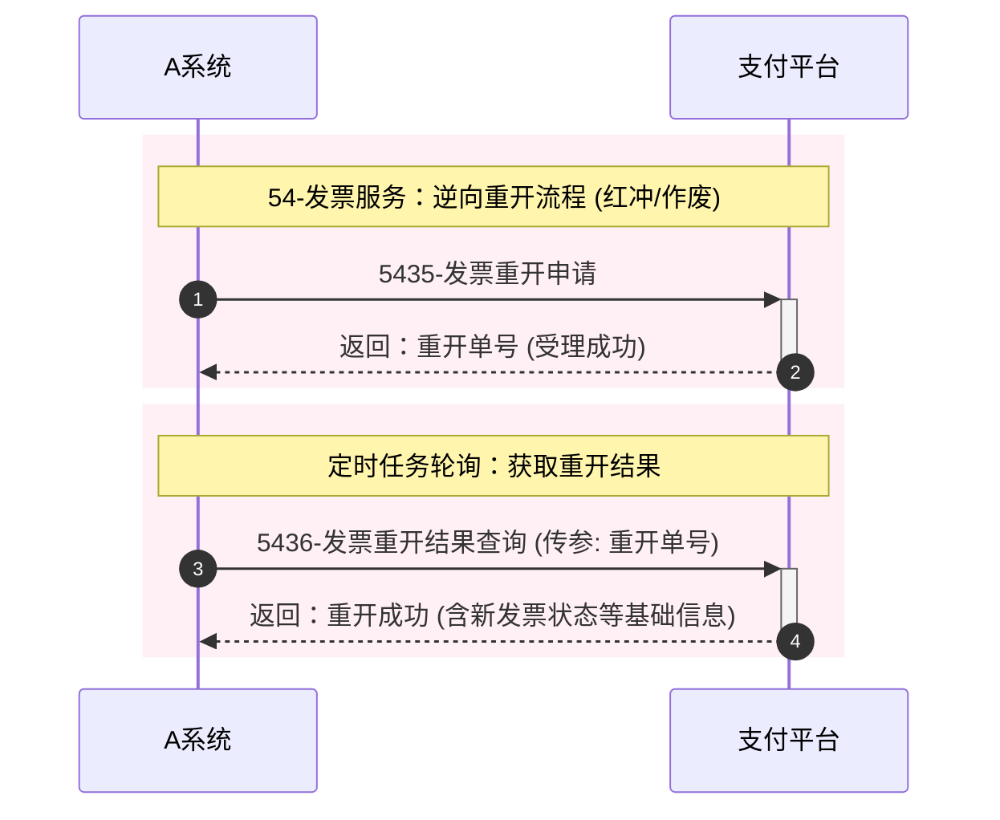

> **面向对象**：对账平台-开放接口文档
> **面向对象**：第三方技术开发人员  
> **版本**：v1.0.1  
> **更新日期**：2026-10


---

[TOC]

---
# 1 接入指南

## 1.1 参数指南

### 1.1.1 认证申请流程
1. **提交应用信息**：向平台提供方提交以下信息
   - **应用简称**：应用的简短名称（用于标识）
   - **应用地址**：应用的访问地址

2. **获取认证凭证**：平台审核通过后，将提供以下认证参数
   - **AppKey**：应用唯一标识  **（公钥，可明文传输）**
   - **AppSecret**：应用密钥  **（私钥，请妥善保管，切勿泄露）**

>  **安全提示**：`AppSecret` 是敏感信息，仅用于认证签名生成，严禁在前端代码或客户端中硬编码和接口交互中传输。

### 1.1.2 接口关键字段说明


|   参数名称   |     参数说明     | 数据类型 |                      数据来源                      |
| ----------- | --------------- | -------- | -------------------------------------------------- |
| appId       | 应用ID（唯一）   | String   | 统一应用平台下发的AppKey                            |
| buyerUserId | 购方用户（唯一） | String   | 第三方系统的当前操用户ID, 使用统一应用平台的UserId。 |

---

## 1.2 API接口认证机制

平台接口均采用 **签名认证机制**，需要在 HTTP 请求头中携带以下认证参数：

### 1.2.1 认证头参数说明

| 参数名称 | 参数说明 | 位置 | 数据类型 | 必填 | 示例值 |
|---------|---------|------|---------|------|--------|
| AppKey | 应用唯一标识（由平台分配） | Header | String | 是 | `121212` |
| AppTimestamp | 请求时间戳（毫秒），用于防重放攻击 | Header | String | 是 | `1733311764881` |
| AppNonce | 请求随机字符串（最长32位），增强安全性 | Header | String | 是 | `87654321` |
| AppSign | 应用签名，用于验证请求合法性 | Header | String | 是 | `A4D490E54173A8CA476F1531F017219A` |

### 1.2.2 签名生成规则

#### 1.2.2.1 签名算法
```
AppSign = MD5(AppKey + ";" + AppTimestamp + ";" + AppNonce + ";" + AppSecret + ";").toUpperCase()
```
#### 1.2.2.2 签名步骤
1. **拼接签名字符串**：按照固定格式拼接参数
```
{AppKey};{AppTimestamp};{AppNonce};{AppSecret};
```
2. **计算 MD5 哈希值**：对拼接后的字符串进行 MD5 加密
3. **转换为大写**：将 MD5 结果转换为大写字母

## 1.3 API接口返回说明

所有开放平台接口均采用统一的响应格式，便于客户端统一处理。

### 1.3.1 响应结构

|  参数名称  |                参数说明                |        类型        | 必填 |      示例值       |
| --------- | -------------------------------------- | ----------------- | ---- | ---------------- |
| success   | 请求是否成功标志                        | boolean           | 是   | `true` / `false` |
| code      | 业务返回代码                            | integer(int32)    | 是   | `200`            |
| msg       | 响应消息（成功时为空，失败时为错误描述） | string            | 是   | `"操作成功"`      |
| data      | 业务数据信息（具体结构见各接口文档）     | object/array/null | 否   | 见下方示例        |
| timestamp | 服务器响应时间戳（毫秒）                | integer(int64)    | 是   | `1733311764881`  |
| costTime  | 接口处理耗时（毫秒）                    | integer(int64)    | 是   | `125`            |

### 1.3.2 响应示例
```
{
   "success": true,
   "code": 0,
   "msg": "",
   "data": null,
   "costTime": 12,
   "timestamp": 1733311764881
}
```
### 1.3.3 注意事项

1. **始终检查 `success` 字段**：表示请求是否成功
2. **时间戳用途**：`timestamp` 可用于客户端与服务器的时间同步校验
3. **耗时监控**：`costTime` 可用于客户端性能监控和超时判断
4. **数据为空**：当 `data` 为 `null` 时，表示该接口无业务数据返回（如删除操作）
5. **错误处理**：当 `success` 为 `false` 时，`msg` 字段包含详细的错误描述，建议展示给用户或记录日志


---

# 2 开放接口API

* 环境说明：

|   环境   |               API地址               |
| -------- | ---------------------------------- |
| 测试环境 | http://183.6.48.123:18080/plat-api |
| 正式环境 | 待定                                |

## 2.1 基础业务API


### 2.1.1 5901-收费项查询


**接口地址**:`/fps/open/base/fee/{appId}`


**请求方式**:`GET`


**请求数据类型**:`application/json`


**响应数据类型**:`application/json`


**接口描述**:


**请求参数**:


| 参数名称 | 参数说明 | 请求类型 | 是否必须 | 数据类型 | schema |
| -------- | -------- | -------- | -------- | -------- | ------ |
| appId    | 应用ID   | path     | true     | string   |        |


**响应状态**:


| 状态码 | 说明 | schema |
| -------- | -------- | ----- | 
|200|OK|ReEntityListOpenFeeItemInfo|


**响应参数**:


| 参数名称 | 参数说明 | 类型 | schema |
| -------- | -------- | ----- |----- | 
|success|成功标志|boolean||
|code|返回代码|integer(int32)|integer(int32)|
|msg|响应消息|string||
|data|业务数据信息|array|OpenFeeItemInfo|
|&emsp;&emsp;feeCd|收费项编码|string||
|&emsp;&emsp;feeName|收费项名称|string||
|timestamp|时间戳|integer(int64)|integer(int64)|
|costTime|消耗时间|integer(int64)|integer(int64)|


**响应示例**:
```javascript
{
  "success": true,
  "code": 0,
  "msg": "",
  "data": [
    {
      "feeCd": "",
      "feeName": ""
    }
  ],
  "timestamp": 0,
  "costTime": 0
}
```

---

## 2.2支付服务API

### 2.2.1 流程说明

#### 2.2.1.1 通知机制

- **异步通知**：平台通过 `noticeUrl` 主动推送支付/退款结果（**推荐优先使用**）
- **主动查询**：商户通过 查询接口轮询查询（**作为兜底方案**）
- **通知重试**：若商户未返回 ACK，平台会按指数退避策略重试（最多 5 次）

---


#### 2.2.1.2 支付流程

##### 2.2.1.2.1 APP端

|        步骤        |                           说明                            |                                                                                     关键字段                                                                                      |
| ----------------- | --------------------------------------------------------- | --------------------------------------------------------------------------------------------------------------------------------------------------------------------------------- |
| **1. 支付申请**   | 5011 接口发起支付<br>第三方系统调用                         | `payWay`（支付方式）= `8010`:微信, `8020`:支付宝<br/>`appId`（应用ID）<br/>`feeItemCd`（收费项）<br/>`bizOrderNo`（业务单号）<br/>`payAmount`（支付金额）<br/>`noticeUrl`（通知地址） |
| **2. 获取授权码** | 支付申请返回 `payAuthCode`，用于 SDK 调起支付               | `orderId` (平台支付单号)<br/>`payAuthCode`（支付授权码）                                                                                                                            |
| **3. SDK支付**    | 调用 `CPCNPay.zhifubaoPay()` 调起收银台                    | 用户完成支付操作，`payAuthCode`（支付授权码）                                                                                                                                       |
| **4. 结果获取**   | 平台异步通知: 5013 支付通知 <br>商户主动查询: 5012 支付查询 | `orderId`平台支付单号<br/>`payStatus`（支付状态）                                                                                                                                  |
| **5. 支付关闭**   | 5015 支付关闭 <br>可选操作，关闭未支付订单                  | 仅支付状态`payStatus`为"未支付"时可关闭, `orderId` (平台支付单号)                                                                                                                    |
| **6. 支付确认**   | 5014 支付确认 <br>可选操作，确认已支付订单                  | 仅支付状态`payStatus`为"已支付"时可确认, `orderId` (平台支付单号) <br/>退款状态`refundStatus`更新为"已过退款期"<br/>系统根据订单的交易过期时间`expireTime`进行自动确认。                 |

 * **支付时序图**



---


##### 2.2.1.2.2 H5端

|        步骤         |                                                       说明                                                       |                                                                                                 关键字段                                                                                                  |
| --------------------- | ---------------------------------------------------------------------------------------------------------------- | --------------------------------------------------------------------------------------------------------------------------------------------------------------------------------------------------------- |
| **1. 支付申请**      | 5011 接口发起支付<br>第三方系统调用                                                                             | `payWay`（支付方式）= `8011`:微信-H5, `8021`:支付宝-H5<br/>`appId`（应用ID）<br/>`feeItemCd`（收费项）<br/>`bizOrderNo`（业务单号）<br/>`payAmount`（支付金额）<br/>`noticeUrl`（通知地址） |
| **2. 获取支付信息** | 支付申请返回 `payAction`、`payBizContent`，调起支付                                                           | `orderId` (平台支付单号)<br/>`payAuthCode`（支付授权码）<br>`payAction`（支付链接）<br>`payBizContent`（支付业务内容）                                                                            |
| **3. 微信支付**      | 如果支付方式payWay=`8011`(微信-H5)，直接通过`payAction`打开链接拉起微信支付；                                 | 用户完成支付操作，`payAction`（支付链接）                                                                                                                                                                |
| **3. 支付宝支付**    | 如果支付方式payWay=`8021`(支付宝-H5)，直接通过`payAction`、`payBizContent`进行form表单拼接拉起支付宝支付； | 用户完成支付操作，`payAction`（支付链接）<br>`payBizContent`（支付业务内容）                                                                                                                           |
| **4. 结果获取**      | 平台异步通知: 5013 支付通知 <br>商户主动查询: 5012 支付查询                                              | `orderId`平台支付单号<br/>`payStatus`（支付状态）                                                                                                                                                      |
| **5. 支付关闭**      | 5015 支付关闭 <br>可选操作，关闭未支付订单                                                                      | 仅支付状态`payStatus`为"未支付"时可关闭, `orderId` (平台支付单号)                                                                                                                                      |
| **6. 支付确认**      | 5014 支付确认 <br>可选操作，确认已支付订单                                                                      | 仅支付状态`payStatus`为"已支付"时可确认, `orderId` (平台支付单号) <br/>退款状态`refundStatus`更新为"已过退款期"<br/>系统根据订单的交易过期时间`expireTime`进行自动确认。                       |

 * ⚠️ `测试环境是模拟的，不能真实拉起支付宝、微信`

 * **支付时序图**




 * **微信支付样例**
```js
// url: `payAction` : 支付链接
windows.open('https://cpcntest-goy9p-1300098148.tcloudbaseapp.com?prepay_id=aW5zdGl0dXRpb25JZD0wMTA1NDkmc291cmNlVHhUeXBlPTUwMTEmdHhzbj0yMDI2MTAwODE4MjgyMzIyMDAwMDAwMDQwOTYmcGx1Z2luRmxhZz0xMCZyZXNvdXJjZUFwcElEPXd4ZjZlODVmMGI0MTAxNGNkYSZyZXNvdXJjZUVudj1jcGNudGVzdC1nb3k5cA==') 
```

 * **支付宝支付样例**
```js
// action: `payAction` : 支付链接
// biz_content: `payBizContent` : 支付业务内容
<form name="punchout_form" method="post"
	action="https://openapi.alipay.com/gateway.do?app_id=2019101768436470&charset=UTF-8&format=JSON&method=alipay.trade.wap.pay&notify_url=https%3A%2F%2Fdevtest.cpcn.com.cn%2Fbmr3%2Fbank881_scanCode_background&return_url=http%3A%2F%2F192.168.140.87%3A8080%2FdreamView%2FpaySuccess.jsp&sign=KWt%2FtixjCBKsWm%2FpcfW7TblknauqsLyCxz%2B9dYsu%2F8wG748EpSPokwnUL66CvaeNx9%2BkThdHPbkrgCCY%2B1n5tVU%2BcioPaXhwFvNPqx2ywlZ0iJWZQaC2ptqvkdE%2F6ekfAD2T6OW%2FT9BZY0O9l%2Fr2OeRIS9kYjxLUVDH9MICZlsiBB%2Fs9xoNH%2BugrK9GEXVJbe4ntH24FqzisRcr7nqToRvlHMFeyIIFLaOH6AcPAD5bhohzN7nVVcunTvf5aXCdJ5jI%2F8BifB6BGFH8F106Yom9rHR5vlkf7aAsfJooJx5YS3xlrJVFYZ5ewUs83MMWZR90s0bANLYjIqbdob%2FutvA%3D%3D&sign_type=RSA2&timestamp=2019-11-06+14%3A26%3A46&version=1.0">
	<input type="hidden" name="biz_content" value="{&quot;body&quot;:&quot;购买测试商品0.01元&quot;,&quot;disable_pay_channels&quot;:&quot;credit_group&quot;,&quot;out_trade_no&quot;:&quot;201911061426469146904686375&quot;,&quot;product_code&quot;:&quot;QUICK_WAP_WAY&quot;,&quot;store_id&quot;:&quot;store001&quot;,&quot;subject&quot;:&quot;手机2019101768436470&quot;,&quot;time_expire&quot;:&quot;2019-11-06 17:26&quot;,&quot;timeout_express&quot;:&quot;180m&quot;,&quot;total_amount&quot;:&quot;0.02&quot;}">
<input type="submit" value="立即支付" style="width: 180px; height: 100px; text-align: center; font-size: 30px;">
</form> 
```
---

##### 2.2.1.2.3 PC端

|          步骤          |                           说明                            |                                                                                     关键字段                                                                                      |
| --------------------- | --------------------------------------------------------- | --------------------------------------------------------------------------------------------------------------------------------------------------------------------------------- |
| **1. 支付申请**       | 5011 接口发起支付<br>第三方系统调用                         | `payWay`（支付方式）= `4210`:微信, `4220`:支付宝<br/>`appId`（应用ID）<br/>`feeItemCd`（收费项）<br/>`bizOrderNo`（业务单号）<br/>`payAmount`（支付金额）<br/>`noticeUrl`（通知地址） |
| **2. 获取支付二维码** | 平台返回 `payImageUrl`，用于打开扫码支付                    | `orderId` (平台支付单号)<br/>`payUrl`（二维码，用于生成二维码图片）<br/>`payImageUrl`（二维码图片URL，可用于直接打开）                                                                 |
| **3. 扫码支付**       | 用户打开支付图片链接，完成支付操作。                        | `payImageUrl` (支付图片链接)                                                                                                                                                      |
| **4. 结果获取**       | 平台异步通知: 5013 支付通知 <br>商户主动查询: 5012 支付查询 | `orderId`平台支付单号<br/>`payStatus`（支付状态）                                                                                                                                  |
| **5. 支付关闭**       | 5015 支付关闭 <br>可选操作，关闭未支付订单                  | 仅支付状态`payStatus`为"未支付"时可关闭, `orderId` (平台支付单号)                                                                                                                    |
| **6. 支付确认**       | 5014 支付确认 <br>可选操作，确认已支付订单                  | 仅支付状态`payStatus`为"已支付"时可确认, `orderId` (平台支付单号) <br/>退款状态`refundStatus`更新为"已过退款期"<br/>系统根据订单的交易过期时间`expireTime`进行自动确认。                 |

 * **支付时序图**



---


#### 2.2.1.3 退款流程

|       步骤       |             说明              |                                  关键字段                                  |
| --------------- | ----------------------------- | -------------------------------------------------------------------------- |
| **1. 退款申请** | 对已支付成功的订单发起退款     | `orderId` (平台支付单号)<br/>`refundWay`退款方式<br/>`noticeUrl`（通知地址） |
| **2. 退款处理** | 平台处理退款请求，返回受理结果 | `refundStatus`（退款状态）                                                  |
| **3. 结果获取** | 平台异步通知 + 商户主动查询    | `refundStatus`（退款状态）                                                  |



### 2.2.2 业务接口

#### 2.2.2.1 5011-支付申请


**接口地址**:`/fps/open/pay/order/apply`


**请求方式**:`POST`


**请求数据类型**:`application/json`


**响应数据类型**:`application/json`


**接口描述**:


**请求示例**:

```javascript
{
  "appId": "",
  "bizOrderNo": "",
  "buyerUserId": "",
  "feeItemCd": "",
  "payAmount": 0,
  "payWay": "",
  "refundDeadLine": "",
  "noticeUrl": ""
}
```


**请求参数**:


|          参数名称           |                                                                 参数说明                                                                 | 请求类型 | 是否必须 |       数据类型        |
| -------------------------- | ---------------------------------------------------------------------------------------------------------------------------------------- | -------- | -------- | -------------------- |
| openPayOrderApplyReq       | 订单申请请求参数                                                                                                                         | body     | true     | OpenPayOrderApplyReq |
| &emsp;&emsp;appId          | 应用ID                                                                                                                                   |          | true     | string               |
| &emsp;&emsp;bizOrderNo     | 业务单号                                                                                                                                 |          | true     | string               |
| &emsp;&emsp;buyerUserId    | 购买人ID                                                                                                                                 |          | true     | string               |
| &emsp;&emsp;feeItemCd      | 收费项编码                                                                                                                               |          | true     | string               |
| &emsp;&emsp;payAmount      | 支付金额(#.##元)                                                                                                                         |          | true     | number               |
| &emsp;&emsp;payWay         | 支付方式：<br>4210:条码微信<br>4220:条码支付宝<br>8010:跳转微信APP<br>8020:跳转支付宝APP<br>8011:跳转微信H5<br>8021:跳转支付宝H5 |          | true     | string               |
| &emsp;&emsp;refundDeadLine | 退款截止时间(yyyyMMdd)                                                                                                                  |          | false    | string               |
| &emsp;&emsp;noticeUrl      | 后台通知地址                                                                                                                             |          | false    | string               |


**响应状态**:


| 状态码 | 说明 | schema |
| -------- | -------- | ----- | 
|200|OK|ReEntityOpenPayOrderInfo|


**响应参数**:


|          参数名称           |                                   参数说明                                   |        类型        |      schema      |
| -------------------------- | ---------------------------------------------------------------------------- | ---------------- | ---------------- |
| success                    | 成功标志                                                                     | boolean          |                  |
| code                       | 返回代码                                                                     | integer(int32)   | integer(int32)   |
| msg                        | 响应消息                                                                     | string           |                  |
| data                       | 业务数据信息                                                                 | OpenPayOrderInfo | OpenPayOrderInfo |
| &emsp;&emsp;appId          | 应用ID                                                                       | string           |                  |
| &emsp;&emsp;bizOrderNo     | 业务单号                                                                     | string           |                  |
| &emsp;&emsp;buyerUserId    | 购买人ID                                                                     | string           |                  |
| &emsp;&emsp;feeItemCd      | 收费项编码                                                                   | string           |                  |
| &emsp;&emsp;payAmount      | 支付金额(#.##元)                                                            | number           |                  |
| &emsp;&emsp;payWay         | 支付方式(4210:条码微信, 4220:条码支付宝, 8010:跳转微信, 8020:跳转支付宝) | string           |                  |
| &emsp;&emsp;refundDeadLine | 退款截止时间(yyyyMMdd)                                                      | string           |                  |
| &emsp;&emsp;noticeUrl      | 后台通知地址                                                                 | string           |                  |
| &emsp;&emsp;orderId        | 平台支付单号                                                                 | string           |                  |
| &emsp;&emsp;payStatus      | 支付状态(0-待支付,1-支付中,2-已支付,3-失败,4-关闭)                         | integer(int32)   |                  |
| &emsp;&emsp;payTime        | 支付时间                                                                     | string           |                  |
| &emsp;&emsp;payAuthCode    | 支付授权码，用于跳转支付(微信/支付宝)                                        | string           |                  |
| &emsp;&emsp;payAction       | 支付链接，用于跳转支付-H5                                                    | string           |                  |
| &emsp;&emsp;payBizContent   | 支付业务内容，用于跳转支付-H5-支付宝                                        | string           |                  |
| &emsp;&emsp;payUrl         | 支付URL/支付二维码，可用于生成二维码图片                                    | string           |                  |
| &emsp;&emsp;payImageUrl    | 支付图片链接                                                                 | string           |                  |
| &emsp;&emsp;expireTime     | 交易过期时间(yyyyMMddHHmmssSSS)                                            | string           |                  |
| &emsp;&emsp;refundStatus   | 退款状态(0-未退款, 1-退款中, 2-退款失败, 3-已退款, 4-已过期限)           | integer(int32)   |                  |
| timestamp                  | 时间戳                                                                       | integer(int64)   | integer(int64)   |
| costTime                   | 消耗时间                                                                     | integer(int64)   | integer(int64)   |


**响应示例**:
```javascript
{
  "success": true,
  "code": 0,
  "msg": "",
  "data": {
    "appId": "",
    "bizOrderNo": "",
    "buyerUserId": "",
    "feeItemCd": "",
    "payAmount": 0,
    "payWay": "",
    "refundDeadLine": "",
    "noticeUrl": "",
    "orderId": "",
    "payStatus": 0,
    "payTime": "",
    "payAuthCode": "",
    "payUrl": "",
    "payImageUrl": "",
    "expireTime": "",
    "refundStatus": 0
  },
  "timestamp": 0,
  "costTime": 0
}
```

---


#### 2.2.2.2 5012-支付查询


**接口地址**:`/fps/open/pay/order/query`


**请求方式**:`POST`


**请求数据类型**:`application/json`


**响应数据类型**:`application/json`


**接口描述**:


**请求示例**:


```javascript
{
  "orderId": ""
}
```


**请求参数**:


|       参数名称       |    参数说明    | 请求类型 | 是否必须 |     数据类型     |     schema      |
| ------------------- | -------------- | -------- | -------- | --------------- | --------------- |
| openPayOrderReq     | 支付单请求参数 | body     | true     | OpenPayOrderReq | OpenPayOrderReq |
| &emsp;&emsp;orderId | 支付单号       |          | true     | string          |                 |


**响应状态**:


| 状态码 | 说明 | schema |
| -------- | -------- | ----- | 
|200|OK|ReEntityOpenPayOrderInfo|


**响应参数**:


|          参数名称           |                                参数说明                                |       类型        |      schema      |
| -------------------------- | ---------------------------------------------------------------------- | ---------------- | ---------------- |
| success                    | 成功标志                                                               | boolean          |                  |
| code                       | 返回代码                                                               | integer(int32)   | integer(int32)   |
| msg                        | 响应消息                                                               | string           |                  |
| data                       | 业务数据信息                                                           | OpenPayOrderInfo | OpenPayOrderInfo |
| &emsp;&emsp;appId          | 应用ID                                                                 | string           |                  |
| &emsp;&emsp;bizOrderNo     | 业务单号                                                               | string           |                  |
| &emsp;&emsp;buyerUserId    | 购买人ID                                                               | string           |                  |
| &emsp;&emsp;feeItemCd      | 收费项编码                                                             | string           |                  |
| &emsp;&emsp;payAmount      | 支付金额(#.##元)                                                       | number           |                  |
| &emsp;&emsp;payWay         | 支付方式(4210:条码微信, 4220:条码支付宝, 8010:跳转微信, 8020:跳转支付宝) | string           |                  |
| &emsp;&emsp;refundDeadLine | 退款截止时间(yyyyMMdd)                                                 | string           |                  |
| &emsp;&emsp;noticeUrl      | 后台通知地址                                                           | string           |                  |
| &emsp;&emsp;orderId        | 平台支付单号                                                           | string           |                  |
| &emsp;&emsp;payStatus      | 支付状态(0-待支付,1-支付中,2-已支付,3-失败,4-关闭)                       | integer(int32)   |                  |
| &emsp;&emsp;payTime        | 支付时间                                                               | string           |                  |
| &emsp;&emsp;payAuthCode    | 支付授权码，用于跳转支付(微信/支付宝)                                    | string           |                  |
| &emsp;&emsp;payUrl         | 支付URL/支付二维码，可用于生成二维码图片                                 | string           |                  |
| &emsp;&emsp;payImageUrl    | 支付图片链接                                                           | string           |                  |
| &emsp;&emsp;expireTime     | 交易过期时间(yyyyMMddHHmmssSSS)                                        | string           |                  |
| &emsp;&emsp;refundStatus   | 退款状态(0-未退款, 1-退款中, 2-退款失败, 3-已退款, 4-已过期限)           | integer(int32)   |                  |
| timestamp                  | 时间戳                                                                 | integer(int64)   | integer(int64)   |
| costTime                   | 消耗时间                                                               | integer(int64)   | integer(int64)   |


**响应示例**:
```javascript
{
  "success": true,
  "code": 0,
  "msg": "",
  "data": {
    "appId": "",
    "bizOrderNo": "",
    "buyerUserId": "",
    "feeItemCd": "",
    "payAmount": 0,
    "payWay": "",
    "refundDeadLine": "",
    "noticeUrl": "",
    "orderId": "",
    "payStatus": 0,
    "payTime": "",
    "payAuthCode": "",
    "payUrl": "",
    "payImageUrl": "",
    "expireTime": "",
    "refundStatus": 0
  },
  "timestamp": 0,
  "costTime": 0
}
```

---


#### 2.2.2.3 5013-支付通知


**接口地址**:`/fps/open/pay/order/notice`


**请求方式**:`POST`


**请求数据类型**:`application/json`


**响应数据类型**:`application/json`


**接口描述**:<p>由应用方实现，用于支付申请后回调通知结果；可通过**签名认证机制**认证。</p>


**请求示例**:
```javascript
{
  "appId": "",
  "bizOrderNo": "",
  "buyerUserId": "",
  "feeItemCd": "",
  "payAmount": 0,
  "payWay": "",
  "refundDeadLine": "",
  "noticeUrl": "",
  "orderId": "",
  "payStatus": 0,
  "payTime": "",
  "payAuthCode": "",
  "payUrl": "",
  "payImageUrl": "",
  "expireTime": "",
  "refundStatus": 0,
}
```


**请求参数**:


|          参数名称           |                                参数说明                                | 请求类型 | 是否必须 |     数据类型      |      schema      |
| -------------------------- | ---------------------------------------------------------------------- | -------- | -------- | ---------------- | ---------------- |
| openPayOrderInfo           | OpenPayOrderInfo                                                       | body     | true     | OpenPayOrderInfo | OpenPayOrderInfo |
| &emsp;&emsp;appId          | 应用ID                                                                 |          | true     | string           |                  |
| &emsp;&emsp;bizOrderNo     | 业务单号                                                               |          | true     | string           |                  |
| &emsp;&emsp;buyerUserId    | 购买人ID                                                               |          | true     | string           |                  |
| &emsp;&emsp;feeItemCd      | 收费项编码                                                             |          | true     | string           |                  |
| &emsp;&emsp;payAmount      | 支付金额(#.##元)                                                       |          | true     | number           |                  |
| &emsp;&emsp;payWay         | 支付方式(4210:条码微信, 4220:条码支付宝, 8010:跳转微信, 8020:跳转支付宝) |          | true     | string           |                  |
| &emsp;&emsp;refundDeadLine | 退款截止时间(yyyyMMdd)                                                 |          | false    | string           |                  |
| &emsp;&emsp;noticeUrl      | 后台通知地址                                                           |          | false    | string           |                  |
| &emsp;&emsp;orderId        | 平台支付单号                                                           |          | false    | string           |                  |
| &emsp;&emsp;payStatus      | 支付状态(0-待支付,1-支付中,2-已支付,3-失败,4-关闭)                       |          | false    | integer(int32)   |                  |
| &emsp;&emsp;payTime        | 支付时间                                                               |          | false    | string           |                  |
| &emsp;&emsp;payAuthCode    | 支付授权码，用于跳转支付(微信/支付宝)                                    |          | false    | string           |                  |
| &emsp;&emsp;payUrl         | 支付URL/支付二维码，可用于生成二维码图片                                 |          | false    | string           |                  |
| &emsp;&emsp;payImageUrl    | 支付图片链接                                                           |          | false    | string           |                  |
| &emsp;&emsp;expireTime     | 交易过期时间(yyyyMMddHHmmssSSS)                                        |          | false    | string           |                  |
| &emsp;&emsp;refundStatus   | 退款状态(0-未退款, 1-退款中, 2-退款失败, 3-已退款, 4-已过期限)           |          | false    |                  | integer(int32)   |


**响应状态**:


| 状态码 | 说明 | schema |
| -------- | -------- | ----- | 
|200|OK|ReEntityVoid|


**响应参数**:


| 参数名称 | 参数说明 | 类型 | schema |
| -------- | -------- | ----- |----- | 
|success|成功标志|boolean||
|code|返回代码|integer(int32)|integer(int32)|
|msg|响应消息|string||
|data|业务数据信息|string||
|timestamp|时间戳|integer(int64)|integer(int64)|
|costTime|消耗时间|integer(int64)|integer(int64)|


**响应示例**:
```javascript
{
  "success": true,
  "code": 0,
  "msg": "",
  "data": {},
  "timestamp": 0,
  "costTime": 0
}
```

---


#### 2.2.2.4 5014-支付确认


**接口地址**:`/fps/open/pay/order/confirm`


**请求方式**:`POST`


**请求数据类型**:`application/json`


**响应数据类型**:`application/json`


**接口描述**:  对已支付的订单进行最终确认，订单进入可结算状态；如果不进行确认，则系统根据订单的交易过期时间(expireTime)进行自动确认。

**请求示例**:


```javascript
{
  "orderId": ""
}
```


**请求参数**:


|       参数名称       |    参数说明    | 请求类型 | 是否必须 |     数据类型     |     schema      |
| ------------------- | -------------- | -------- | -------- | --------------- | --------------- |
| openPayOrderReq     | 支付单请求参数 | body     | true     | OpenPayOrderReq | OpenPayOrderReq |
| &emsp;&emsp;orderId | 支付单号       |          | true     | string          |                 |


**响应状态**:


| 状态码 | 说明 | schema |
| -------- | -------- | ----- | 
|200|OK|ReEntityOpenPayOrderInfo|


**响应参数**:


|          参数名称           |                                参数说明                                |       类型        |      schema      |
| -------------------------- | ---------------------------------------------------------------------- | ---------------- | ---------------- |
| success                    | 成功标志                                                               | boolean          |                  |
| code                       | 返回代码                                                               | integer(int32)   | integer(int32)   |
| msg                        | 响应消息                                                               | string           |                  |
| data                       | 业务数据信息                                                           | OpenPayOrderInfo | OpenPayOrderInfo |
| &emsp;&emsp;appId          | 应用ID                                                                 | string           |                  |
| &emsp;&emsp;bizOrderNo     | 业务单号                                                               | string           |                  |
| &emsp;&emsp;buyerUserId    | 购买人ID                                                               | string           |                  |
| &emsp;&emsp;feeItemCd      | 收费项编码                                                             | string           |                  |
| &emsp;&emsp;payAmount      | 支付金额(#.##元)                                                       | number           |                  |
| &emsp;&emsp;payWay         | 支付方式(4210:条码微信, 4220:条码支付宝, 8010:跳转微信, 8020:跳转支付宝) | string           |                  |
| &emsp;&emsp;refundDeadLine | 退款截止时间(yyyyMMdd)                                                 | string           |                  |
| &emsp;&emsp;noticeUrl      | 后台通知地址                                                           | string           |                  |
| &emsp;&emsp;orderId        | 平台支付单号                                                           | string           |                  |
| &emsp;&emsp;payStatus      | 支付状态(0-待支付,1-支付中,2-已支付,3-失败,4-关闭)                       | integer(int32)   |                  |
| &emsp;&emsp;payTime        | 支付时间                                                               | string           |                  |
| &emsp;&emsp;payAuthCode    | 支付授权码，用于跳转支付(微信/支付宝)                                    | string           |                  |
| &emsp;&emsp;payUrl         | 支付URL/支付二维码，可用于生成二维码图片                                 | string           |                  |
| &emsp;&emsp;payImageUrl    | 支付图片链接                                                           | string           |                  |
| &emsp;&emsp;expireTime     | 交易过期时间(yyyyMMddHHmmssSSS)                                        | string           |                  |
| &emsp;&emsp;refundStatus   | 退款状态(0-未退款, 1-退款中, 2-退款失败, 3-已退款, 4-已过期限)           | integer(int32)   |                  |
| timestamp                  | 时间戳                                                                 | integer(int64)   | integer(int64)   |
| costTime                   | 消耗时间                                                               | integer(int64)   | integer(int64)   |


**响应示例**:
```javascript
{
  "success": true,
  "code": 0,
  "msg": "",
  "data": {
    "appId": "",
    "bizOrderNo": "",
    "buyerUserId": "",
    "feeItemCd": "",
    "payAmount": 0,
    "payWay": "",
    "refundDeadLine": "",
    "noticeUrl": "",
    "orderId": "",
    "payStatus": 0,
    "payTime": "",
    "payAuthCode": "",
    "payUrl": "",
    "payImageUrl": "",
    "expireTime": "",
    "refundStatus": 0
  },
  "timestamp": 0,
  "costTime": 0
}
```

---


#### 2.2.2.5 5015-支付关闭


**接口地址**:`/fps/open/pay/order/close`


**请求方式**:`POST`


**请求数据类型**:`application/json`


**响应数据类型**:`application/json`


**接口描述**:   对未支付成功的订单进行关闭操作。


**请求示例**:


```javascript
{
  "orderId": ""
}
```


**请求参数**:


|       参数名称       |    参数说明    | 请求类型 | 是否必须 |     数据类型     |     schema      |
| ------------------- | -------------- | -------- | -------- | --------------- | --------------- |
| openPayOrderReq     | 支付单请求参数 | body     | true     | OpenPayOrderReq | OpenPayOrderReq |
| &emsp;&emsp;orderId | 支付单号       |          | true     | string          |                 |


**响应状态**:


| 状态码 | 说明 | schema |
| -------- | -------- | ----- | 
|200|OK|ReEntityOpenPayOrderInfo|


**响应参数**:


|          参数名称           |                                参数说明                                |       类型        |      schema      |
| -------------------------- | ---------------------------------------------------------------------- | ---------------- | ---------------- |
| success                    | 成功标志                                                               | boolean          |                  |
| code                       | 返回代码                                                               | integer(int32)   | integer(int32)   |
| msg                        | 响应消息                                                               | string           |                  |
| data                       | 业务数据信息                                                           | OpenPayOrderInfo | OpenPayOrderInfo |
| &emsp;&emsp;appId          | 应用ID                                                                 | string           |                  |
| &emsp;&emsp;bizOrderNo     | 业务单号                                                               | string           |                  |
| &emsp;&emsp;buyerUserId    | 购买人ID                                                               | string           |                  |
| &emsp;&emsp;feeItemCd      | 收费项编码                                                             | string           |                  |
| &emsp;&emsp;payAmount      | 支付金额(#.##元)                                                       | number           |                  |
| &emsp;&emsp;payWay         | 支付方式(4210:条码微信, 4220:条码支付宝, 8010:跳转微信, 8020:跳转支付宝) | string           |                  |
| &emsp;&emsp;refundDeadLine | 退款截止时间(yyyyMMdd)                                                 | string           |                  |
| &emsp;&emsp;noticeUrl      | 后台通知地址                                                           | string           |                  |
| &emsp;&emsp;orderId        | 平台支付单号                                                           | string           |                  |
| &emsp;&emsp;payStatus      | 支付状态(0-待支付,1-支付中,2-已支付,3-失败,4-关闭)                       | integer(int32)   |                  |
| &emsp;&emsp;payTime        | 支付时间                                                               | string           |                  |
| &emsp;&emsp;payAuthCode    | 支付授权码，用于跳转支付(微信/支付宝)                                    | string           |                  |
| &emsp;&emsp;payUrl         | 支付URL/支付二维码，可用于生成二维码图片                                 | string           |                  |
| &emsp;&emsp;payImageUrl    | 支付图片链接                                                           | string           |                  |
| &emsp;&emsp;expireTime     | 交易过期时间(yyyyMMddHHmmssSSS)                                        | string           |                  |
| &emsp;&emsp;refundStatus   | 退款状态(0-未退款, 1-退款中, 2-退款失败, 3-已退款, 4-已过期限)           | integer(int32)   |                  |
| timestamp                  | 时间戳                                                                 | integer(int64)   | integer(int64)   |
| costTime                   | 消耗时间                                                               | integer(int64)   | integer(int64)   |


**响应示例**:
```javascript
{
  "success": true,
  "code": 0,
  "msg": "",
  "data": {
    "appId": "",
    "bizOrderNo": "",
    "buyerUserId": "",
    "feeItemCd": "",
    "payAmount": 0,
    "payWay": "",
    "refundDeadLine": "",
    "noticeUrl": "",
    "orderId": "",
    "payStatus": 0,
    "payTime": "",
    "payAuthCode": "",
    "payUrl": "",
    "payImageUrl": "",
    "expireTime": "",
    "refundStatus": 0
  },
  "timestamp": 0,
  "costTime": 0
}
```

---

#### 2.2.2.6 5021-退款申请


**接口地址**:`/fps/open/pay/refund/apply`


**请求方式**:`POST`


**请求数据类型**:`application/json`


**响应数据类型**:`application/json`


**接口描述**:


**请求示例**:


```javascript
{
  "orderId": "",
  "refundWay": "",
  "noticeUrl": ""
}
```


**请求参数**:


|        参数名称        |                   参数说明                   | 请求类型 | 是否必须 |     数据类型      |      schema      |
| --------------------- | -------------------------------------------- | -------- | -------- | ---------------- | ---------------- |
| openPayRefundReq      | 支付退款请求参数                              | body     | true     | OpenPayRefundReq | OpenPayRefundReq |
| &emsp;&emsp;orderId   | 支付单号                                     |          | true     | string           |                  |
| &emsp;&emsp;refundWay | 退款方式:<br>10-退回到支付账户<br>20-原路退回 |          | true     | string           |                  |
| &emsp;&emsp;noticeUrl | 后台通知地址                                 |          | false    | string           |                  |


**响应状态**:


| 状态码 | 说明 | schema |
| -------- | -------- | ----- | 
|200|OK|ReEntityOpenPayRefundInfo|


**响应参数**:


| 参数名称 | 参数说明 | 类型 | schema |
| -------- | -------- | ----- |----- | 
|success|成功标志|boolean||
|code|返回代码|integer(int32)|integer(int32)|
|msg|响应消息|string||
|data|业务数据信息|OpenPayRefundInfo|OpenPayRefundInfo|
|&emsp;&emsp;appId|应用ID|string||
|&emsp;&emsp;refundId|退款单号|string||
|&emsp;&emsp;orderId|支付单号|string||
|&emsp;&emsp;refundStatus|退款状态(0-未退款,1-退款中,2-退款失败,3-已退款,4-已过期限)|integer(int32)||
|&emsp;&emsp;applyTime|退款申请时间|string||
|&emsp;&emsp;refundTime|退款时间|string||
|&emsp;&emsp;channelTraceNo|渠道交易流水号|string||
|&emsp;&emsp;noticeUrl|退款通知地址|string||
|timestamp|时间戳|integer(int64)|integer(int64)|
|costTime|消耗时间|integer(int64)|integer(int64)|


**响应示例**:
```javascript
{
  "success": true,
  "code": 0,
  "msg": "",
  "data": {
    "appId": "",
    "refundId": "",
    "orderId": "",
    "refundStatus": 0,
    "applyTime": "",
    "refundTime": "",
    "channelTraceNo": "",
    "noticeUrl": ""
  },
  "timestamp": 0,
  "costTime": 0
}
```

---


#### 2.2.2.7 5022-退款查询


**接口地址**:`/fps/open/pay/refund/query`


**请求方式**:`POST`


**请求数据类型**:`application/json`


**响应数据类型**:`application/json`


**接口描述**:


**请求示例**:


```javascript
{
  "refundId": ""
}
```


**请求参数**:


|       参数名称        |     参数说明     | 请求类型 | 是否必须 |      数据类型       |       schema       |
| -------------------- | --------------- | -------- | -------- | ------------------ | ------------------ |
| openPayRefundQuery   | 退款单号请求参数 | body     | true     | OpenPayRefundQuery | OpenPayRefundQuery |
| &emsp;&emsp;refundId | 退款单号         |          | true     | string             |                    |


**响应状态**:


| 状态码 | 说明 | schema |
| -------- | -------- | ----- | 
|200|OK|ReEntityOpenPayRefundInfo|


**响应参数**:


| 参数名称 | 参数说明 | 类型 | schema |
| -------- | -------- | ----- |----- | 
|success|成功标志|boolean||
|code|返回代码|integer(int32)|integer(int32)|
|msg|响应消息|string||
|data|业务数据信息|OpenPayRefundInfo|OpenPayRefundInfo|
|&emsp;&emsp;appId|应用ID|string||
|&emsp;&emsp;refundId|退款单号|string||
|&emsp;&emsp;orderId|支付单号|string||
|&emsp;&emsp;refundStatus|退款状态(0-未退款,1-退款中,2-退款失败,3-已退款,4-已过期限)|integer(int32)||
|&emsp;&emsp;applyTime|退款申请时间|string||
|&emsp;&emsp;refundTime|退款时间|string||
|&emsp;&emsp;channelTraceNo|渠道交易流水号|string||
|&emsp;&emsp;noticeUrl|退款通知地址|string||
|timestamp|时间戳|integer(int64)|integer(int64)|
|costTime|消耗时间|integer(int64)|integer(int64)|


**响应示例**:
```javascript
{
  "success": true,
  "code": 0,
  "msg": "",
  "data": {
    "appId": "",
    "refundId": "",
    "orderId": "",
    "refundStatus": 0,
    "applyTime": "",
    "refundTime": "",
    "channelTraceNo": "",
    "noticeUrl": ""
  },
  "timestamp": 0,
  "costTime": 0
}
```

---

#### 2.2.2.8 5023-退款通知


**接口地址**:`/fps/open/pay/refund/notice`


**请求方式**:`POST`


**请求数据类型**:`application/json`


**响应数据类型**:`application/json`


**接口描述**:<p>由应用方实现，用于退款申请后回调通知结果；可通过**签名认证机制**认证。</p>


**请求示例**:


```javascript
{
  "appId": "",
  "refundId": "",
  "orderId": "",
  "refundStatus": 0,
  "applyTime": "",
  "refundTime": "",
  "channelTraceNo": "",
  "noticeUrl": ""
}
```


**请求参数**:


|          参数名称           |                         参数说明                         | 请求类型 | 是否必须 |      数据类型      |      schema       |
| -------------------------- | -------------------------------------------------------- | -------- | -------- | ----------------- | ----------------- |
| openPayRefundInfo          | 退款单信息                                               | body     | true     | OpenPayRefundInfo | OpenPayRefundInfo |
| &emsp;&emsp;appId          | 应用ID                                                   |          | false    | string            |                   |
| &emsp;&emsp;refundId       | 退款单号                                                 |          | false    | string            |                   |
| &emsp;&emsp;orderId        | 支付单号                                                 |          | false    | string            |                   |
| &emsp;&emsp;refundStatus   | 退款状态(0-未退款,1-退款中,2-退款失败,3-已退款,4-已过期限) |          | false    | integer(int32)    |                   |
| &emsp;&emsp;applyTime      | 退款申请时间                                              |          | false    | string            |                   |
| &emsp;&emsp;refundTime     | 退款时间                                                 |          | false    | string            |                   |
| &emsp;&emsp;channelTraceNo | 渠道交易流水号                                            |          | false    | string            |                   |
| &emsp;&emsp;noticeUrl      | 退款通知地址                                              |          | false    | string            |                   |


**响应状态**:


| 状态码 | 说明 | schema |
| -------- | -------- | ----- | 
|200|OK|ReEntityVoid|


**响应参数**:


| 参数名称 | 参数说明 | 类型 | schema |
| -------- | -------- | ----- |----- | 
|success|成功标志|boolean||
|code|返回代码|integer(int32)|integer(int32)|
|msg|响应消息|string||
|data|业务数据信息|string||
|timestamp|时间戳|integer(int64)|integer(int64)|
|costTime|消耗时间|integer(int64)|integer(int64)|


**响应示例**:
```javascript
{
  "success": true,
  "code": 0,
  "msg": "",
  "data": {},
  "timestamp": 0,
  "costTime": 0
}
```

---

## 2.3 招行支付发票开具服务API

### 2.3.1 流程说明

#### 2.3.1.1 发票开具申请



#### 2.3.1.2 发票开具重开



---

### 2.3.2 业务接口
#### 2.3.2.1 5431-发票开具申请


**接口地址**:`/fps/open/cmb/pay/invoice/issue`


**请求方式**:`POST`


**请求数据类型**:`application/x-www-form-urlencoded,application/json`


**响应数据类型**:`application/json`


**接口描述**:<p>针对已集成招行支付，提供开票功能</p>


**请求示例**:


```javascript
{
  "appId": "",
  "buyerUserId": "",
  "invoiceId": "",
  "invoiceType": "001",
  "buyerType": 2,
  "buyerTaxNum": "",
  "buyerName": "有限公司",
  "buyerTel": "",
  "buyerAddress": "",
  "buyerBank": "",
  "buyerAccount": "",
  "totalAmount": 0.01,
  "salesList": [
    {
      "salesNum": "",
      "salesAmount": 0.01,
      "salesTime": "2023-10-25 15:30:00",
      "feeItemCd": ""
    }
  ]
}
```


**请求参数**:


|               参数名称               |           参数说明            | 请求类型 | 是否必须 |       数据类型       |       schema        |
| ----------------------------------- | ---------------------------- | -------- | -------- | ------------------- | ------------------- |
| openCmbInvoiceIssue                 | 开票申请参数                  | body     | true     | OpenCmbInvoiceIssue | OpenCmbInvoiceIssue |
| &emsp;&emsp;appId                   | 应用ID                       |          | true     | string              |                     |
| &emsp;&emsp;buyerUserId             | 购方用户ID                    |          | true     | string              |                     |
| &emsp;&emsp;invoiceId               | 发票单号，源于开票开具返回     |          | true     | string              |                     |
| &emsp;&emsp;invoiceType             | 发票类型（001-专票 002-普票） |          | true     | string              |                     |
| &emsp;&emsp;buyerType               | 购方类型（1-自然人;2-企业）    |          | true     | string              |                     |
| &emsp;&emsp;buyerTaxNum             | 购方税号                      |          | false    | string              |                     |
| &emsp;&emsp;buyerName               | 购方名称                      |          | true     | string              |                     |
| &emsp;&emsp;buyerTel                | 购方电话                      |          | false    | string              |                     |
| &emsp;&emsp;buyerAddress            | 购方地址                      |          | false    | string              |                     |
| &emsp;&emsp;buyerBank               | 购方开户行                    |          | false    | string              |                     |
| &emsp;&emsp;buyerAccount            | 购方账号                      |          | false    | string              |                     |
| &emsp;&emsp;totalAmount             | 金额(元),格式：#.##           |          | true     | number              |                     |
| &emsp;&emsp;salesList               | 支付单列表                    |          | true     | array               | SalesInfo           |
| &emsp;&emsp;&emsp;&emsp;salesNum    | 支付单号                      |          | true     | string              |                     |
| &emsp;&emsp;&emsp;&emsp;salesAmount | 支付单金额(元)，格式：#.##    |          | true     | number              |                     |
| &emsp;&emsp;&emsp;&emsp;salesTime   | 支付时间                      |          | true     | string(date-time)   |                     |
| &emsp;&emsp;&emsp;&emsp;feeItemCd   | 收费项编码                    |          | true     | string              |                     |


**响应状态**:


| 状态码 | 说明 | schema |
| -------- | -------- | ----- | 
|200|OK|ReEntityOpenInvoiceIssueResp|


**响应参数**:


| 参数名称 | 参数说明 | 类型 | schema |
| -------- | -------- | ----- |----- | 
|success|成功标志|boolean||
|code|返回代码|integer(int32)|integer(int32)|
|msg|响应消息|string||
|data|业务数据信息|OpenInvoiceIssueResp|OpenInvoiceIssueResp|
|&emsp;&emsp;invoiceId|开票单号(唯一)|string||
|&emsp;&emsp;invoiceKey|发票KEY|string||
|&emsp;&emsp;invoiceNum|发票号码|string||
|&emsp;&emsp;invoiceState|发票状态(0-待开票, 1-开票中, 2-开票成功, 3-开票失败, 4-已冲红, 5-已作废)|integer(int32)||
|&emsp;&emsp;invoiceUrl|发票图片URL|string||
|&emsp;&emsp;createTime|创建时间|string(date-time)||
|&emsp;&emsp;salesList|支付单列表|array|FpsInvoiceSales|
|&emsp;&emsp;&emsp;&emsp;invoiceId|开票ID|string||
|&emsp;&emsp;&emsp;&emsp;salesNum|支付单编号|string||
|&emsp;&emsp;&emsp;&emsp;salesAmount|支付单金额|number||
|&emsp;&emsp;&emsp;&emsp;salesTime|销售时间|string(date-time)||
|&emsp;&emsp;&emsp;&emsp;appId|应用ID|string||
|&emsp;&emsp;&emsp;&emsp;appName|应用名称|string||
|&emsp;&emsp;&emsp;&emsp;feeItemCd|收费项编码|string||
|&emsp;&emsp;&emsp;&emsp;feeItemName|收费项名称|string||
|timestamp|时间戳|integer(int64)|integer(int64)|
|costTime|消耗时间|integer(int64)|integer(int64)|


**响应示例**:
```javascript
{
  "success": true,
  "code": 0,
  "msg": "",
  "data": {
    "invoiceId": "",
    "invoiceKey": "",
    "invoiceNum": "",
    "invoiceState": 0,
    "invoiceUrl": "",
    "createTime": "",
    "salesList": [
      {
        "invoiceId": "",
        "salesNum": "",
        "salesAmount": 0,
        "salesTime": "",
        "appId": "",
        "appName": "",
        "feeItemCd": "",
        "feeItemName": ""
      }
    ]
  },
  "timestamp": 0,
  "costTime": 0
}
```


#### 2.3.2.2 5432-发票开具申请结果


**接口地址**:`/fps/open/cmb/pay/invoice/issue/{invoiceId}`


**请求方式**:`POST`


**请求数据类型**:`application/x-www-form-urlencoded`


**响应数据类型**:`application/json`


**接口描述**:<p>针对已集成招行支付，提供开票结果查询功能</p>建议定时获取，直到发票状态为终止状态(2-开票成功, 3-开票失败, 4-已冲红, 5-已作废)；


**请求参数**:


|  参数名称  | 参数说明 | 请求类型 | 是否必须 | 数据类型 | schema |
| --------- | -------- | -------- | -------- | -------- | ------ |
| invoiceId |          | path     | true     | string   |        |


**响应状态**:


| 状态码 | 说明 | schema |
| -------- | -------- | ----- | 
|200|OK|ReEntityOpenInvoiceIssueResp|


**响应参数**:


| 参数名称 | 参数说明 | 类型 | schema |
| -------- | -------- | ----- |----- | 
|success|成功标志|boolean||
|code|返回代码|integer(int32)|integer(int32)|
|msg|响应消息|string||
|data|业务数据信息|OpenInvoiceIssueResp|OpenInvoiceIssueResp|
|&emsp;&emsp;invoiceId|开票单号(唯一)|string||
|&emsp;&emsp;invoiceKey|发票KEY|string||
|&emsp;&emsp;invoiceNum|发票号码|string||
|&emsp;&emsp;invoiceState|发票状态(0-待开票, 1-开票中, 2-开票成功, 3-开票失败, 4-已冲红, 5-已作废)|integer(int32)||
|&emsp;&emsp;invoiceUrl|发票图片URL|string||
|&emsp;&emsp;createTime|创建时间|string(date-time)||
|&emsp;&emsp;salesList|支付单列表|array|FpsInvoiceSales|
|&emsp;&emsp;&emsp;&emsp;invoiceId|开票ID|string||
|&emsp;&emsp;&emsp;&emsp;salesNum|支付单编号|string||
|&emsp;&emsp;&emsp;&emsp;salesAmount|支付单金额|number||
|&emsp;&emsp;&emsp;&emsp;salesTime|销售时间|string(date-time)||
|&emsp;&emsp;&emsp;&emsp;appId|应用ID|string||
|&emsp;&emsp;&emsp;&emsp;appName|应用名称|string||
|&emsp;&emsp;&emsp;&emsp;feeItemCd|收费项编码|string||
|&emsp;&emsp;&emsp;&emsp;feeItemName|收费项名称|string||
|timestamp|时间戳|integer(int64)|integer(int64)|
|costTime|消耗时间|integer(int64)|integer(int64)|


**响应示例**:
```javascript
{
  "success": true,
  "code": 0,
  "msg": "",
  "data": {
    "invoiceId": "",
    "invoiceKey": "",
    "invoiceNum": "",
    "invoiceState": 0,
    "invoiceUrl": "",
    "createTime": "",
    "salesList": [
      {
        "invoiceId": "",
        "salesNum": "",
        "salesAmount": 0,
        "salesTime": "",
        "appId": "",
        "appName": "",
        "feeItemCd": "",
        "feeItemName": ""
      }
    ]
  },
  "timestamp": 0,
  "costTime": 0
}
```


#### 2.3.2.3 5435-发票开具重开


**接口地址**:`/fps/open/cmb/pay/invoice/reissue`


**请求方式**:`POST`


**请求数据类型**:`application/x-www-form-urlencoded,application/json`


**响应数据类型**:`application/json`


**接口描述**:<p>针对已集成招行支付，提供重新开票功能</p>


**请求示例**:


```javascript
{
  "appId": "",
  "buyerUserId": "",
  "invoiceId": "",
  "invoiceType": "001",
  "buyerType": 2,
  "buyerTaxNum": "",
  "buyerName": "有限公司",
  "buyerTel": "",
  "buyerAddress": "",
  "buyerBank": "",
  "buyerAccount": ""
}
```


**请求参数**:


|         参数名称          |           参数说明            | 请求类型 | 是否必须 |       数据类型       |       schema        |
| ------------------------ | ---------------------------- | -------- | -------- | ------------------- | ------------------- |
| openCmbInvoiceApply      | 开票申请参数                  | body     | true     | OpenCmbInvoiceApply | OpenCmbInvoiceApply |
| &emsp;&emsp;appId        | 应用ID                       |          | true     | string              |                     |
| &emsp;&emsp;buyerUserId  | 购方用户ID                    |          | true     | string              |                     |
| &emsp;&emsp;invoiceId    | 发票单号，源于开票开具返回     |          | true     | string              |                     |
| &emsp;&emsp;invoiceType  | 发票类型（001-专票 002-普票） |          | true     | string              |                     |
| &emsp;&emsp;buyerType    | 购方类型（1-自然人;2-企业）    |          | true     | string              |                     |
| &emsp;&emsp;buyerTaxNum  | 购方税号                      |          | false    | string              |                     |
| &emsp;&emsp;buyerName    | 购方名称                      |          | true     | string              |                     |
| &emsp;&emsp;buyerTel     | 购方电话                      |          | false    | string              |                     |
| &emsp;&emsp;buyerAddress | 购方地址                      |          | false    | string              |                     |
| &emsp;&emsp;buyerBank    | 购方开户行                    |          | false    | string              |                     |
| &emsp;&emsp;buyerAccount | 购方账号                      |          | false    | string              |                     |


**响应状态**:


| 状态码 | 说明 | schema |
| -------- | -------- | ----- | 
|200|OK|ReEntityFpsInvoiceReissueVo|


**响应参数**:


| 参数名称 | 参数说明 | 类型 | schema |
| -------- | -------- | ----- |----- | 
|success|成功标志|boolean||
|code|返回代码|integer(int32)|integer(int32)|
|msg|响应消息|string||
|data|业务数据信息|FpsInvoiceReissueVo|FpsInvoiceReissueVo|
|&emsp;&emsp;reissueId|重开申请单号|string||
|&emsp;&emsp;reissueStatus|重开状态：0-处理中 1-成功 2-失败|integer(int32)||
|&emsp;&emsp;applyUserId|申请人ID|string||
|&emsp;&emsp;createTime|创建时间|string(date-time)||
|&emsp;&emsp;oriInvoiceId|原发票单号|string||
|&emsp;&emsp;oriInvoiceNum|原发票号码|string||
|&emsp;&emsp;newInvoiceId|新发票单号|string||
|&emsp;&emsp;newInvoiceInfo|新发票单信息|OpenInvoiceIssueResp|OpenInvoiceIssueResp|
|&emsp;&emsp;&emsp;&emsp;invoiceId|开票单号(唯一)|string||
|&emsp;&emsp;&emsp;&emsp;invoiceKey|发票KEY|string||
|&emsp;&emsp;&emsp;&emsp;invoiceNum|发票号码|string||
|&emsp;&emsp;&emsp;&emsp;invoiceState|发票状态(0-待开票, 1-开票中, 2-开票成功, 3-开票失败, 4-已冲红, 5-已作废)|integer(int32)||
|&emsp;&emsp;&emsp;&emsp;invoiceUrl|发票图片URL|string||
|&emsp;&emsp;&emsp;&emsp;createTime|创建时间|string(date-time)||
|&emsp;&emsp;&emsp;&emsp;salesList|支付单列表|array|FpsInvoiceSales|
|&emsp;&emsp;&emsp;&emsp;&emsp;&emsp;invoiceId|开票ID|string||
|&emsp;&emsp;&emsp;&emsp;&emsp;&emsp;salesNum|支付单编号|string||
|&emsp;&emsp;&emsp;&emsp;&emsp;&emsp;salesAmount|支付单金额|number||
|&emsp;&emsp;&emsp;&emsp;&emsp;&emsp;salesTime|销售时间|string(date-time)||
|&emsp;&emsp;&emsp;&emsp;&emsp;&emsp;appId|应用ID|string||
|&emsp;&emsp;&emsp;&emsp;&emsp;&emsp;appName|应用名称|string||
|&emsp;&emsp;&emsp;&emsp;&emsp;&emsp;feeItemCd|收费项编码|string||
|&emsp;&emsp;&emsp;&emsp;&emsp;&emsp;feeItemName|收费项名称|string||
|timestamp|时间戳|integer(int64)|integer(int64)|
|costTime|消耗时间|integer(int64)|integer(int64)|


**响应示例**:
```javascript
{
  "success": true,
  "code": 0,
  "msg": "",
  "data": {
    "reissueId": "",
    "reissueStatus": 0,
    "applyUserId": "",
    "createTime": "",
    "oriInvoiceId": "",
    "oriInvoiceNum": "",
    "newInvoiceId": "",
    "newInvoiceInfo": {
      "invoiceId": "",
      "invoiceKey": "",
      "invoiceNum": "",
      "invoiceState": 0,
      "invoiceUrl": "",
      "createTime": "",
      "salesList": [
        {
          "invoiceId": "",
          "salesNum": "",
          "salesAmount": 0,
          "salesTime": "",
          "appId": "",
          "appName": "",
          "feeItemCd": "",
          "feeItemName": ""
        }
      ]
    }
  },
  "timestamp": 0,
  "costTime": 0
}
```


#### 2.3.2.4 5436-发票开具重开结果


**接口地址**:`/fps/open/cmb/pay/invoice/reissue/{reissueId}`


**请求方式**:`GET`


**请求数据类型**:`application/x-www-form-urlencoded`


**响应数据类型**:`application/json`


**接口描述**:<p>针对已集成招行支付，提供重新开票结果查询功能。</p>
  * 由于后端逻辑复杂以及税局端生成发票图片响应问题，建议每隔一分钟获取；
  * 发票开具重开成功后，原发票的发票状态=4-已冲红，发票图片URL失效；


**请求参数**:


|  参数名称  |   参数说明   | 请求类型 | 是否必须 | 数据类型 | schema |
| --------- | ------------ | -------- | -------- | -------- | ------ |
| reissueId | 发票重开单号 | path     | true     | string   |        |


**响应状态**:


| 状态码 | 说明 | schema |
| -------- | -------- | ----- | 
|200|OK|ReEntityFpsInvoiceReissueVo|


**响应参数**:


| 参数名称 | 参数说明 | 类型 | schema |
| -------- | -------- | ----- |----- | 
|success|成功标志|boolean||
|code|返回代码|integer(int32)|integer(int32)|
|msg|响应消息|string||
|data|业务数据信息|FpsInvoiceReissueVo|FpsInvoiceReissueVo|
|&emsp;&emsp;reissueId|重开申请单号|string||
|&emsp;&emsp;reissueStatus|重开状态：0-处理中 1-成功 2-失败|integer(int32)||
|&emsp;&emsp;applyUserId|申请人ID|string||
|&emsp;&emsp;createTime|创建时间|string(date-time)||
|&emsp;&emsp;oriInvoiceId|原发票单号|string||
|&emsp;&emsp;oriInvoiceNum|原发票号码|string||
|&emsp;&emsp;newInvoiceId|新发票单号|string||
|&emsp;&emsp;newInvoiceInfo|新发票单信息|OpenInvoiceIssueResp|OpenInvoiceIssueResp|
|&emsp;&emsp;&emsp;&emsp;invoiceId|开票单号(唯一)|string||
|&emsp;&emsp;&emsp;&emsp;invoiceKey|发票KEY|string||
|&emsp;&emsp;&emsp;&emsp;invoiceNum|发票号码|string||
|&emsp;&emsp;&emsp;&emsp;invoiceState|发票状态(0-待开票, 1-开票中, 2-开票成功, 3-开票失败, 4-已冲红, 5-已作废)|integer(int32)||
|&emsp;&emsp;&emsp;&emsp;invoiceUrl|发票图片URL|string||
|&emsp;&emsp;&emsp;&emsp;createTime|创建时间|string(date-time)||
|&emsp;&emsp;&emsp;&emsp;salesList|支付单列表|array|FpsInvoiceSales|
|&emsp;&emsp;&emsp;&emsp;&emsp;&emsp;invoiceId|开票ID|string||
|&emsp;&emsp;&emsp;&emsp;&emsp;&emsp;salesNum|支付单编号|string||
|&emsp;&emsp;&emsp;&emsp;&emsp;&emsp;salesAmount|支付单金额|number||
|&emsp;&emsp;&emsp;&emsp;&emsp;&emsp;salesTime|销售时间|string(date-time)||
|&emsp;&emsp;&emsp;&emsp;&emsp;&emsp;appId|应用ID|string||
|&emsp;&emsp;&emsp;&emsp;&emsp;&emsp;appName|应用名称|string||
|&emsp;&emsp;&emsp;&emsp;&emsp;&emsp;feeItemCd|收费项编码|string||
|&emsp;&emsp;&emsp;&emsp;&emsp;&emsp;feeItemName|收费项名称|string||
|timestamp|时间戳|integer(int64)|integer(int64)|
|costTime|消耗时间|integer(int64)|integer(int64)|


**响应示例**:
```javascript
{
  "success": true,
  "code": 0,
  "msg": "",
  "data": {
    "reissueId": "",
    "reissueStatus": 0,
    "applyUserId": "",
    "createTime": "",
    "oriInvoiceId": "",
    "oriInvoiceNum": "",
    "newInvoiceId": "",
    "newInvoiceInfo": {
      "invoiceId": "",
      "invoiceKey": "",
      "invoiceNum": "",
      "invoiceState": 0,
      "invoiceUrl": "",
      "createTime": "",
      "salesList": [
        {
          "invoiceId": "",
          "salesNum": "",
          "salesAmount": 0,
          "salesTime": "",
          "appId": "",
          "appName": "",
          "feeItemCd": "",
          "feeItemName": ""
        }
      ]
    }
  },
  "timestamp": 0,
  "costTime": 0
}
```


#### 2.3.2.5 5437-发票图片查询


**接口地址**:`/fps/open/cmb/pay/invoice/image-url/{invoiceId}`


**请求方式**:`GET`


**请求数据类型**:`application/x-www-form-urlencoded`


**响应数据类型**:`application/json`


**接口描述**:<p>针对已集成招行支付，提供发票图片查询功能</p>


**请求参数**:


|  参数名称  | 参数说明 | 请求类型 | 是否必须 | 数据类型 | schema |
| --------- | -------- | -------- | -------- | -------- | ------ |
| invoiceId |          | path     | true     | string   |        |


**响应状态**:


| 状态码 | 说明 | schema |
| -------- | -------- | ----- | 
|200|OK|ReEntityString|


**响应参数**:


| 参数名称 | 参数说明 | 类型 | schema |
| -------- | -------- | ----- |----- | 
|success|成功标志|boolean||
|code|返回代码|integer(int32)|integer(int32)|
|msg|响应消息|string||
|data|业务数据信息|string||
|timestamp|时间戳|integer(int64)|integer(int64)|
|costTime|消耗时间|integer(int64)|integer(int64)|


**响应示例**:
```javascript
{
  "success": true,
  "code": 0,
  "msg": "",
  "data": "",
  "timestamp": 0,
  "costTime": 0
}
```