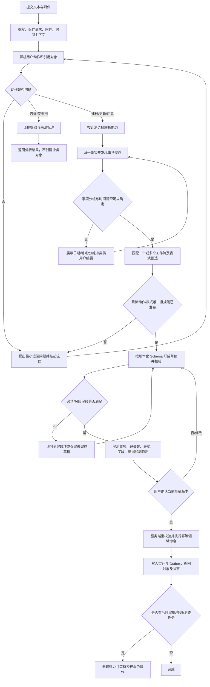

# 智能监理系统重构总体架构与实施设计

版本：0.1（评审稿）  
日期：2026-10-20  
适用范围：微信小程序、服务端 API、AI 辅助服务、业务数据与表单文书

## 1. 设计目标

系统以监理业务事实和业务流程为中心。文字、图片、文件和语音是同一业务请求的不同信息来源，输入形式不决定业务类型。一次请求可以涉及零个、一个或多个现场事项；一个事项可以关联多份证据、生成一个或多个业务对象，也可以只供识别而不落库。

重构要解决：

- 用户表达与现场证据分离，避免附件被自动等同为某种表单。
- 一次请求支持多事项、多日期、多表单和跨轮补充，保留来源与不确定性。
- 业务数据结构化、可追溯；表单渲染和 AI 抽取服从同一版本化定义。
- 写入、签发、整改、复查由可校验的业务状态和权限控制。
- 模型、OCR、存储和表单模板可替换，避免业务规则锁定在提示词或单一供应商。

## 2. 依据与事实边界

设计参考目录内的 RPD、字段草稿、GD-B-212 旁站、GD-B-214 巡视、GD-B-215/216 通知及回复、GD-B-217 会议纪要、GD-B-219 材料台账、GD-B-220 监理日志、GD-B-221 监理月报、GDAQ30306 危大巡视、GDAQ30307 安全联系单、GDAQ30308 安全隐患整改通知及对应填写样例。

资料不是完全一致的权威 schema：字段表范围说明与编号有缺项，字段必填/系统生成口径仍需业务确认；模板版本和样例存在差别；样例出现跨午夜旁站、同日多个危大类别记录及日志中日期/星期口径值得复核。因此本设计将“业务定义确认”列为首阶段硬门槛。未确认的规则必须标记待决，不得由模型或开发人员默认补齐。

## 3. 架构原则

1. **意图与载荷解耦**：业务动作由用户表达、已确认上下文和权限决定；附件类型只选择可执行的解析器。
2. **事实与解释分离**：原始证据、抽取事实、模型判断、人工修订分别存储，保留来源和审计信息。
3. **候选先于命令**：AI 规划和事项分组产生候选结果；领域服务校验后，用户确认才执行有副作用的命令。
4. **多对多关系显式化**：请求、事项、附件、记录、问题、文书和台账通过关联表连接，不以照片数推导记录数。
5. **Schema 与工作流分离**：Schema 定义数据形状；工作流定义状态、转换、责任角色和副作用；模板定义呈现。
6. **可恢复与幂等**：异步分析、用户补充、确认、重试和撤销都使用持久化流程实例及幂等命令。
7. **先模块化单体**：保持事务边界清楚，按领域模块组织；按真实负载和团队边界再拆分服务。

## 4. 逻辑架构

```text
微信小程序 / Web 管理端
  ├─ 请求编辑器：文字、附件、引用已有业务对象
  ├─ 事项与草稿审阅：确认、编辑、拆分、合并、移除证据
  └─ 工作流任务：补充字段、审批、整改、复查
              │ HTTPS / API
              ▼
应用/API 层（认证、项目上下文、授权、幂等、API 契约）
              │
              ├─ 请求工作台与会话状态
              ├─ 意图/计划服务（结构化计划，不直接写库）
              ├─ 证据处理服务（文件解析、OCR、水印、视觉、语音）
              ├─ 事项整理服务（候选事实组、冲突和依据）
              ├─ 表单目录与校验服务（版本化 Schema）
              ├─ 领域服务
              │    ├─ 工作记录 / 验收 / 旁站 / 危大巡视
              │    ├─ 问题与隐患整改闭环
              │    ├─ 通知、回复、联系单、会议纪要
              │    ├─ 材料批次台账
              │    └─ 日志、月报及聚合
              ├─ 文书渲染与导出
              └─ 审计、事件/outbox、通知
                 │                     │
        PostgreSQL + JSONB       对象存储（原图/派生件）
                 │                     │
          后台任务队列：OCR、图像分析、导出、聚合、重试
```

建议先在现有 Python 服务内按上述边界重构，继续采用 FastAPI、Pydantic、SQLAlchemy；以 PostgreSQL 作为事务数据库，对象存储保存文件。Redis/任务队列按部署条件选择 Celery、RQ、Dramatiq 或现有基础设施。队列消息只携带实体 ID，不传递大文件或敏感凭证。AI provider 通过内部适配接口封装，支持超时、限流、重试、模型版本记录和脱敏。

## 5. 领域模型

### 5.1 核心实体

| 实体 | 关键字段/职责 |
|---|---|
| `ProjectContext` | 项目、建设/施工/监理单位、单位工程/楼栋/区域树、项目时区、专业类型、人员及角色。作为项目基础信息的受控来源。 |
| `WorkRequest` | 一次用户请求：project、actor、conversation、原始文本、附件引用、请求时间、客户端时区、处理状态、幂等键。保留原始输入。 |
| `WorkflowInstance` | workflow type/version、当前状态、当前节点、上下文版本、等待用户动作、租约/重试信息、超时及取消状态。 |
| `EvidenceAsset` | 原始文件、内容哈希、MIME、大小、存储地址、上传时间、媒体时间、隐私/保留策略、处理状态。 |
| `EvidenceObservation` | 单项观察值：字段/标签、原始值、规范值、来源（用户/EXIF/OCR/视觉/项目资料/人工）、证据位置、模型与版本、置信度、确认状态。 |
| `WorkEvent` | 现实中的工作事项：日期/区间、项目、单位工程/部位、活动类别、施工内容、参与主体、来源请求、状态。仅表示候选或已确认事实，不等同于表单。 |
| `BusinessRecord` | 正式记录的通用身份：record type、project、business date/time、section、status、schema version、creator、revision。类型专属字段采用类型表或版本化 JSONB 快照，并对高频检索字段规范化。 |
| `Issue` | 质量问题/安全隐患：类别、现象、风险评估、发现时间、部位、证据、确认人、处理状态。AI 风险结论和人工定性分开。 |
| `Document` | 文书类型/表码/版本、编号、内容快照、草稿/审核/签发状态、关联记录/事项/问题、收发和签收信息。 |
| `MaterialBatch` | 材料类别、名称、规格、数量、厂家、进场/使用部位、报验、取样、检测、验收等生命周期。 |
| `FormDefinition` | form type/code/version、字段及类型、必填条件、来源策略、校验器、模板版本、签章位、权限和生命周期引用。 |
| `AuditEvent` | actor、action、entity、before/after hash、reason、request/workflow、timestamp、trace id。追加写，不覆盖历史。 |

### 5.2 关联

- `RequestEvidence`：一次请求带入的附件和文本证据。
- `EventEvidence`：事项与证据多对多，可标记主证据/补充证据/反证。
- `EventRecord`：事项与正式记录多对多，注明来源关系和派生类型。
- `RecordEvidence`：记录与附件多对多，照片用途分类（现场、隐患、举牌验收、整改前/后等）。
- `IssueRecord` / `IssueDocument`：问题与发现记录、通知、回复及复查文书关联。
- `LedgerSource`：材料台账条目关联报验、见证取样、检测报告、验收记录和影像。
- `DocumentRelation`：通知与回复、会议纪要附件等带 relation type 的文书关联。

删除采用业务软删除或撤销事件，保留审计；源附件去重使用内容哈希，但逻辑关联不能因文件去重丢失。

### 5.3 状态

请求：`RECEIVED → ANALYZING → PLAN_READY → AWAITING_USER → EXECUTING → COMPLETED`；异常可进入 `RETRYABLE_FAILED`、`NEEDS_REVIEW`、`CANCELLED`。  
事项：`CANDIDATE → CONFIRMED → LINKED/RECORDED`，也可 `REJECTED` 或 `MERGED`。  
记录生命周期按表式配置，但典型为 `DRAFT → SUBMITTED → APPROVED/REJECTED → ARCHIVED`。  
隐患整改：`REPORTED → NOTICE_DRAFT → NOTICE_ISSUED → RECTIFYING → PENDING_REVIEW → CLOSED/RETURNED`。  
状态转换必须检查角色、前置状态、所需证据和必填字段；不能仅通过更新任意 status 字符串完成。

## 6. 统一请求与智能处理

### 6.1 请求信封

```json
{
  "request_id": "client-generated-uuid",
  "conversation_id": "uuid-or-null",
  "project_id": 123,
  "text": "记录今天的工作",
  "parts": [
    {"kind": "image", "asset_id": "uuid"},
    {"kind": "file", "asset_id": "uuid"}
  ],
  "client_context": {"timezone": "Asia/Shanghai", "locale": "zh-CN"},
  "reply_to_workflow_id": null
}
```

附件先独立上传并获得 asset ID；统一请求只提交引用。支持纯文字、纯附件、混合输入、引用历史对象和多轮补充。不要让前端分别调用“隐患识别/工作记录”入口来决定业务。

### 6.2 处理阶段

1. **请求规范化**：校验用户和项目权限，保存原文/附件引用/时区/幂等键。
2. **任务计划解析**：解析动作、目标对象、时间范围、显式类型、是否请求写入、引用对象及歧义。Plan 是受 schema 约束的候选，不触发副作用。
3. **按需证据提取**：根据请求任务选择可用能力，支持图片 OCR/水印、视觉描述、文档解析、音频转写、项目资料检索；同时允许并行运行与任务相关的提取。
4. **事实归一**：输出 Observation，不直接覆盖用户原话；做单位/日期规范化并保留原值和来源。
5. **事项解析**：从请求文本和 Observation 生成一个或多个候选 WorkEvent，提供证据依据、冲突、相似事件和拆分/合并置信说明。候选仅用于展示。
6. **目标工作流匹配**：依据用户要求、事项类型、既有对象及配置的业务规则，提出目标 record/document/ledger action。缺少选择依据时生成一个最小澄清问题。
7. **表单填充与校验**：按确定的 FormDefinition 映射值、运行类型/必填/跨字段/权限规则，字段携带 provenance；缺项保持缺失。
8. **预览与确认**：展示事项分组、日期、目标表式、字段、证据关系、未确定项及将执行的命令。允许用户修改并版本化草稿。
9. **执行**：确认 token 对应具体草稿版本和动作集合；领域服务在事务中校验、写入、关联附件、写审计及 outbox。
10. **回执/恢复**：返回每个业务对象 ID、失败项、关联照片和后续动作；相同幂等键重复提交返回既有结果。

模型结果使用 JSON Schema/受约束结构输出；字段结果携带 `value`, `source`, `source_ref`, `confidence`, `needs_confirmation`。低置信阈值由字段风险级别配置，不使用一个全局阈值。

### 6.3 主流程与业务分支



流程分支的业务约束：

| 分支条件 | 系统行为 | 明确禁止的隐式行为 |
|---|---|---|
| 咨询、看图、识别或总结，未请求建档 | 返回有来源依据的分析；可将识别结果保存为会话产物 | 新建巡视、隐患、通知或正式记录 |
| 用户请求记录工作，但事项/表式不明确 | 展示事项候选和适用表式选项，询问最少的决定性问题 | 按附件类型默认表式；把“记录”固定映射为一种表 |
| 多附件、多日期或不同部位 | 按内容、用户描述、时间和项目上下文生成可编辑分组；冲突单独标记 | 按附件数生成记录；只按水印日期硬拆分或合并 |
| 一项工作可能需要记录加问题/通知等多个对象 | 展示对象清单及其关系，分别校验字段、权限和确认 | 把一份表单当成唯一产物，或隐式签发通知 |
| 用户引用已有记录、问题、通知或材料批次 | 解析唯一对象后进入补充/更正工作流；多候选时要求选择 | 无法确定对象时静默创建新对象 |
| 日志/月报汇总 | 读取授权且状态符合范围的业务源，生成可追溯草稿 | 把未确认识别结果或空数据推断成“无问题/已完成” |
| 业务规则或表式未发布 | 可提供信息整理和只读预览，说明无法正式建档的具体原因 | 使用相似表单、旧提示词或模型常识兜底写入 |

### 6.4 规划结果及 AI 节点契约

动作解析节点只负责把自然语言解析成受约束的候选 `RequestPlan`，不直接选择数据库写入路径。`actions` 可为空、单个或多个；每个动作包含明确性、依据和歧义。例：

```json
{
  "request_id": "uuid",
  "user_goal": "记录今天的工作",
  "actions": [{
    "kind": "create_work_records",
    "target_types": [],
    "explicitness": "underspecified",
    "reason_refs": ["request:text:0-7"],
    "ambiguities": ["record_type", "business_date", "event_partition"]
  }],
  "referenced_entities": [],
  "write_requested": true,
  "clarification_required": true
}
```

`RequestPlan` 只是一份可审阅的工作计划，不是授权令牌。后续节点各自使用明确输入输出：证据提取输出 `EvidenceObservation[]`；事项解析输出 `WorkEventCandidate[]` 及证据关系和分组依据；表式匹配输出候选及规则依据；字段填充输出带来源的字段值和校验结果。每个节点的输出均进行结构校验、枚举校验和业务规则校验，失败时进入可见错误/人工处理，不把自由文本答案当作 API 参数。

提示上下文按职责分层并版本化：固定安全和输出契约、当前节点任务、项目已确认配置、该表式 schema 与规则、经授权检索到的业务资料、当前请求中的不可信内容。只将当前节点需要的最小上下文交给模型；不把历史提示词和检索到的所有资料不断拼接进全局指令。上传文档、照片文字、水印和检索片段均作为待分析数据，不作为系统或用户授权。温度、模型、提示模板、输入摘要哈希、Schema 版本和校验结果可观测、可回放；提示模板不能绕过服务端授权和状态机。

## 7. 表单与流程定义

### 7.1 表单定义

Schema 采用 JSON Schema 兼容结构或 Pydantic 类型生成的注册表，带语义扩展。字段至少声明：稳定 key、label、value type、单位/格式、枚举、required condition、auto-fill policy、source priority、validation、visibility、signoff role、template binding、sensitivity、risk tier。表单版本不可原地覆盖；升级创建新版本和迁移映射。

项目默认字段必须标出数据来源及有效期；编号由并发安全的 sequence 服务按项目/表码分配。导出使用版本化 DOCX 模板及字段绑定，不从 AI 回答反向解析字段。

### 7.2 工作流定义

采用显式状态机定义：输入事件、适用条件、角色、状态转换、字段门槛、可执行命令、补偿策略、超时策略。简单流程由 Python 领域代码实现并配 workflow metadata；需要可配置分支时再引入成熟 BPMN/状态工作流引擎。工作流状态必须落库，部署后可恢复。

### 7.3 配置边界

适合配置：字段、表码、枚举、展示名、模板映射、普通必填规则、澄清文案、可选解析能力。  
应由代码强约束：鉴权、角色权限、审批与签发、编号唯一性、状态迁移、事务、幂等、审计和不可逆副作用。  
配置变更需版本、审批、发布、回滚和 schema 校验；不能允许业务配置绕开权限。

### 7.4 Schema 元数据和来源策略

字段定义应能表达业务含义而不只是控件类型。建议字段元数据包括：`key`、显示名、类型/单位、必填条件、业务风险级别、允许来源、规范化器、校验器、来源引用要求、人工确认要求、可编辑角色、签认方式、输出模板绑定和版本。自动填充规则应逐字段声明可用来源（项目主数据、请求明确表达、已确认观察、外部天气等）及冲突优先级；“由系统生成”不得成为全表级布尔开关。

签名/盖章是签署动作和签章资产，不是从姓名字段自动生成的普通文本。项目名称、单位名称、人员姓名可由授权主数据带出，但签署仍需要对应人员在受控签章流程中完成。Excel 字段表关于系统生成、必填、默认文案的说明属于待对账输入；例如巡视问题处理默认文案不得将未知事实改写成“已完成整改”。未裁决规则在 registry 中应显式标为 `unresolved`，该字段可在草稿中空缺并提示阻断原因，不允许通过通用模型提示填平。

## 8. 日期、分组和不确定性策略

- 分开保存请求中表达的业务日期、证据拍摄/发生日期、上传时间、系统登记时间和最终确认日期。
- 相对日期按项目配置时区解释；用户明确日期优先于系统当前日期，但证据冲突必须呈现。
- 图片 EXIF、水印 OCR、文件正文和用户描述是不同来源；按字段定义排序来源，冲突不静默覆盖。
- 分组基于项目、单位工程/部位、活动、时间区间、人员及证据连续性等特征；具体权重配置/版本化，并给出理由。
- 聚类只输出候选组；允许一图多事项、多图一事项、暂不归属。水印差异是信号而不是无条件拆分规则。
- 时间区间支持跨午夜；保存时区和原始时间，校验结束时刻不因日期归一错误倒置。
- AI 推断值不得写成事实来源；关键字段由用户确认后记录确认者与时间。

## 9. 业务流程目录

| 领域流程 | 主要输入 | 核心输出/生命周期 |
|---|---|---|
| 工作事项建档 | 描述、证据、项目现场上下文 | 候选事项 → 用户选择记录表式 → 草稿 → 记录 |
| 旁站 | 工序、部位、开始/结束、人员设备材料、监理检查项 | GD-B-212 记录；跨午夜时段支持；检查项目可结构化 |
| 巡视 | 部位、时间、巡视内容、问题处理、照片 | GD-B-214 或用户选择的适用表式；可关联多个发现 |
| 危大巡视 | 危大工程类别/规模、部位、时间、安全检查项、主体 | GDAQ30306；按项目专业和危大类别版本化检查清单 |
| 平行检查/验收/见证 | 检查依据/实测或验收对象、结论及签认 | 专属记录；选择房建/市政清单及适用表式 |
| 问题与隐患闭环 | 已确认问题、风险、部位、证据、整改要求 | 问题 → 通知草稿/签发 → 回复 → 复查 → 闭环/退回 |
| 通知与联系 | 事由、对象、内容、依据、期限 | GD-B-215/安全通知/联系单；审批、送达及回复关系 |
| 会议纪要 | 会议时间地点、议题、单位人员、决定、附件 | GD-B-217 纪要、签到/附件关系、发出状态 |
| 材料台账 | 材料批次、报验、取样检测、验收 | GD-B-219 的持续批次及相关资料关系，阶段更新不重复建批次 |
| 监理日志 | 项目和业务日期、已存业务事实、补充事项 | GD-B-220 可编辑聚合草稿；数据来源可追溯后审核归档 |
| 监理月报 | 报告期间、业务数据、进度/合同等补充资料 | GD-B-221 主表及七个分表；统计值来自结构化数据，分析文字标记生成来源 |

## 10. API 与内部契约

建议资源化接口（具体命名在 API 设计阶段统一）：

- `POST /api/v2/assets`：上传/登记附件，返回 asset ID 和处理状态。
- `POST /api/v2/work-requests`：统一提交用户请求，返回 request/workflow ID。
- `GET /api/v2/workflows/{id}`：查询处理进度、待办和当前草稿版本。
- `POST /api/v2/workflows/{id}/answers`：补充澄清字段或选择事项/表式。
- `PATCH /api/v2/workflows/{id}/drafts/{draftId}`：修改分组、字段和证据关联。
- `POST /api/v2/workflows/{id}/confirmations`：确认明确的草稿版本和动作集。
- `POST /api/v2/records`、`/issues`、`/documents`、`/ledger-entries`：领域命令入口，不暴露通用任意 SQL/字段写入。
- `POST /api/v2/documents/{id}/transitions`、`/issues/{id}/transitions`：校验状态转换。
- `GET /api/v2/form-definitions/{type}/{version}`：获取客户端展示/服务端校验定义。

接口使用 OpenAPI、Pydantic 输入输出模型、乐观锁版本号、Idempotency-Key、trace ID。确认请求必须绑定 `workflow_id + draft_version + action_hash + actor`，防止用户确认后草稿被改而执行旧动作。

## 11. 异步任务、可靠性与安全

- API 快速落库并返回处理状态；长耗时图像/文档分析走队列，支持任务级超时、重试和死信告警。
- 用 transactional outbox 保证业务提交与任务/通知发出一致；消费者按 task ID 幂等。
- 多对象创建使用事务；跨外部服务失败使用可见的部分失败状态和补偿操作，不假称全部完成。
- 附件校验 MIME/大小/恶意文件，私有对象存储、短期签名 URL、加密、访问审计和项目隔离。
- Prompt 注入防护：上传文档内容只作为不可信数据；禁止其覆盖系统策略、触发工具执行或绕过用户确认。
- 输出文书和隐患建议标明草稿/AI 辅助状态，保留人工修订记录。
- 权限以用户角色、项目成员关系、业务动作和记录状态共同判定；小程序前端隐藏按钮不构成授权。
- 提供数据保留、删除/匿名化、备份恢复和日志脱敏策略。

## 12. 可观测性与质量指标

每个 request/workflow/task/model call 有关联 trace。记录模型名称/版本、Schema 版本、提示模板版本、耗时、token、解析错误、人工修改差异和写入结果；默认不在普通日志记录原始敏感图片或完整文书。

按阶段评估：请求路由、证据字段准确率、事项拆分/合并质量、表式选择准确率、字段来源正确率、澄清轮次、草稿修改率、确认率、重复写入率、照片关联完整率、任务恢复成功率、导出一致性、权限拒绝正确性。建立离线黄金样例和端到端回归，覆盖失败/冲突用例，不以单一模型路由分数作为上线标准。

## 13. 实施阶段与退出标准

### 阶段 0：业务盘点、口径决策和基线

**工作**：盘点所有空白模板/填写样例/实际线上表码；把字段草稿与模板逐项对账；明确角色、状态、编号规则、项目基础字段来源、记录和文书关系；建立决策日志、风险矩阵及真实案例集。  
**交付**：业务术语表、表单目录初版、生命周期图、差异清单、已确认/待决项、重构数据迁移盘点。  
**退出条件**：首批范围中的每种表式有业务 owner、版本、字段来源、必填/签认规则；样例差异有裁决或明确隔离策略。未确认表式不进入自动写入范围。

### 阶段 1：平台骨架与统一请求

**工作**：增加统一请求/附件 API、持久化 workflow、权限和幂等基础设施、审计/outbox、模型适配器、对象存储、异步任务接口。小程序所有文字和附件统一提交，不再在客户端分流业务。  
**交付**：API 契约、迁移脚本、流程状态查询、上传与安全策略、结构化日志及运行面板。  
**退出条件**：纯文字、图片、文件及混合消息均能建立同构请求；重复请求不产生重复工作流；异步失败可恢复且有可见状态；既有入口仍可兼容或被明确下线。

### 阶段 2：证据、事项与草稿工作台

**工作**：实现 EvidenceObservation 和来源追踪；接入图片水印/OCR、视觉、文档抽取；实现候选 WorkEvent、人工事项编辑、分组解释和待确认列表。  
**交付**：证据处理流水线、事项草稿 API/界面、冲突和缺失字段表达。  
**退出条件**：覆盖纯描述、单图、多图、混合文件、跨日、无水印、同图多事项；用户可以拆分/合并/移除/归属证据；分析不会自动写业务记录。

### 阶段 3：Schema Registry 与文书模板

**工作**：落地版本化表单定义、来源优先级、条件必填、类型与跨字段校验、签章位、模板绑定和渲染回归。  
**交付**：经业务签认的首批表式 registry、模板绑定、字段迁移策略。建议先覆盖普通巡视、旁站、危大巡视、隐患通知/回复、日志，其他表式按优先级扩展。  
**退出条件**：每个填表示例能映射到结构化字段并渲染；模板版本有快照；不合法数据被服务端阻止；表式/字段变更可回归且历史文书可重现。

### 阶段 4：领域写入与闭环

**工作**：实现记录/问题/通知/回复/材料批次领域服务、签发权限、状态迁移、审计、关联与撤销/更正流程。  
**交付**：受确认保护的写入命令、通知整改闭环、材料批次生命周期。  
**退出条件**：确认动作与草稿版本绑定；重复确认幂等；越权状态转换被拒绝；通知回复及复查可追溯；部分失败不伪报成功。

### 阶段 5：日志、月报和跨领域聚合

**工作**：建立按业务日期的只读聚合层，生成日志和月报草稿，关联原始记录；统计数值由查询/规则计算，AI 仅辅助叙述并引用来源。  
**交付**：GD-B-220、GD-B-221 主表及分表的聚合和人工审核流程。  
**退出条件**：计数可从源记录复算；空数据与缺失数据明确区分；聚合范围、时区、状态过滤可解释；不凭附件生成未发生的业务事实。

### 阶段 6：全量迁移、优化和治理

**工作**：扩展剩余表式、兼容旧 API/旧数据、质量评测、灰度迁移、容量与成本优化、权限审计和运营配置发布。  
**交付**：迁移报告、回滚方案、SLO、运营手册、Schema/模板治理流程。  
**退出条件**：核心流程灰度指标达标；数据迁移可核对；旧路径有下线窗口和回滚开关；评测、告警和模板发布责任明确。

阶段可并行准备，但阶段 0 的业务口径和阶段 1 的统一请求不能被跳过。生产写入应按项目/表单逐步开启。

## 14. 风险与决策清单

| 决策项 | 需要确认的内容 |
|---|---|
| 表单权威版本 | 广东统表年份、项目采用版本、示例是否允许作为内容范例而非字段权威 |
| 记录颗粒度 | 一条巡视记录允许覆盖多个部位/事项的业务边界；危大记录按作业面/类别/时段如何拆分 |
| 字段口径 | 必填、选填、系统生成、默认文案、签认人角色及现场事实来源 |
| 日期规则 | 业务日期 vs 拍摄日期冲突、补录、跨午夜、项目时区及日志归属日 |
| 图片规则 | 水印可信等级、OCR 错误确认阈值、同图多事项关系及原图保留策略 |
| 问题分类 | 质量问题、安全隐患、一般观察项如何定性，谁有权确认 |
| 文书签发 | 各表式签发角色、审批权限、签名服务和送达证据 |
| 日志月报 | 数据源范围、草稿/归档状态过滤、人工录入与聚合字段的优先关系 |
| 迁移兼容 | 旧工作记录、`extra_fields`、文书 JSON、照片关联和撤销记录如何迁移 |
| 服务基础设施 | 对象存储、队列、扫描/OCR 服务、备份和部署约束 |

## 15. 参考资料

- `RPD.docx`：功能域、影像/水印及整改闭环的既有需求输入。
- `监理通各记录关键字（草稿）(1).xlsx`：字段参考和房建/市政验收清单；当前标记为草稿，需对账。
- 空白模板：`14旁站记录.docx`、`16巡视记录.docx`、`17监理通知单、回复单.docx`、`18会议纪要.docx`、`20材料台账.docx`、`21监理日志.docx`、`22监理月报.docx`、安全联系单/隐患通知、危大巡视模板。
- 填写样例：旁站记录、巡视记录、危大巡视多类别样例、监理日志、质量问题监理通知单。

